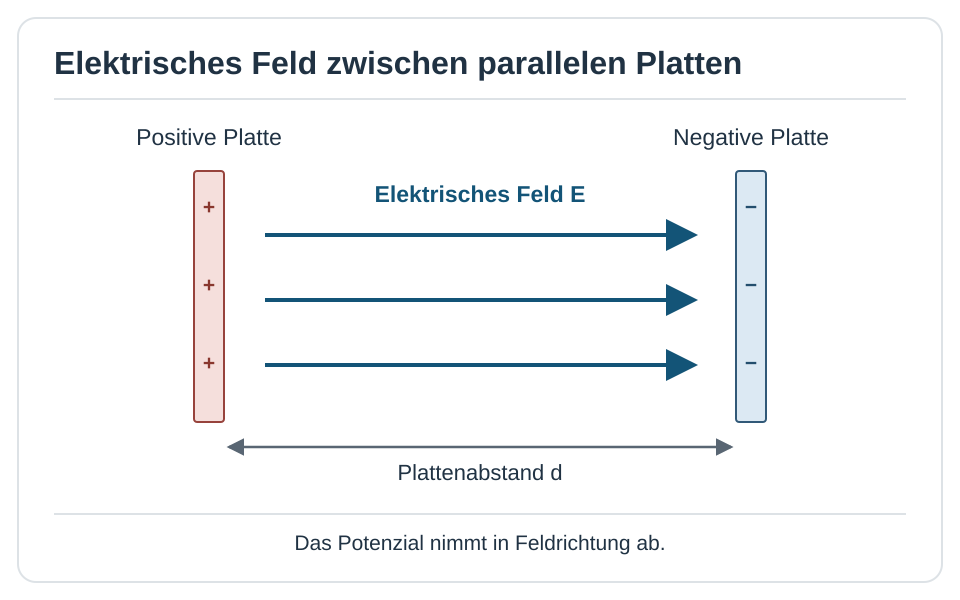

# M4-L1 – Elektrostatik, Potential und Kapazität {#L1}

**Kursbereich:** M4 – Bachelor: Elektromagnetische Felder und Wellen

**Niveau:** Bachelor

**Vorwissen:** [Ladung, Strom, Spannung und Leistung](M1-L1.md) sowie [Vektorrechnung und räumliche Ableitungen](M2-L5.md).

**Lernziel:** Aus Symmetrie und Ladung ein elektrisches Feld bestimmen, eine Potenzialdifferenz berechnen und daraus die Kapazität für eine idealisierte Geometrie herleiten.

## Vom Kraftfeld zur Schaltung {#S1}

Eine Spannung zwischen zwei Metallflächen lässt sich am Schaltbild als einzelne Größe anschreiben. Im Raum zwischen den Flächen beschreibt ein elektrisches Feld, welche Kraft eine kleine Probeladung an ihrem jeweiligen Ort erfährt. Für eine ruhende Ladung $q$ ist die elektrische Kraft $\mathbf F=q\mathbf E$. Eine positive Ladung wird in Feldrichtung beschleunigt, eine negative in Gegenrichtung. Die Einheit von $\mathbf E$ ist $\mathrm{V/m}$, äquivalent zu $\mathrm{N/C}$.

Statische Ladungsverteilungen und zeitlich konstante Felder sind Gegenstand der Elektrostatik. Im elektrostatischen Gleichgewicht verschwindet das Feld in einem ideal leitenden Körper. Die Oberfläche dieses Körpers hat ein gemeinsames Potenzial. Ladung an seiner Oberfläche kann jedoch außerhalb des Körpers ein Feld erzeugen.

## Der Gauß-Satz und die Symmetrie {#S2}

Für eine geschlossene Fläche $S$ im Vakuum gilt mit nach außen gerichtetem $\mathrm d\mathbf A$:

$$
\oint_S \mathbf E\cdot\mathrm d\mathbf A
=\frac{Q_\mathrm{innen}}{\varepsilon_0},
\qquad
\varepsilon_0\approx8{,}854\cdot10^{-12}\,\mathrm{F/m}.
$$

Der Fluss ist eine vorzeichenbehaftete Summe der **normalen** Feldanteile. Das Gesetz gilt für jede geschlossene Fläche. Es ergibt eine einfache Feldstärke, wenn die Geometrie die Richtung und den Betrag auf geeigneten Flächenteilen vorgibt. Bei einer isolierten, unendlich ausgedehnten, ebenen Ladungsschicht mit Flächenladungsdichte $\sigma$ tritt das Feld für $\sigma>0$ nach beiden Seiten aus. Eine kleine gedachte Zylinderfläche schneidet die Schicht. Der Mantel liefert keinen Fluss, und beide Deckel mit Fläche $A_\mathrm{G}$ liefern je $E A_\mathrm{G}$. Daraus folgt $E=\sigma/(2\varepsilon_0)$.

Zwei entgegengesetzt geladene, parallele Flächen ergeben durch Überlagerung im Zwischenraum $E=\sigma/\varepsilon_0$ von der positiven zur negativen Platte. Im idealisierten Außenraum löschen sich die Beiträge aus. Bei endlichen Platten ist diese Aussage eine Näherung für den Bereich fern vom Rand.

{alt="Zwei parallele Platten. Das elektrische Feld zeigt von der positiven zur negativen Platte, und das Potenzial nimmt in dieser Richtung ab."}

## Potenzialdifferenz und Kapazität {#S3}

Die Potenzialdifferenz gibt die Änderung der potenziellen Energie pro positiver Probeladung an. Entlang eines Weges von $a$ nach $b$ gilt:

$$
V_b-V_a=-\int_a^b \mathbf E\cdot\mathrm d\boldsymbol{\ell}.
$$

Das Minuszeichen besagt, dass das Potenzial in Feldrichtung sinkt. Bei den Platten im Abstand $d$ ist daher $U=V_+-V_-=E d$. Die Beträge $Q=\sigma A$ und $U$ ergeben für die Plattenfläche $A$ die Kapazität:

$$
C=\frac{Q}{U}=\varepsilon_0\frac{A}{d}.
$$

Für konstante Geometrie und ein lineares Medium ist das Verhältnis unabhängig von der angelegten Spannung. $1\,\mathrm F=1\,\mathrm{C/V}$. In der Schaltung fasst $C$ die räumliche Ladungs- und Feldverteilung als Bauelementparameter zusammen.

## Rechenbeispiel und Selbstkontrolle {#S4}

Zwei quadratische Metallplatten haben jeweils $40\,\mathrm{cm^2}=4{,}0\cdot10^{-3}\,\mathrm{m^2}$ Fläche. Der Abstand ist $0{,}50\,\mathrm{mm}$ und die Spannung $12\,\mathrm V$. Luft wird als Vakuum angenähert.

| Größe | Rechnung | Ergebnis |
| --- | --- | --- |
| Feldstärke | $E=U/d$ | $24\,\mathrm{kV/m}$ |
| Kapazität | $C=\varepsilon_0 A/d$ | $70{,}8\,\mathrm{pF}$ |
| Ladungsbetrag auf einer Platte | $Q=CU$ | $850\,\mathrm{pC}$ |
| Gespeicherte Energie | $W_\mathrm e=CU^2/2$ | $5{,}10\,\mathrm{nJ}$ |

Die Ladungen der Platten haben die Werte $+Q$ und $-Q$. Beim quasistatischen Laden wächst $U$ proportional zu $Q$. Deshalb ergibt die aufzubringende Arbeit $\int_0^Q (q/C)\,\mathrm dq=Q^2/(2C)$.

1. Der Abstand wird verdoppelt, die Quelle hält $U$ konstant. Was ändert sich?
2. Welche Änderung der potenziellen Energie hat ein Elektron beim Übergang von der negativen zur positiven Platte?

**Lösungen.** 1. $E$ und $C$ halbieren sich, ebenso $Q$ und $W_\mathrm e$. 2. $\Delta W_\mathrm{pot}=q\Delta V=-e\cdot12\,\mathrm V=-12\,\mathrm{eV}\approx-1{,}92\cdot10^{-18}\,\mathrm J$. Das Feld gibt diese Energie an die Bewegung des Elektrons ab, wenn keine weiteren Kräfte Arbeit verrichten.

## Modellgrenzen und Ausblick {#S5}

Seitliche Randfelder, raue Elektroden und ein inhomogenes Medium ändern die Kapazität. Bei zeitlich veränderlicher magnetischer Induktion lässt sich das gesamte elektrische Feld im Allgemeinen nicht allein durch ein skalares Potenzial beschreiben. [Materialeigenschaften und Randbedingungen](M4-L2.md) untersucht als Nächstes, wie sich das Feld an einer Materialgrenze aufteilt.

## Quellen {#S6}

- [OpenStax – University Physics Volume 2, § 8.1 Capacitors and Capacitance](https://openstax.org/books/university-physics-volume-2/pages/8-1-capacitors-and-capacitance) · Feld, Spannung und Kapazität des Plattenkondensators. · Zuletzt abgerufen: 2026-11-25
- [OpenStax – University Physics Volume 2, § 6.2 Explaining Gauss’s Law](https://openstax.org/books/university-physics-volume-2/pages/6-2-explaining-gausss-law) · § 6.2, Gleichung 6.5: elektrischer Fluss durch geschlossene Flächen. · Zuletzt abgerufen: 2026-11-25
- [OpenStax – University Physics Volume 2, § 6.3 Applying Gauss’s Law](https://openstax.org/books/university-physics-volume-2/pages/6-3-applying-gausss-law) · § 6.3: Anwendung des Gauß-Gesetzes auf symmetrische Ladungsverteilungen. · Zuletzt abgerufen: 2026-11-25
- [OpenStax – University Physics Volume 2, § 7.2 Electric Potential and Potential Difference](https://openstax.org/books/university-physics-volume-2/pages/7-2-electric-potential-and-potential-difference) · § 7.2: Potenzialdifferenz als Feldintegral. · Zuletzt abgerufen: 2026-11-25
