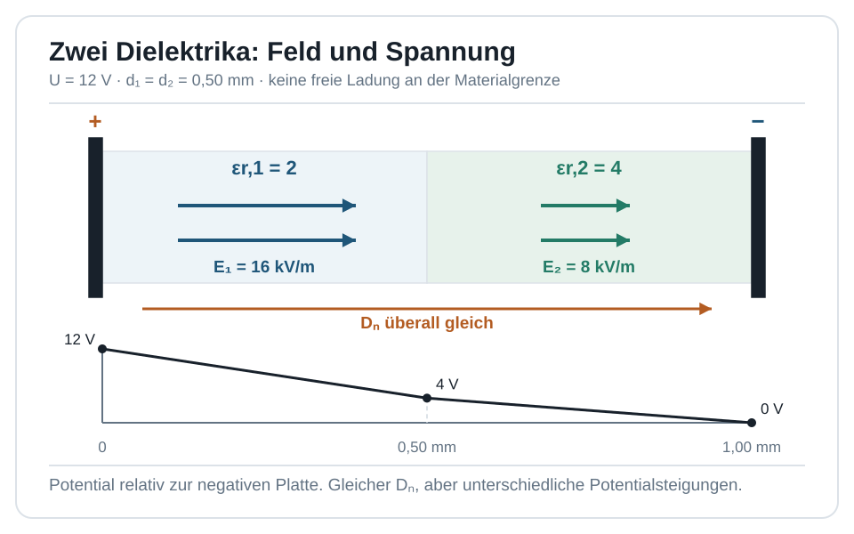

# M4-L2 – Materialeigenschaften und Randbedingungen {#L2}

**Kursbereich:** M4 – Bachelor: Elektromagnetische Felder und Wellen

**Niveau:** Bachelor

**Vorwissen:** [Elektrostatik, Potential und Kapazität](M4-L1.md) und [Widerstand, Ohmsches Gesetz und einfache Netze](M1-L2.md).

**Lernziel:** Permittivität und Leitfähigkeit unterscheiden und aus den Randbedingungen die Felder in einem geschichteten Dielektrikum berechnen.

## Wie ein Material auf ein Feld reagiert {#S1}

In einem Dielektrikum verschieben sich gebundene Ladungen geringfügig oder vorhandene Dipole richten sich teilweise aus. Die makroskopische Polarisation $\mathbf P$ ist das elektrische Dipolmoment pro Volumen. Sie wird in $\mathrm{C/m^2}$ gemessen. Die elektrische Flussdichte $\mathbf D=\varepsilon_0\mathbf E+\mathbf P$ hat dieselbe Einheit. Für ein lineares, isotropes, zeitunabhängiges Modell gilt

$$
\mathbf D=\varepsilon\mathbf E,
\qquad
\varepsilon=\varepsilon_0\varepsilon_\mathrm r.
$$

Die relative Permittivität $\varepsilon_\mathrm r$ ist dimensionslos. Bei gleicher Geometrie und gleicher angelegter Spannung speichert ein vollständig mit einem solchen Material gefüllter Kondensator mehr Ladung als im Vakuum, wenn $\varepsilon_\mathrm r>1$. Ist der Kondensator abgeklemmt und bleibt seine Ladung erhalten, fällt entsprechend seine Spannung.

## Welche Feldanteile sind an einer Grenze stetig? {#S2}

Die Einheitsnormale $\mathbf n$ zeige vom Medium 1 zum Medium 2. Mit der **freien** Flächenladungsdichte $\sigma_\mathrm f$ gelten in der Elektrostatik:

$$
\mathbf n\cdot(\mathbf D_2-\mathbf D_1)=\sigma_\mathrm f,
\qquad
\mathbf n\times(\mathbf E_2-\mathbf E_1)=\mathbf 0.
$$

Die erste Bedingung folgt aus dem Gauß-Satz $\oint\mathbf D\cdot\mathrm d\mathbf A=Q_\mathrm{frei}$ für einen flachen Zylinder über der Grenze. Ohne freie Flächenladung bleibt der Normalanteil von $\mathbf D$ stetig. Der Normalanteil von $\mathbf E$ kann sich wegen verschiedener $\varepsilon$ unterscheiden. Die zweite Bedingung folgt aus der verschwindenden elektrostatischen Umlaufspannung einer schmalen Schleife quer zur Grenze. Der tangentiale Anteil von $\mathbf E$ ist damit stetig. Polarisationsladung geht über $\mathbf D$ bereits in die Beschreibung ein.

An der Oberfläche eines idealen Leiters im elektrostatischen Gleichgewicht ist das äußere Feld normal zur Oberfläche, da innen $\mathbf E=\mathbf 0$ gilt. Wählt man die Normale vom Leiter nach außen, entspricht $D_{\mathrm{außen},n}$ im gewöhnlichen idealisierten Modell der freien Oberflächenladungsdichte.

## Beispiel: Zwei Schichten im Plattenkondensator {#S3}

Die Plattenfläche beträgt $A=40\,\mathrm{cm^2}$, die Spannung $U=12\,\mathrm V$. Zwei Schichten der Dicke $d_1=d_2=0{,}50\,\mathrm{mm}$ liegen hintereinander in Feldrichtung. Sie haben $\varepsilon_{\mathrm r,1}=2$ und $\varepsilon_{\mathrm r,2}=4$. Randfelder und freie Ladung an der gemeinsamen Materialgrenze werden vernachlässigt. Mit der Richtung von der positiven zur negativen Platte gilt:

$$
D_{1,n}=D_{2,n}=D_n,\qquad
U=E_{1,n}d_1+E_{2,n}d_2
=D_n\left(\frac{d_1}{\varepsilon_1}+\frac{d_2}{\varepsilon_2}\right).
$$

Damit ist $E_{1,n}=2E_{2,n}$. Aus der Spannungsbedingung ergeben sich $E_{1,n}=16\,\mathrm{kV/m}$ und $E_{2,n}=8\,\mathrm{kV/m}$. Über der ersten Schicht fallen $8\,\mathrm V$ ab, über der zweiten $4\,\mathrm V$. Der Betrag der freien Plattenladung ist $Q=A D_n\approx1{,}13\,\mathrm{nC}$. Die Kapazität beträgt $C=Q/U\approx94{,}4\,\mathrm{pF}$. Die Anordnung wirkt wie zwei Kondensatoren in Reihe, weil beide Schichten denselben normalen Verschiebungsfluss führen.

{alt="Zwei gleich dicke Dielektrikumschichten mit elektrischen Feldstärken 16 und 8 Kilovolt pro Meter, durchgehend gleicher normaler Flussdichte und stückweise linearem Potential."}

Die Längen der blauen und grünen Feldpfeile stehen im Verhältnis zwei zu eins. Der untere Graph zeigt das Potential relativ zur negativen Platte: Es ist an der Materialgrenze stetig, seine Steigung ändert sich jedoch.

## Leitfähigkeit und Modellwahl {#S4}

Die Leitfähigkeit $\kappa$ in $\mathrm{S/m}$ beschreibt den ohmschen Transport freier Ladung. Für einen isotropen Leiter verwendet man $\mathbf J=\kappa\mathbf E$, wobei $\mathbf J$ in $\mathrm{A/m^2}$ gemessen wird. Bei einem geraden, homogenen Leiter der Länge $\ell$ und Querschnittsfläche $A$ folgt für ein gleichförmiges Feld $R=\ell/(\kappa A)$. Für $\ell=0{,}10\,\mathrm m$, $A=1\,\mathrm{mm^2}$ und $\kappa=5{,}8\cdot10^7\,\mathrm{S/m}$ ergibt sich $R\approx1{,}72\,\mathrm{m\Omega}$. Das Modell realer Gleichstromleitung hat im Inneren ein kleines Feld. Ein ideales Dielektrikum hat $\kappa=0$, kann aber polarisiert werden.

## Selbstkontrolle und Weiterlernen {#S5}

1. Was ergibt sich, wenn beide Schichten im Beispiel $\varepsilon_{\mathrm r}=4$ besitzen?
2. Welche Feldbedingung bleibt erfüllt, wenn eine freie Flächenladung an der Materialgrenze aufgebracht wird?

**Lösungen.** 1. Beide Felder sind $12\,\mathrm{kV/m}$. Die Anordnung entspricht einer Schicht von $1{,}00\,\mathrm{mm}$ mit $\varepsilon_{\mathrm r}=4$. Daraus folgen $C\approx141{,}7\,\mathrm{pF}$ und $6\,\mathrm V$ Spannungsabfall je Schicht. 2. Die tangentialen Komponenten von $\mathbf E$ bleiben gleich. Der Normalanteil von $\mathbf D$ springt beim Übergang 1 nach 2 um $\sigma_\mathrm f$.

Permittivität und Leitfähigkeit können von Frequenz, Temperatur und Feldstärke abhängen. Bei zeitabhängigen Signalen spielen Verluste und Materialverzögerungen eine Rolle. [Magnetostatik und magnetische Kreise](M4-L3.md) führt die entsprechenden magnetischen Größen ein.

## Quellen {#S6}

- [MIT OpenCourseWare – Electromagnetic Fields and Energy, Chapter 6 Polarization](https://ocw.mit.edu/courses/res-6-001-electromagnetic-fields-and-energy-spring-2008/pages/chapter-6/) · §§ 6.2–6.3 zu elektrischer Flussdichte, Grenzbedingungen und linearen Medien. · Zuletzt abgerufen: 2026-11-25
- [OpenStax – University Physics Volume 2, § 8.4 Capacitor with a Dielectric](https://openstax.org/books/university-physics-volume-2/pages/8-4-capacitor-with-a-dielectric) · Ladung, Spannung und Kapazität mit Dielektrikum. · Zuletzt abgerufen: 2026-11-25
- [MIT OpenCourseWare – Electromagnetic Fields and Energy, Chapter 7 Conduction and Electroquasistatic Charge Relaxation](https://ocw.mit.edu/courses/res-6-001-electromagnetic-fields-and-energy-spring-2008/pages/chapter-7/) · § 7.2 zur stationären ohmschen Leitung. · Zuletzt abgerufen: 2026-11-25
