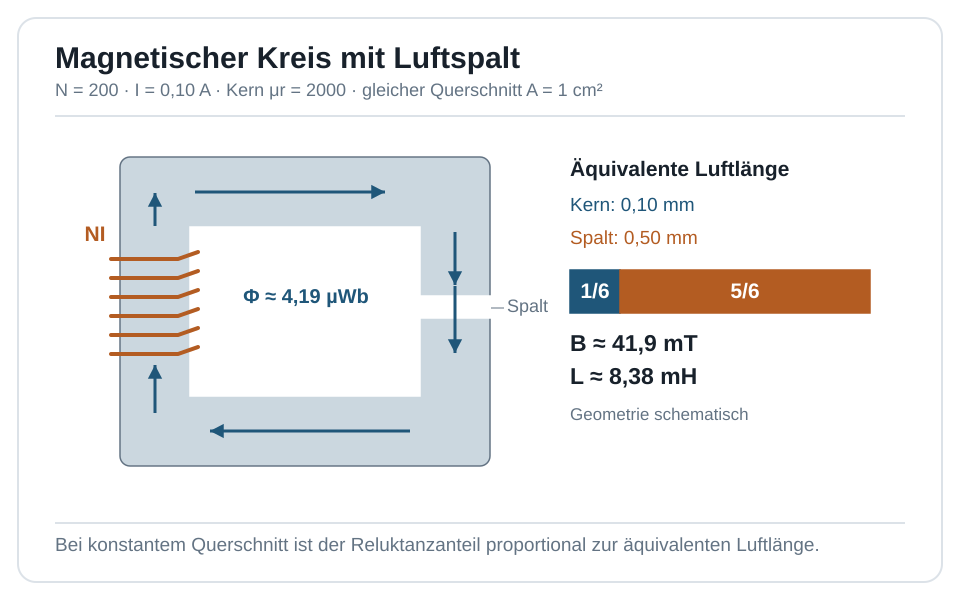

# M4-L3 – Magnetostatik und magnetische Kreise {#L3}

**Kursbereich:** M4 – Bachelor: Elektromagnetische Felder und Wellen

**Niveau:** Bachelor

**Vorwissen:** [Materialeigenschaften und Randbedingungen](M4-L2.md), [Vektorrechnung und räumliche Ableitungen](M2-L5.md).

**Lernziel:** Magnetische Feldstärke, Flussdichte und Fluss unterscheiden, die Ampère-Beziehung anwenden und einen einfachen magnetischen Kreis mit Luftspalt berechnen.

## Magnetfeld um einen Leiter {#S1}

Ein zeitlich konstanter Strom erzeugt ein Magnetfeld. Bei einem langen, geraden Draht verlaufen die Feldlinien in Kreisen um die Drahtachse. Die rechte Hand gibt die Orientierung an. Der Daumen zeigt in Richtung des technischen Stroms, die gekrümmten Finger geben den Umlaufsinn an. Für den magnetostatischen Fall gilt, wenn die Umlaufrichtung und die Flächennormale durch dieselbe Rechte-Hand-Regel festgelegt sind:

$$
\oint_{\partial S}\mathbf H\cdot\mathrm d\boldsymbol{\ell}
=I_{\mathrm f,S} .
$$

Dabei ist $I_{\mathrm f,S}$ der freie Strom durch die orientierte Fläche. $\mathbf H$ ist die magnetische Feldstärke in $\mathrm{A/m}$. $\mathbf B$ ist die magnetische Flussdichte in Tesla, $1\,\mathrm T=1\,\mathrm{Wb/m^2}$. Für ein lineares, isotropes Material gilt $\mathbf B=\mu\mathbf H$ mit $\mu=\mu_0\mu_\mathrm r$ und $\mu_0\approx1{,}257\cdot10^{-6}\,\mathrm{H/m}$. Der magnetische Fluss durch eine orientierte Fläche ist

$$
\Phi=\int_S\mathbf B\cdot\mathrm d\mathbf A .
$$

Nur bei überall gleicher normaler Flussdichte vereinfacht sich dies zu $\Phi=B_n A$. Die Einheit des Flusses ist Weber. Durch jede geschlossene Fläche ist der gesamte magnetische Fluss null. Deshalb wird im einfachen magnetischen Kreis jeder Teilfluss, der im Kern austritt, über einen anderen Abschnitt zurückgeführt.

## Einfache Feldmodelle {#S2}

Beim sehr langen Draht in Luft liefert die Zylindersymmetrie $H=I/(2\pi r)$ außerhalb des Drahts. Bei einer langen Spule mit Windungszahl $N$ und Länge $\ell$ ist im Inneren fern von den Enden näherungsweise $H=(N/\ell)I$. Dazu wählt man eine längliche geschlossene Kontur, deren eine Seite im nahezu homogenen Spulenfeld liegt und deren andere Seite sich im schwachen Außenfeld befindet.

Beispiel einer Luftspule: Die Windungsdichte beträgt $1000\,\mathrm{m^{-1}}$, der Strom $0{,}20\,\mathrm A$ und der Querschnitt $2{,}0\,\mathrm{cm^2}$. Daraus folgen $H=200\,\mathrm{A/m}$, $B\approx251\,\mathrm{\mu T}$ und $\Phi\approx50{,}3\,\mathrm{nWb}$ pro senkrecht durchsetzter Windung im homogenen Bereich.

## Ersatzmodell mit Kern und Luftspalt {#S3}

Ein geschlossener magnetischer Pfad mit annähernd gleicher Flussdichte über dem Querschnitt $A$ kann in Abschnitte zerlegt werden. Die Ampère-Beziehung wird durch $\sum_i H_i\ell_i=NI$ angenähert. Mit $H_i=B_i/\mu_i$ folgt bei vernachlässigbarem Streufluss:

$$
NI=\Phi\sum_i\frac{\ell_i}{\mu_i A_i}
=\Phi\mathcal R_\mathrm{m}.
$$

Die magnetische Reluktanz $\mathcal R_\mathrm{m}$ hat die Einheit $\mathrm{A/Wb}=\mathrm{H^{-1}}$. $NI$ ist die magnetische Durchflutung. Das Ersatzmodell verwendet dieselbe algebraische Form wie eine elektrische Reihenschaltung. Dabei bezeichnet $\Phi$ einen Fluss der magnetischen Flussdichte und keinen elektrischen Strom.

Ein Kern hat mittlere Weglänge $0{,}20\,\mathrm m$, $\mu_\mathrm r=2000$ und einen Luftspalt von $0{,}50\,\mathrm{mm}$. Beide Querschnitte betragen $1{,}0\,\mathrm{cm^2}$. Mit $N=200$ und $I=0{,}10\,\mathrm A$ ist

$$
B\approx
\frac{\mu_0 NI}{\ell_\mathrm K/\mu_{\mathrm r,K}+\ell_\mathrm g}
=41{,}9\,\mathrm{mT},
\qquad
\Phi\approx4{,}19\,\mathrm{\mu Wb}.
$$

Der Kern trägt mit einer äquivalenten Luftlänge von $0{,}10\,\mathrm{mm}$ bei. Der Spalt macht darum $5/6$ der gesamten Reluktanz aus. Wenn alle $N$ Windungen denselben Fluss umfassen, ergibt sich im linearen Modell die Induktivität $L=N\Phi/I\approx8{,}38\,\mathrm{mH}$.

{alt="Schematischer Kern mit Wicklung und Luftspalt, geschlossener Flusspfad sowie Balken der Reluktanzanteile ein Sechstel Kern und fünf Sechstel Spalt."}

Die Darstellung ist nicht maßstäblich. Trotz des kurzen Luftspalts entfällt der größere Teil der magnetischen Reluktanz auf ihn; Streufluss und Feldaufweitung sind wie in der Rechnung nicht berücksichtigt.

## Selbstkontrolle und Weiterlernen {#S4}

1. Wie ändert sich das äußere Feld eines langen Drahts, wenn sich der Abstand verdoppelt?
2. Der Luftspalt des Beispiels wird auf $1{,}0\,\mathrm{mm}$ vergrößert. Berechne die neue Flussdichte und den Fluss.

**Lösungen.** 1. $H$ und bei gleicher Umgebung auch $B$ halbieren sich. Die Umlaufrichtung bleibt bei unverändertem Strom gleich. 2. Der Nenner wächst von $0{,}60$ auf $1{,}10\,\mathrm{mm}$. $B$ beträgt etwa $22{,}8\,\mathrm{mT}$, $\Phi$ etwa $2{,}28\,\mathrm{\mu Wb}$.

In realen Kernen können $\mu$ und damit $L$ mit der Erregung variieren. Sättigung, Hysterese, Streufluss und die Aufweitung des Feldes im Luftspalt begrenzen das Modell. [Induktion und elektromagnetische Energie](M4-L4.md) behandelt die Folgen einer Änderung von $\Phi$.

## Quellen {#S5}

- [OpenStax – University Physics Volume 2, § 12.5 Ampère’s Law](https://openstax.org/books/university-physics-volume-2/pages/12-5-amperes-law) · Abschnitt 12.5 – Ampère-Gesetz und Feld um einen langen Leiter. · Zuletzt abgerufen: 2026-11-25
- [MIT OpenCourseWare – Electromagnetic Fields and Energy, Chapter 9 Magnetization](https://ocw.mit.edu/courses/res-6-001-electromagnetic-fields-and-energy-spring-2008/d4860fdc85d667828060e6d72e49a62f_09.pdf) · § 9.7 zum magnetischen Ersatzkreis. · Zuletzt abgerufen: 2026-11-25
