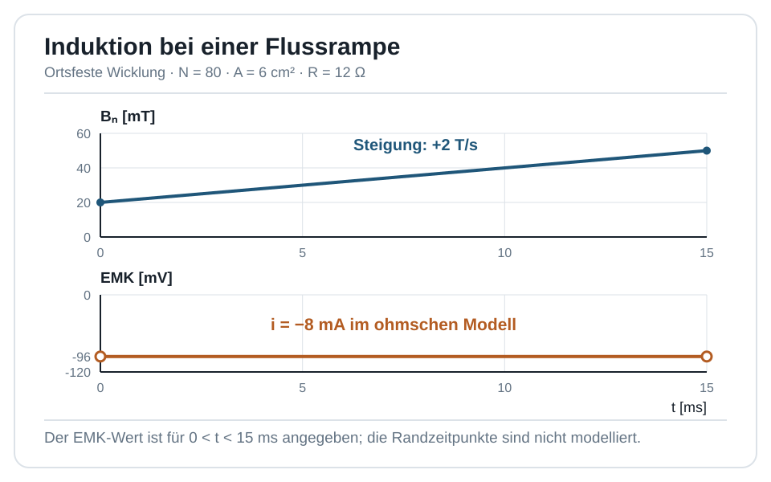

# M4-L4 – Induktion und elektromagnetische Energie {#L4}

**Kursbereich:** M4 – Bachelor: Elektromagnetische Felder und Wellen

**Niveau:** Bachelor

**Vorwissen:** [Magnetostatik und magnetische Kreise](M4-L3.md), [Analysis und Differentialgleichungen für zeitabhängige Modelle](M2-L3.md).

**Lernziel:** Für eine feststehende Spule die induzierte Umlaufspannung mit konsistenter Orientierung bestimmen und die Energieübertragung im Modell erklären.

## Ein sich ändernder Fluss erzeugt eine Umlaufspannung {#S1}

Eine ruhende Leiterschleife in einem konstanten Magnetfeld hat keine durch dieses Feld induzierte Umlaufspannung. Ändert sich die Flussdichte innerhalb der Schleife, kann dagegen ein elektrisches Feld entlang des Drahtes entstehen. Sein Umlauf ist im Allgemeinen von null verschieden. Dadurch unterscheidet sich dieser Fall von der Elektrostatik, in der sich alle elektrischen Feldanteile aus einem skalaren Potenzial herleiten lassen.

Wähle für eine ortsfeste Schleife die Flächennormale $\mathbf n$. Die positive Umlaufrichtung um den Rand $\partial S$ folgt daraus per Rechte-Hand-Regel. Mit $\mathrm d\mathbf A=\mathbf n\,\mathrm dA$ gelten

$$
\Phi(t)=\int_S\mathbf B(\mathbf r,t)\cdot\mathrm d\mathbf A,
\qquad
\mathcal E=\oint_{\partial S}\mathbf E\cdot\mathrm d\boldsymbol\ell
=-\frac{\mathrm d\Phi}{\mathrm dt}.
$$

$\mathcal E$ bezeichnet hier die induzierte elektromotorische Kraft (EMK) in Volt. Trotz ihres Namens ist sie eine Energie pro Ladung und hat keine Krafteinheit. Für $N$ gleich orientierte Windungen mit demselben Fluss folgt $\mathcal E=-N\,\mathrm d\Phi/\mathrm dt$.

## Die Lenz-Regel als Vorzeichenprobe {#S2}

Nimmt ein positiver Fluss zu, folgt $\mathcal E<0$. In einer rein ohmsch modellierten geschlossenen Schleife fließt der Strom dann entgegen der positiven Umlaufrichtung. Sein Magnetfeld wirkt der **Zunahme** des ursprünglichen Flusses entgegen. Verringert sich der positive Fluss, hat der induzierte Strom die entgegengesetzte Richtung. Entscheidend ist also die Änderung des Flusses. Ein großes, aber konstantes Feld liefert in diesem Modell weiterhin $\mathcal E=0$.

Wer die Normale umkehrt, kehrt zugleich die positive Umlaufrichtung um. Fluss, EMK und der berechnete Strom wechseln dann ihr Vorzeichen. Die physikalische Stromrichtung, die aus dem Stromwert **und** der zugehörigen Bezugsrichtung hervorgeht, bleibt gleich.

## Durchgerechnete Flussrampe {#S3}

Eine ortsfeste Wicklung mit $N=80$ und $A=6{,}0\,\mathrm{cm^2}$ pro Windung liegt in einem räumlich gleichförmigen Feld. Die normale Flussdichte steigt in $15\,\mathrm{ms}$ gleichmäßig von $20$ auf $50\,\mathrm{mT}$. Der modellierte Schleifenwiderstand beträgt $12\,\Omega$. Wir betrachten das Innere des Rampenintervalls und vernachlässigen die Selbstinduktivität. In SI-Einheiten:

$$
\dot B_n=\frac{0{,}050-0{,}020}{0{,}015}\,\mathrm{T/s}
=2{,}0\,\mathrm{T/s},
\quad
\mathcal E=-N A\dot B_n=-96\,\mathrm{mV},
\quad
i=\frac{\mathcal E}{R}=-8{,}0\,\mathrm{mA}.
$$

Die Wärmeleistung im Widerstand ist $P=Ri^2=0{,}768\,\mathrm{mW}$. Während der Rampe werden somit rund $11{,}5\,\mathrm{\mu J}$ umgesetzt. Eine äußere Einrichtung, die das ansteigende Feld aufrechterhält, muss Energie in dieses gekoppelte System einspeisen. Das negative Vorzeichen von $i$ beschreibt seine Richtung und erzeugt keine negative Verlustleistung.

{alt="Zeitdiagramme einer Flussdichterampe von 20 auf 50 Millitesla und der konstanten negativen EMK von 96 Millivolt innerhalb des Rampenintervalls."}

Die EMK folgt aus der zeitlichen Steigung und nicht aus dem momentanen Betrag der Flussdichte. Die offenen Punkte markieren, dass die Randzeitpunkte der Rampe im vereinfachten Modell nicht behandelt werden.

## Selbstinduktion und Energie im Feld {#S4}

Eine Wicklung erzeugt beim Stromanstieg ihren eigenen Fluss. Für eine lineare Induktivität ist die Flussverkettung $\Psi=Li$. Die induzierte EMK lautet $-\mathrm d\Psi/\mathrm dt$. Schreibt man dasselbe Bauelement in **passiver Vorzeichenkonvention** in eine Schaltung, gilt für seine Klemmenspannung $u_L=L\,\mathrm di/\mathrm dt$. Dann ist $u_L i$ die Leistung, die an den Klemmen in das Bauelement hineinfließt:

$$
W_\mathrm m=\int_0^i L i'\,\mathrm di'=\frac12 L i^2.
$$

Ein verlustfreies lineares magnetisches Medium speichert lokal die Energiedichte $w_\mathrm m=\mathbf B\cdot\mathbf H/2$ in $\mathrm{J/m^3}$. In einer realen Wicklung sind Feldspeicherung und Materialverluste getrennt zu betrachten.

## Selbstkontrolle und Weiterlernen {#S5}

1. In der Flussrampe sinkt $B_n$ im selben Zeitraum von $50$ auf $20\,\mathrm{mT}$. Wie ändern sich die Ergebnisse?
2. Wie viel Energie speichert eine lineare Spule mit $L=8\,\mathrm{mH}$ bei $i=0{,}10\,\mathrm A$?

**Lösungen.** 1. $\mathcal E=+96\,\mathrm{mV}$, $i=+8{,}0\,\mathrm{mA}$. Quadratische Verlustleistung und Energie bleiben gleich. 2. $W_\mathrm m=40\,\mathrm{\mu J}$.

Das Beispiel setzt eine feste Schleifengeometrie und ein vorgegebenes äußeres Feld voraus. Bei schnellen Änderungen oder großer Selbstinduktivität beeinflussen die Wicklung und ihre Kopplung den Zeitverlauf. Bei bewegten Leitern trägt auch die magnetische Kraft auf bewegte Ladung zur EMK bei. [Maxwell-Gleichungen und Wellenausbreitung](M4-L5.md) fasst die wechselseitige Kopplung der Felder zusammen.

## Quellen {#S6}

- [OpenStax – University Physics Volume 2, § 13.1 Faraday’s Law](https://openstax.org/books/university-physics-volume-2/pages/13-1-faradays-law) · Abschnitt 13.1 – Flussänderung und induzierte EMK. · Zuletzt abgerufen: 2026-11-25
- [OpenStax – University Physics Volume 2, § 13.2 Lenz’s Law](https://openstax.org/books/university-physics-volume-2/pages/13-2-lenzs-law) · Abschnitt 13.2 – Stromrichtung bei zunehmendem oder abnehmendem Fluss. · Zuletzt abgerufen: 2026-11-25
- [OpenStax – University Physics Volume 2, § 14.3 Energy in a Magnetic Field](https://openstax.org/books/university-physics-volume-2/pages/14-3-energy-in-a-magnetic-field) · Abschnitt 14.3 – Energie der Induktivität und Energiedichte des Feldes. · Zuletzt abgerufen: 2026-11-25
