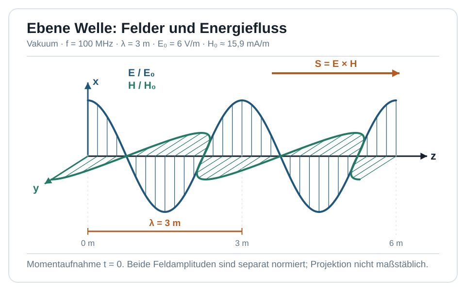

# M4-L5 – Maxwell-Gleichungen und Wellenausbreitung {#L5}

**Kursbereich:** M4 – Bachelor: Elektromagnetische Felder und Wellen

**Niveau:** Bachelor

**Vorwissen:** [Vektorrechnung und räumliche Ableitungen](M2-L5.md), [Induktion und elektromagnetische Energie](M4-L4.md).

**Lernziel:** Quellen und Wirbel der elektromagnetischen Felder zuordnen und Richtung, Ausbreitungsgeschwindigkeit und Leistungsfluss einer ebenen Welle bestimmen.

## Vier Gleichungen und die Materialbeschreibung {#S1}

Die Differentialform der Maxwell-Gleichungen beschreibt Felder räumlich und zeitlich. In makroskopischer SI-Schreibweise gilt:

| Gleichung | Aussage |
| --- | --- |
| $\nabla\cdot\mathbf D=\rho_\mathrm f$ | Freie Ladungsdichte ist Quelle der elektrischen Flussdichte. |
| $\nabla\cdot\mathbf B=0$ | Durch jede geschlossene Fläche ist der magnetische Nettofluss null. |
| $\nabla\times\mathbf E=-\partial_t\mathbf B$ | Eine Änderung der magnetischen Flussdichte erzeugt einen Wirbel des elektrischen Felds. |
| $\nabla\times\mathbf H=\mathbf J_\mathrm f+\partial_t\mathbf D$ | Zum Wirbel des magnetischen Felds tragen freier Strom und zeitlich veränderliche elektrische Flussdichte bei. |

$\rho_\mathrm f$ wird in $\mathrm{C/m^3}$ gemessen, $\mathbf J_\mathrm f$ in $\mathrm{A/m^2}$. Die Ableitung $\partial_t\mathbf D$ hat dieselbe Einheit wie die freie Stromdichte. Der Term heißt Verschiebungsstromdichte. Bildet man die Divergenz der letzten Gleichung, ist die linke Seite null. Zusammen mit dem elektrischen Gauß-Gesetz folgt $\partial_t\rho_\mathrm f+\nabla\cdot\mathbf J_\mathrm f=0$. Damit ist die zeitliche Änderung freier Ladung an den freien Strom gebunden.

Ergänzend braucht man Materialbeziehungen. In einem linearen, verlustfreien und isotropen Medium mit konstanten $\varepsilon,\mu>0$ gelten $\mathbf D=\varepsilon\mathbf E$ und $\mathbf B=\mu\mathbf H$.

## Warum sich eine Änderung ausbreitet {#S2}

Betrachte ein solches Medium ohne freie Ladung und freien Strom. Ein Modellfall ist ein Feld $\mathbf E=E_x(z,t)\mathbf e_x$ und $\mathbf H=H_y(z,t)\mathbf e_y$. Beide sind unabhängig von $x$ und $y$. Die Wirbelgleichungen liefern:

$$
\partial_z E_x=-\mu\partial_t H_y,
\qquad
\partial_z H_y=-\varepsilon\partial_t E_x.
$$

Differenziert man die erste Gleichung nach $z$ und setzt die zweite ein, erhält man $\partial_z^2 E_x=\mu\varepsilon\partial_t^2 E_x$. Diese Wellengleichung hat für Ausbreitung in positiver $z$-Richtung Lösungen der Form $E_x(z,t)=E_0\cos(\omega t-kz)$ mit $k=\omega/v$. Die Geschwindigkeit ist $v=1/\sqrt{\mu\varepsilon}$, die Wellenlänge $\lambda=v/f$ bei $f=\omega/(2\pi)$. Im Vakuum entspricht $v$ der Lichtgeschwindigkeit $c$.

Für die vorwärts laufende Welle gilt $H_y=E_x/\eta$ mit der Wellenimpedanz $\eta=\sqrt{\mu/\varepsilon}$ in Ohm. Die Feldrichtungen $\mathbf E,\mathbf H$ sowie die Richtung der Ausbreitung stehen paarweise senkrecht aufeinander. Kehrt sich die Ausbreitungsrichtung bei gleicher elektrischer Polarisationsrichtung um, wechselt das Vorzeichen von $H_y$ relativ zu $E_x$.

## Leistungsfluss und Beispiel {#S3}

Der Poynting-Vektor $\mathbf S=\mathbf E\times\mathbf H$ hat die Einheit $\mathrm{W/m^2}$. Im Beispiel zeigt er in positive $z$-Richtung. Über eine Periode gemittelt gilt $\langle S_z\rangle=E_0^2/(2\eta)$, wobei $E_0$ der **Scheitelwert** ist. Die $2$ im Nenner kommt vom zeitlichen Mittel von $\cos^2$.

Für $f=100\,\mathrm{MHz}$ und $E_0=6{,}0\,\mathrm{V/m}$ im Vakuum ergibt sich mit $c\approx3{,}00\cdot10^8\,\mathrm{m/s}$ und $\eta_0\approx377\,\Omega$:

| Größe | Ergebnis |
| --- | --- |
| Wellenlänge $\lambda$ | $3{,}00\,\mathrm m$ |
| Scheitel der magnetischen Feldstärke $H_0$ | $15{,}9\,\mathrm{mA/m}$ |
| Scheitel der magnetischen Flussdichte $B_0$ | $20{,}0\,\mathrm{nT}$ |
| Mittlere Leistungsflussdichte | $47{,}7\,\mathrm{mW/m^2}$ |

{alt="Räumliche Projektion einer ebenen Welle: elektrische Feldstärke in x-Richtung und magnetische Feldstärke in y-Richtung, beide sinusförmig und in Phase, Ausbreitung und Energiefluss in positiver z-Richtung."}

Beide sinusförmigen Kurven zeigen die Feldkomponenten zum selben Zeitpunkt, jeweils auf ihren eigenen Scheitelwert normiert. Sie sind keine Bahnen von Teilchen. Der Achsensinn ist so gewählt, dass das Kreuzprodukt des elektrischen und magnetischen Feldes in positive z-Richtung weist.

## Selbstkontrolle und Weiterlernen {#S4}

1. Berechne $v$, $\lambda$ und $\eta$ bei derselben Frequenz in einem idealen Medium mit $\varepsilon_\mathrm r=4$ und $\mu_\mathrm r=1$.
2. Eine vorwärts laufende Welle hat $\mathbf E$ in Richtung $\mathbf e_y$ und $\mathbf H$ in Richtung $-\mathbf e_x$. In welche Richtung geht der Energiefluss?

**Lösungen.** 1. $v=c/2$, $\lambda\approx1{,}50\,\mathrm m$ und $\eta=\eta_0/2\approx188{,}5\,\Omega$. 2. $\mathbf e_y\times(-\mathbf e_x)=\mathbf e_z$.

Ein räumlich unendliches ebenes Wellenfeld ist ein Modell. Endliche Quellen können gekrümmte Wellenfronten und komplexe Nahfelder erzeugen. Verluste oder frequenzabhängige Materialwerte verändern Dämpfung und Phasenverlauf. [Wellen an Grenzen und auf Leitungen](M4-L6.md) zeigt, wie sich eine Welle an einem Übergang aufteilt.

## Quellen {#S5}

- [OpenStax – University Physics Volume 2, § 16.1 Maxwell’s Equations and Electromagnetic Waves](https://openstax.org/books/university-physics-volume-2/pages/16-1-maxwells-equations-and-electromagnetic-waves) · Abschnitt 16.1 – Zusammenhang der vier Feldgleichungen. · Zuletzt abgerufen: 2026-11-25
- [OpenStax – University Physics Volume 2, § 16.2 Plane Electromagnetic Waves](https://openstax.org/books/university-physics-volume-2/pages/16-2-plane-electromagnetic-waves) · Abschnitt 16.2 – Wellengleichung, Feldrichtungen und Wellenlänge. · Zuletzt abgerufen: 2026-11-25
- [OpenStax – University Physics Volume 2, § 16.3 Energy Carried by Electromagnetic Waves](https://openstax.org/books/university-physics-volume-2/pages/16-3-energy-carried-by-electromagnetic-waves) · Abschnitt 16.3 – Poynting-Vektor und mittlere Leistungsflussdichte. · Zuletzt abgerufen: 2026-11-25
