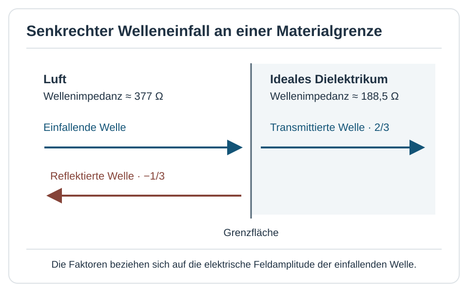

# M4-L6 – Wellen an Grenzen und auf Leitungen {#L6}

**Kursbereich:** M4 – Bachelor: Elektromagnetische Felder und Wellen

**Niveau:** Bachelor

**Vorwissen:** [Maxwell-Gleichungen und Wellenausbreitung](M4-L5.md), [Sinusförmiger Wechselstrom und komplexe Impedanz](M1-L6.md).

**Lernziel:** Für senkrechten Welleneinfall und für eine idealisierte Leitung Reflexionskoeffizienten berechnen, Feld- und Leistungsverhältnisse auseinanderhalten und Laufzeiten einordnen.

## Eine ebene Welle trifft senkrecht auf eine Grenze {#S1}

Eine Welle läuft aus Medium 1 mit Wellenimpedanz $\eta_1$ auf eine ebene Grenze zu Medium 2 mit Wellenimpedanz $\eta_2$ zu. Beide Medien seien homogen und verlustfrei. Die elektrische Polarisation liegt parallel zur Grenzfläche. Wir bezeichnen die auf dieselbe elektrische Richtung bezogenen komplexen Amplituden an der Grenze als $E_\mathrm i$, $E_\mathrm r$ und $E_\mathrm t$ für einfallende, reflektierte und transmittierte Welle.

Ohne eingeprägten Oberflächenstrom sind die tangentialen Felder an der Grenze stetig. Für die rücklaufende Welle hat das magnetische Feld relativ zum elektrischen Feld ein umgekehrtes Vorzeichen. Daher gilt:

$$
E_\mathrm i+E_\mathrm r=E_\mathrm t,\qquad
\frac{E_\mathrm i-E_\mathrm r}{\eta_1}=\frac{E_\mathrm t}{\eta_2}.
$$

Nach Auflösen ergibt sich für die elektrischen Amplituden

$$
\Gamma_E=\frac{E_\mathrm r}{E_\mathrm i}
=\frac{\eta_2-\eta_1}{\eta_2+\eta_1},
\qquad
\frac{E_\mathrm t}{E_\mathrm i}=1+\Gamma_E .
$$

Die mittlere reflektierte Leistung pro Fläche als Anteil der einfallenden beträgt $\mathcal R=|\Gamma_E|^2$. Das transmittierte Leistungsverhältnis ist dagegen $\mathcal T=(\eta_1/\eta_2)|1+\Gamma_E|^2$. Der Impedanzfaktor folgt aus der Relation zwischen elektrischer Feldamplitude und Leistungsfluss im jeweiligen Medium.

## Beispiel: Luft und idealisiertes Dielektrikum {#S2}

Von Luft mit $\eta_1\approx377\,\Omega$ trifft die Welle auf ein Medium mit $\varepsilon_\mathrm r=4$ und $\mu_\mathrm r=1$. Somit ist $\eta_2\approx188{,}5\,\Omega$. Die Amplitudenverhältnisse sind $\Gamma_E=-1/3$ und $E_\mathrm t/E_\mathrm i=2/3$. Die reflektierte elektrische Komponente hat an der Grenze eine um $\pi$ gedrehte Phase relativ zur einfallenden. Die Leistungsanteile betragen $\mathcal R=1/9$ und $\mathcal T=8/9$. Ihre Summe ist eins.

{alt="Senkrechter Einfall auf eine verlustfreie Grenze. Das reflektierte elektrische Feld hat den relativen Faktor −1/3. Das transmittierte Feld hat den Faktor 2/3."}

## Spannungswellen auf einer Leitung {#S3}

Auch eine idealisierte, verlustfreie Zweileiterleitung trägt vor- und rücklaufende Wellen. Ihr reeller Wellenwiderstand $Z_0$ ist das Verhältnis von Spannungs- zu Stromamplitude einer **einzelnen** vorlaufenden Welle. Am Abschluss $Z_L$ gilt mit Strombezug in Richtung Last:

$$
U_L=U^++U^-,
\qquad
I_L=\frac{U^+-U^-}{Z_0},
\qquad
\Gamma_U=\frac{U^-}{U^+}=\frac{Z_L-Z_0}{Z_L+Z_0}.
$$

Bei $Z_L=Z_0$ verschwindet die Reflexion am Lastende. Beim idealen Leerlauf ergibt sich $\Gamma_U=+1$ und $I_L=0$. Beim idealen Kurzschluss gilt $\Gamma_U=-1$ und $U_L=0$. Beide reflektieren im verlustfreien Modell die gesamte einfallende Leistung.

Eine $50\,\Omega$-Leitung mit $Z_L=100\,\Omega$ empfängt am Abschluss eine hinlaufende Spannung mit $1{,}0\,\mathrm V$ Scheitelwert. Dann gilt $\Gamma_U=1/3$, also sind $U_L=1{,}333\,\mathrm V$ und $I_L=13{,}33\,\mathrm{mA}$ Scheitelwerte. Die mittlere Lastleistung ist $U_L^2/(2Z_L)\approx8{,}89\,\mathrm{mW}$. Die hinlaufende Welle transportiert $10\,\mathrm{mW}$, die rücklaufende rund $1{,}11\,\mathrm{mW}$. Die Differenz entspricht der Leistung in der Last.

## Laufzeit, Selbstkontrolle und Weiterlernen {#S4}

Für $\ell=10\,\mathrm m$ und $v=2{,}0\cdot10^8\,\mathrm{m/s}$ benötigt eine Änderung $50\,\mathrm{ns}$ bis zum Lastende. Eine dort erzeugte Reflexion erreicht die Quelle nach weiteren $50\,\mathrm{ns}$. Die stationären Zeiger beschreiben die eingeschwungene Sinusantwort, enthalten aber für sich genommen keine Beschreibung der Einschaltfront. Für schnelle Flanken kann eine Leitung auch bei niedriger Wiederholfrequenz elektrisch lang sein. Für eine grobe Näherung als konzentrierte Verbindung muss ihre Laufzeit deutlich kürzer als die maßgeblichen Signaländerungen sein.

1. Was ergibt sich am Ende derselben $50\,\Omega$-Leitung bei $Z_L=25\,\Omega$ und unveränderter hinlaufender Amplitude?
2. Wie groß ist die Hin- und Rücklaufzeit bei halbierter Leitungslänge?

**Lösungen.** 1. $\Gamma_U=-1/3$, $U_L\approx0{,}667\,\mathrm V$, $I_L\approx26{,}7\,\mathrm{mA}$. Die Last nimmt rund $8{,}89\,\mathrm{mW}$ auf, weil der reflektierte Leistungsanteil weiterhin $1/9$ beträgt. 2. Die Hin- und Rücklaufzeit beträgt insgesamt $50\,\mathrm{ns}$.

Bei schrägem Einfall ist die Polarisation für die Reflexion relevant. Reale Leitungen können Dämpfung, Dispersion und zusätzliche Moden aufweisen. [Zum Studienweg](pages/studienweg.md).

## Quellen {#S5}

- [Steven W. Ellingson – Electromagnetics, Volume 2 (2020, VT Publishing, PDF)](https://vtechworks.lib.vt.edu/bitstream/handle/10919/93253/Electromagnetics_Vol2_screen-reader-friendly.pdf) · § 5.1, S. 56–59: ebene Wellen bei senkrechtem Einfall, Randbedingungen und Reflexion. · Zuletzt abgerufen: 2026-11-25
- [Steven W. Ellingson – Electromagnetics, Volume 1 (2018, VT Publishing, PDF)](https://vtechworks.lib.vt.edu/bitstream/handle/10919/84164/Electromagnetics_Vol1_screen-reader-friendly.pdf) · § 3.12, S. 47–48, Gl. 3.86: Spannungsreflexionskoeffizient und Leitungsabschluss. · Zuletzt abgerufen: 2026-11-25
