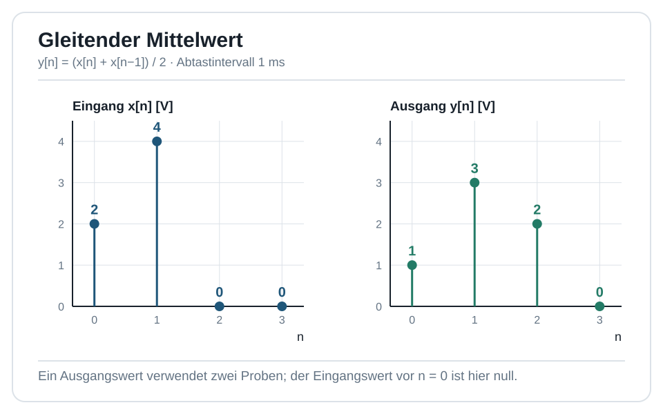

# M5-L1 – Signale, Systeme und Linearität {#L1}

**Kursbereich:** M5 – Bachelor: Signale und Systeme

**Niveau:** Bachelor

**Vorwissen:** Sinus, Exponentialfunktion und komplexe Zeiger aus [M2-L4](M2-L4.md). Die Sprungantwort aus [M1-L5](M1-L5.md) dient als erstes Systembeispiel.

**Lernziel:** Zeitkontinuierliche und zeitdiskrete Signale unterscheiden und ein Signalmodell auf Linearität, Zeitinvarianz, Kausalität und Beschränktheit prüfen.

## Eine Messspannung und ihre Abtastwerte {#S1}

Ein Schwingungssensor liefert eine Spannung $x(t)$ für jeden Zeitpunkt $t$. Der Rechner erhält bei einem Abtastintervall $T_\mathrm s$ nur die Folge $x[n]=x(nT_\mathrm s)$, wobei $n$ ganzzahlig ist. Zwischen zwei Folgengliedern liegt jeweils eine Zeitspanne von $T_\mathrm s$. Bei $T_\mathrm s=1\,\mathrm{ms}$ gehört $x[4]$ zum Zeitpunkt $4\,\mathrm{ms}$. Runde Klammern bezeichnen im Folgenden kontinuierliche Zeit, eckige Klammern diskrete Zeit.

Die Zeitdiskretisierung bestimmt, wann eine Größe erfasst wird. Die Quantisierung bestimmt, welche Werte die digitale Darstellung annehmen kann. Eine reellwertige Folge im Modell kann daher bereits zeitdiskret sein, bevor ein Analog-Digital-Umsetzer sie auf Zahlen mit endlicher Auflösung abbildet.

Ein System $T$ ordnet einem Eingang $x$ einen Ausgang $y=T\{x\}$ zu. Zu dieser Zuordnung gehört auch der Anfangszustand. Wenn wir eine Schaltung als System für Eingangssignale charakterisieren, setzen wir ihren dynamischen Zustand zunächst auf null. Eine vorgeladene Kapazität würde eine zusätzliche freie Antwort erzeugen.

## Vier getrennte Eigenschaften {#S2}

**Linearität.** Für Eingangssignale $x_1,x_2$ und konstante Faktoren $a,b$ muss gelten

$$
T\{a x_1+b x_2\}=aT\{x_1\}+bT\{x_2\}.
$$

Darin stecken Skalierung und Addition. Aus der Gleichung folgt $T\{0\}=0$. Ein konstanter Messoffset macht die Zuordnung $T\{x\}=x+c$ für $c\ne0$ affin. Ein Wandler mit quadratischer Kennlinie $T\{x\}=x^2$ verletzt die Skalierung, weil Verdopplung des Eingangs den Ausgang vervierfacht.

**Zeitinvarianz.** Wenn der Eingang um $n_0$ Abtastwerte später ankommt, muss die Ausgabe ebenfalls um genau $n_0$ Abtastwerte verschoben sein. Formal gilt für den Verschiebeoperator $D_{n_0}x[n]=x[n-n_0]$ die Gleichheit $T\{D_{n_0}x\}=D_{n_0}T\{x\}$. Zeitabhängige Verstärkung verletzt diese Eigenschaft trotz Linearität. Für $T\{x\}[n]=n x[n]$ sind die Ergebnisse $n x[n-n_0]$ und $(n-n_0)x[n-n_0]$ im Allgemeinen verschieden.

**Kausalität.** Bei gleichem Eingang bis einschließlich $n$ darf die Ausgabe bis $n$ nicht davon abhängen, wie die beiden Eingänge danach fortgesetzt werden. $y[n]=x[n+1]$ ist daher nicht kausal. Eine Offline-Auswertung aufgezeichneter Daten kann solche Vorschauwerte benutzen.

**BIBO-Stabilität.** Ein für alle Zeiten beschränkter Eingang muss einen beschränkten Ausgang ergeben. Dieser Test fragt nach endlichen Ausgangswerten und sagt für sich genommen nichts über die interne Zustandsstabilität einer beliebigen Realisierung aus.

## Beispiel: Gleitender Mittelwert am Sensorkanal {#S3}

Ein Messrechner zeigt $y[n]=(x[n]+x[n-1])/2$ an. Der Ausgang nutzt den aktuellen und den letzten Wert. Für die ersten Eingangsproben $x[0]=2\,\mathrm V$, $x[1]=4\,\mathrm V$ und $x[2]=0\,\mathrm V$ mit $x[-1]=0\,\mathrm V$ ergibt sich

| Index $n$ | Eingangsprobe | Angezeigter Mittelwert |
| ---: | ---: | ---: |
| 0 | $2\,\mathrm V$ | $1\,\mathrm V$ |
| 1 | $4\,\mathrm V$ | $3\,\mathrm V$ |
| 2 | $0\,\mathrm V$ | $2\,\mathrm V$ |
| 3 | $0\,\mathrm V$ | $0\,\mathrm V$ |

Der Ausdruck addiert verzögerte Eingangswerte mit konstanten Gewichten. Damit ist er linear und zeitinvariant. Er ist kausal. Ist jeder Betrag $|x[n]|\le M$, ergibt die Dreiecksungleichung auch $|y[n]|\le M$. Die Annahme über den Wert vor der Messung erklärt hier den Startwert. In einer realen Neuberechnung kann man den ersten Wert doppelt gewichten oder erst mit zwei vorliegenden Messwerten beginnen. Diese Randbehandlung gehört zur Definition der Auswertung.

{alt="Zwei diskrete Stängeldiagramme: Eingangsproben 2, 4, 0 und 0 Volt, Ausgangsproben 1, 3, 2 und 0 Volt."}

Die einzelnen Punkte sind Abtastwerte und keine kontinuierlichen Kurven. Der Ausgang bei Index zwei bleibt trotz des auf null gefallenen Eingangs noch bei zwei Volt, weil die vorherige Probe in den Mittelwert eingeht.

## Selbstkontrolle {#S4}

1. Welche Eingangszeitpunkte benötigt $y[n]=(x[n-1]+x[n+1])/2$? Ist das System linear, zeitinvariant und kausal?
2. Ist ein Integrator $y(t)=\int_0^t x(\tau)\,\mathrm d\tau$ für $t\ge0$ BIBO-stabil? Nutze einen beschränkten konstanten Eingang.

### Lösungen

1. Der Mittelwert nutzt den vorherigen und den nächsten Wert. Die Gewichte sind konstant, also ist die Zuordnung linear und zeitinvariant. Der nächste Wert macht sie nicht kausal.
2. Für $x(t)=1$ ist $y(t)=t$. Obwohl der Eingang beschränkt bleibt, wächst der Ausgang unbegrenzt. Dieser Eingang widerlegt die BIBO-Stabilität.

## Gültigkeitsbereich und Weiterlernen {#S5}

An realen Sensoren gelten Linearität und Zeitinvarianz häufig nur in einem Arbeitsbereich. Sättigung, Drift und wechselnde Verarbeitung sind eigenständige Effekte. In [M5-L2](M5-L2.md) nutzen wir Linearität und Zeitinvarianz, um aus einem kurzen Testsignal die Antwort auf ein beliebiges Signal herzuleiten.

## Quellen {#S6}

- [MIT OpenCourseWare, 6.003 Signals and Systems, Lecture 1: Signals and Systems](https://ocw.mit.edu/courses/6-003-signals-and-systems-fall-2011/resources/mit6_003f11_lec01/) · Signal- und Systemeigenschaften · Zuletzt abgerufen: 2026-11-25
