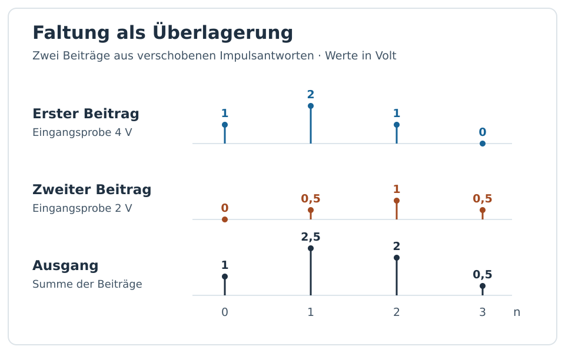

# M5-L2 – Impulsantwort und Faltung {#L2}

**Kursbereich:** M5 – Bachelor: Signale und Systeme

**Niveau:** Bachelor

**Vorwissen:** Zeitdiskrete Folgen, Linearität, Zeitinvarianz und Kausalität aus [M5-L1](M5-L1.md).

**Lernziel:** Eine diskrete Faltung von Hand berechnen, die kontinuierliche Faltung einordnen und aus einer Impulsantwort Aussagen zu Verzögerung, Kausalität und Stabilität ableiten.

## Ein Systemtest mit einem einzigen Eingangswert {#S1}

Der Einheitsimpuls $\delta[n]$ ist bei $n=0$ gleich eins und an allen anderen Indizes null. Die **Impulsantwort** eines linearen zeitinvarianten Systems ist $h[n]=T\{\delta\}[n]$. Jede Folge endlicher Länge ist eine Summe gewichteter, verschobener Impulse. Die Antwort auf $x[k]\delta[n-k]$ ist daher $x[k]h[n-k]$. Die Summe der Einzelantworten heißt **Faltung**:

$$
x[n]=\sum_{k=-\infty}^{\infty}x[k]\delta[n-k],
\qquad
y[n]=(x*h)[n]=\sum_{k=-\infty}^{\infty}x[k]h[n-k].
$$

Für unendliche Folgen muss die Summe für den betrachteten Eingang existieren. Die Formel legt keinen separaten Startzustand fest. Der Ausgabeanteil aus einem Anfangszustand wird in einer konkreten Differential- oder Differenzengleichung gegebenenfalls zusätzlich berücksichtigt.

{alt="Ein Eingang aus zwei Impulsen erzeugt zwei zeitverschobene, verschieden hohe Kopien derselben Impulsantwort. Die Überlagerung ergibt vier Ausgangswerte."}

## Vom Ablesen zur Berechnung {#S2}

Ein Filter verteilt eine Eingangsprobe auf drei aufeinanderfolgende Ausgangswerte. Seine dimensionslose Impulsantwort ist $h[0]=1/4$, $h[1]=1/2$, $h[2]=1/4$, übrige Werte null. Der Eingang sei $x[0]=4\,\mathrm V$, $x[1]=2\,\mathrm V$ und sonst null. Schreibe zwei Reihen mit gewichteten Kopien von $h$ und addiere spaltenweise:

| Index $n$ | $0$ | $1$ | $2$ | $3$ |
| --- | ---: | ---: | ---: | ---: |
| $4h[n]$ in Volt | 1 | 2 | 1 | 0 |
| $2h[n-1]$ in Volt | 0 | 0,5 | 1 | 0,5 |
| $y[n]$ in Volt | 1 | 2,5 | 2 | 0,5 |

Beim Index $n=2$ ergibt die Faltungsformel zum Beispiel $4\,\mathrm V\cdot h[2]+2\,\mathrm V\cdot h[1]=2\,\mathrm V$. Später als $n=3$ ist kein Produkt mehr ungleich null. Für endliche Folgen der Längen $M$ und $N$, die mit Einträgen ungleich null beginnen und enden, hat die lineare Faltung die Länge $M+N-1$. Die Probe $\sum_n y[n]=(\sum_n x[n])(\sum_n h[n])$ liefert hier $6\,\mathrm V$ und deckt beispielsweise einen vergessenen Randwert auf. Die resultierenden vier Werte sind Momentanwerte zu vier Abtastzeiten.

## Kontinuierliche Zeit, Kausalität und Stabilität {#S3}

Der kontinuierliche Impuls $\delta(t)$ ist eine Distribution. Er ist durch seine Siebeigenschaft $\int x(\tau)\delta(t-\tau)\,\mathrm d\tau=x(t)$ charakterisiert. Die kontinuierliche Entsprechung ist daher

$$
(x*h)(t)=\int_{-\infty}^{\infty}x(\tau)h(t-\tau)\,\mathrm d\tau.
$$

Für eine gewöhnliche kontinuierliche Impulsantwort eines LTI-Systems bedeutet Kausalität $h(t)=0$ für $t<0$. In der diskreten Zeit lautet die Bedingung $h[n]=0$ für $n<0$. Eine kausale Impulsantwort greift in der Faltung nur auf Gegenwart und Vergangenheit des Eingangs zu.

Für BIBO-Stabilität verlangt der diskrete Faltungstest $\sum_n |h[n]|<\infty$. Multipliziert man diese Summe mit der Eingangsgrenze $M$, erhält man eine obere Grenze für $|y[n]|$. Im kontinuierlichen Fall mit gewöhnlicher Impulsantwort gilt entsprechend $\int |h(t)|\,\mathrm dt<\infty$. Bei einem System mit direktem Durchgriff kann zusätzlich ein gewichteter Dirac-Impuls auftreten. Dessen Beitrag ist ein skaliertes Eingangssignal.

## Selbstkontrolle {#S4}

1. Verschiebe den gesamten Eingang des Tabellenbeispiels um drei Proben nach rechts. Bei welchen Indizes liegen die vier Ausgangswerte?
2. Die kausale Antwort sei $h[n]=2^{-n}$ für $n\ge0$. Berechne die obere Grenze von $|y[n]|$ für $|x[n]|\le3\,\mathrm V$.

### Lösungen

1. Zeitinvarianz verschiebt die Ausgangsfolge um drei Proben. Die Werte werden für $n=3,4,5,6$ in derselben Reihenfolge ausgegeben.
2. Die Reihe $\sum_{n=0}^\infty 2^{-n}$ ist gleich zwei. Die Grenze für den Ausgangsbetrag ist daher $6\,\mathrm V$. Ein konstanter positiver Eingang erreicht diese Grenze, wenn er im Modell auch für alle negativen Indizes anliegt.

## Gültigkeitsbereich und Weiterlernen {#S5}

Eine einzelne Impulsantwort beschreibt ein System dann vollständig, wenn die LTI-Annahmen gelten und der Eingang die einzige Anregung ist. Bei Aufzeichnung mit endlicher Dauer können fehlende Randwerte die Auswertung beeinflussen. [M5-L3](M5-L3.md) zeigt, wie die Faltung im Frequenzbereich durch eine Multiplikation ersetzt werden kann.

## Quellen {#S6}

- [MIT OpenCourseWare, 6.003 Signals and Systems, Lecture 8: Convolution](https://ocw.mit.edu/courses/6-003-signals-and-systems-fall-2011/resources/mit6_003f11_lec08/) · Impulszerlegung, Faltung und Beispiele · Zuletzt abgerufen: 2026-11-25
