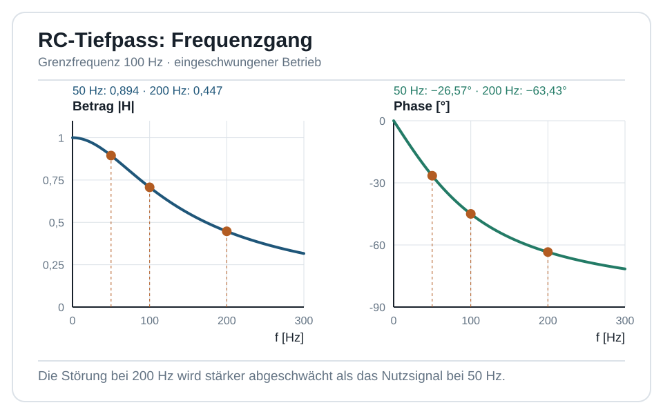

# M5-L3 – Fourier-Analyse, Spektren und Frequenzgang {#L3}

**Kursbereich:** M5 – Bachelor: Signale und Systeme

**Niveau:** Bachelor

**Vorwissen:** Komplexe Exponentialfunktionen aus [M2-L4](M2-L4.md) und Impulsantworten aus [M5-L2](M5-L2.md).

**Lernziel:** Fourier-Reihe, Fourier-Transformation und DFT am jeweiligen Einsatz unterscheiden und Amplitude sowie Phase eines Sensorsignals hinter einem Tiefpass berechnen.

## Zeitverlauf und Frequenzdarstellung {#S1}

Eine periodische Schwingung mit Grundfrequenz $f_0$ lässt sich unter geeigneten Voraussetzungen in Komponenten bei den Frequenzen $k f_0$ zerlegen. Das ist die Aufgabe der Fourier-Reihe. Bei einem aperiodischen Signal mit endlichem Betragsintegral kann man beispielsweise diese Konvention für die kontinuierliche Fourier-Transformation verwenden:

$$
X(f)=\int_{-\infty}^{\infty}x(t)\,\mathrm e^{-\mathrm j2\pi ft}\,\mathrm dt,
\qquad
x(t)=\int_{-\infty}^{\infty}X(f)\,\mathrm e^{+\mathrm j2\pi ft}\,\mathrm df
$$

Die inverse Formel gilt dort, wo die nötigen Voraussetzungen erfüllt sind. Hier steht $f$ für Frequenz in Hertz, $t$ für Zeit in Sekunden und $\mathrm j^2=-1$. In der Zeigerdarstellung von [M1-L6](M1-L6.md) steht $\omega=2\pi f$ für die Kreisfrequenz. Ein reeller Kosinus besteht in der komplexen Darstellung aus zwei Exponentialfunktionen mit konjugierten Koeffizienten bei $+f_0$ und $-f_0$. Die Anfangsphase bestimmt deren Winkel. Eine zeitlich unbegrenzte Sinusschwingung hat kein endliches Betragsintegral. Ihr kontinuierliches Spektrum wird im erweiterten Sinn als Linienpaar dargestellt.

## Messaufzeichnung und DFT {#S2}

Eine Messung mit $N$ Proben bei $f_\mathrm s$ besitzt eine diskrete Fourier-Transformation mit $N$ Ausgabewerten. Wähle

$$
X[k]=\sum_{n=0}^{N-1}x[n]\,\mathrm e^{-\mathrm j2\pi kn/N},
\qquad
x[n]=\frac1N\sum_{k=0}^{N-1}X[k]\,\mathrm e^{+\mathrm j2\pi kn/N}.
$$

Die Frequenzschritte betragen $\Delta f=f_\mathrm s/N$. Im oberen Teil des Indexbereichs lassen sich die Frequenzen als $(k-N)\Delta f$ lesen. Beobachte $x[n]=2\,\mathrm V\cos(2\pi n/8)$ mit $N=8$ und $f_\mathrm s=800\,\mathrm{Hz}$. Das Fenster enthält genau eine Periode. Die einzigen von null verschiedenen DFT-Werte sind $X[1]=X[7]=8\,\mathrm V$. Sie gehören zu $+100$ und $-100\,\mathrm{Hz}$. Der Spitzenwert des ursprünglichen Kosinus ist $2|X[1]|/8=2\,\mathrm V$. Die Verdopplung gilt für ein solches Linienpaar außerhalb von Gleichanteil und Nyquist-Frequenz. Treffen die Daten die Periodengrenzen nicht, verteilt sich Energie des beobachteten Tons bei rechteckigem Fenster über mehrere DFT-Indizes. Das heißt **spektrale Leckage**.

## Frequenzgang und Beispiel eines Sensors {#S3}

Aus der Faltung $y=x*h$ folgt für das LTI-System $Y(f)=H(f)X(f)$. Bei einer einzelnen sinusförmigen Komponente im eingeschwungenen Betrieb skaliert $|H(f)|$ die Amplitude und $\arg H(f)$ addiert sich zur Phase. Betrachte einen normierten RC-Tiefpass mit Grenzfrequenz $f_c=100\,\mathrm{Hz}$:

$$
H(f)=\frac1{1+\mathrm j f/f_c},\qquad
|H(f)|=\frac1{\sqrt{1+(f/f_c)^2}},\qquad
\arg H(f)=-\arctan(f/f_c).
$$

Die berechneten Spitzenamplituden gelten nach Abklingen der freien Antwort:

| Komponente | Eingangsamplitude | Verstärkung | Ausgangsamplitude | Zusätzliche Phase |
| --- | ---: | ---: | ---: | ---: |
| Nutzschwingung bei $50\,\mathrm{Hz}$ | $2\,\mathrm V$ | $0{,}8944$ | $1{,}7889\,\mathrm V$ | $-26{,}57^\circ$ |
| Störung bei $200\,\mathrm{Hz}$ | $1\,\mathrm V$ | $0{,}4472$ | $0{,}4472\,\mathrm V$ | $-63{,}43^\circ$ |

Am Eingang beträgt das Amplitudenverhältnis Nutzsignal zu Störung zwei. Am Ausgang beträgt es vier. Das Filter verschiebt zugleich die Phasen und verringert die Nutzamplitude. Welche Grenzfrequenz passt, hängt daher von den tolerierbaren Abweichungen ab.

{alt="Betrags- und Phasenfrequenzgang eines RC-Tiefpasses mit Grenzfrequenz 100 Hertz und Punkten bei 50, 100 und 200 Hertz."}

Die orangefarbenen Punkte markieren Nutzfrequenz, Grenzfrequenz und Störfrequenz. Die Verstärkung ist ein Verhältnis, keine Ausgangsspannung; sie muss mit der jeweiligen Eingangsamplitude multipliziert werden.

## Selbstkontrolle {#S4}

1. Wie fein ist das DFT-Frequenzraster einer Aufzeichnung mit 1000 Proben bei $8\,\mathrm{kHz}$?
2. Berechne Betrag und Phase des RC-Tiefpasses bei $f=f_c$.

### Lösungen

1. $\Delta f=8000/1000\,\mathrm{Hz}=8\,\mathrm{Hz}$. Ein feineres Raster belegt allein noch keine bessere Trennbarkeit eng benachbarter Komponenten. Beobachtungsdauer und Fensterform beeinflussen sie.
2. Der Betrag ist $1/\sqrt2\approx0{,}7071$, die Phase beträgt $-45^\circ$. Ein eingeschwungener Sinus von $1\,\mathrm V$ Spitze erscheint am Ausgang mit etwa $0{,}7071\,\mathrm V$ Spitze.

## Gültigkeitsbereich und Weiterlernen {#S5}

Ein solcher Frequenzgang beschreibt das gewählte Modell im linearen Arbeitsbereich. Änderungen der zeitlichen Datenbasis und der Skalierung müssen bei Spektren dokumentiert werden. In [M5-L4](M5-L4.md) ergänzen wir die Frequenzachse um eine komplexe Variable, mit der man freie Antwortanteile und Stabilität untersucht.

## Quellen {#S6}

- [MIT OpenCourseWare, 6.003 Signals and Systems, Lecture 16: Fourier Transform](https://ocw.mit.edu/courses/6-003-signals-and-systems-fall-2011/resources/mit6_003f11_lec16/) · Transformation und Frequenzdarstellung · Zuletzt abgerufen: 2026-11-25
- [MIT OpenCourseWare, 6.003 Signals and Systems, Lecture Notes](https://ocw.mit.edu/courses/6-003-signals-and-systems-fall-2011/pages/lecture-notes/) · Einheiten 9 und 17–19 zu Frequenzgang und diskreten Frequenzdarstellungen · Zuletzt abgerufen: 2026-11-25
