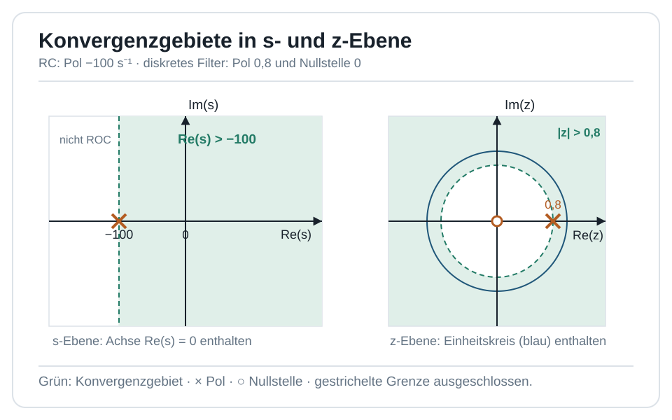

# M5-L4 – Laplace- und z-Transformation als Systemwerkzeuge {#L4}

**Kursbereich:** M5 – Bachelor: Signale und Systeme

**Niveau:** Bachelor

**Vorwissen:** Lineare Differentialgleichungen aus [M2-L3](M2-L3.md), Faltung aus [M5-L2](M5-L2.md) und Frequenzgang aus [M5-L3](M5-L3.md).

**Lernziel:** Pol, Nullstelle und Konvergenzgebiet an einfachen zeitkontinuierlichen und zeitdiskreten Systemen bestimmen und zwischen kausaler Realisierung und Eingangs-Ausgangs-Stabilität unterscheiden.

## Zwei Transformationen für exponentielle Anteile {#S1}

In der zeitkontinuierlichen Rechnung ersetzt die komplexe Variable $s=\sigma+\mathrm j\omega$ die reine Schwingungsachse $\mathrm j\omega$. In diskreter Zeit übernimmt $z=r\mathrm e^{\mathrm j\Omega}$ mit $r>0$ und Winkel $\Omega$ in Radiant pro Probe diese Aufgabe. Die beidseitigen Transformationen lauten

$$
H(s)=\int_{-\infty}^{\infty}h(t)\,\mathrm e^{-st}\,\mathrm dt,
\qquad
H(z)=\sum_{n=-\infty}^{\infty}h[n]z^{-n}.
$$

Hier dient $H$ als Übertragungsfunktion zur jeweiligen Impulsantwort. Das **Konvergenzgebiet** gibt an, für welche $s$ oder $z$ Integral oder Summe absolut konvergieren. Es gehört zum Transformationsergebnis. Die Fourier-Antwort erhält man auf $\sigma=0$ beziehungsweise $r=1$, wenn diese Linie oder dieser Kreis zum Konvergenzgebiet gehört. Pole sind Stellen, an denen der gekürzte rationale Ausdruck unbeschränkt wird. Nullstellen sind Stellen, an denen er null wird. Eine vollständig gekürzte Eingangs-Ausgangs-Übertragungsfunktion kann interne Zustandsmoden verbergen.

## Beispiel in kontinuierlicher Zeit {#S2}

Der RC-Tiefpass im Modell $\tau\,\mathrm dy/\mathrm dt+y=x$ hat bei Anfangswert null und $\tau=0{,}01\,\mathrm s$ die kausale Impulsantwort $h(t)=100\,\mathrm e^{-100t}u(t)$, mit der Einheit $\mathrm s^{-1}$ für den Faktor 100. Hier bezeichnet $u(t)$ die Einheitssprungfunktion. Einsetzen in das Integral ergibt

$$
H(s)=\frac{100}{s+100},
\qquad
\operatorname{Re}(s)>-100\,\mathrm s^{-1}.
$$

Der einzige Pol liegt bei $s=-100\,\mathrm s^{-1}$. Es gibt keine endliche Nullstelle. Der konvergente Bereich folgt aus $h(t)\mathrm e^{-st}=100\,\mathrm e^{-(s+100)t}$ für $t\ge0$. Die imaginäre Achse liegt im Gebiet, also ist der Filter BIBO-stabil. Die Übertragungsfunktion beschreibt die erzwungene Antwort bei Anfangswert null. Für einen von null verschiedenen Kondensatorspannungswert $y(0)$ addiert sich im linearen Modell die freie Antwort $y(0)\mathrm e^{-100t}$.

Derselbe rationale Ausdruck gehört bei $\operatorname{Re}(s)<-100\,\mathrm s^{-1}$ zu $-100\,\mathrm e^{-100t}u(-t)$, von einem einzelnen Grenzpunkt abgesehen. Der Ausdruck wächst für $t\to-\infty$. Diese Impulsantwort ist antikausal und BIBO-instabil. Ein Polwert allein legt sie nicht fest.

## Beispiel in diskreter Zeit {#S3}

Betrachte $y[n]=0{,}8y[n-1]+0{,}2x[n]$ ohne freie Anfangsantwort. Die kausale Impulsantwort ist $h[n]=0{,}2(0{,}8)^n u[n]$. Summiere die geometrische Reihe:

$$
H(z)=\frac{0{,}2}{1-0{,}8z^{-1}}
     =\frac{0{,}2z}{z-0{,}8},
\qquad |z|>0{,}8.
$$

Der Pol liegt bei $0{,}8$, die Nullstelle bei $0$. Der Einheitskreis liegt im Konvergenzgebiet. Die Sprungantwort bei $x[n]=u[n]$ lautet $y[n]=1-(0{,}8)^{n+1}$ für $n\ge0$. Sie beginnt mit $0{,}2$ und $0{,}36$ und nähert sich eins. Der Grenzwert stimmt mit $H(1)=1$ überein.

Für ein kausales rationales Eingangs-Ausgangs-System liegen bei BIBO-Stabilität die Pole in der offenen linken Halbebene beziehungsweise streng innerhalb des Einheitskreises. Bei unbekannter Kausalität prüft man das Konvergenzgebiet statt allein die Pole.

{alt="Zwei komplexe Ebenen: grünes Konvergenzgebiet rechts des Pols minus 100 in der s-Ebene und außerhalb des Radius 0,8 in der z-Ebene; die imaginäre Achse beziehungsweise der Einheitskreis liegen darin."}

Die Schattierung zeigt jeweils das kausale Konvergenzgebiet im dargestellten Koordinatenausschnitt. Der blaue Einheitskreis ist keine Polgrenze des diskreten Beispiels. Für die BIBO-Stabilität ist in beiden Fällen entscheidend, dass die jeweilige Fourier-Linie vollständig im Konvergenzgebiet liegt.

## Selbstkontrolle {#S4}

1. Bestimme Pol, Nullstelle und Stabilität von $H(z)=(1-z^{-1})/(1-0{,}5z^{-1})$ bei kausaler Antwort.
2. Eine beidseitige Laplace-Transformation besitzt das Gebiet $-4<\operatorname{Re}(s)<-1$, mit den Grenzen in $\mathrm s^{-1}$. Kann das zugehörige System BIBO-stabil sein?

### Lösungen

1. Nach Multiplikation mit $z$ ergibt sich $(z-1)/(z-0{,}5)$. Der Pol liegt bei $0{,}5$, die Nullstelle bei $1$. Das kausale Gebiet $|z|>0{,}5$ enthält den Einheitskreis. Das System ist BIBO-stabil. Die Nullstelle bei $z=1$ unterdrückt einen stationären Gleichanteil.
2. Nein. Die imaginäre Achse hat Realteil null und liegt außerhalb des genannten Gebiets. Dem gewöhnlichen LTI-Modell fehlt daher eine absolut integrierbare Impulsantwort.

## Gültigkeitsbereich und Weiterlernen {#S5}

Die Beispiele gelten für die angegebenen LTI-Modelle und Konvergenzgebiete. In [M5-L5](M5-L5.md) betrachten wir die Wahl des Abtastintervalls, bevor ein diskretes Filter überhaupt angewendet werden kann.

## Quellen {#S6}

- [MIT OpenCourseWare, 6.003 Signals and Systems, Lecture 6: Laplace Transform](https://ocw.mit.edu/courses/6-003-signals-and-systems-fall-2011/resources/mit6_003f11_lec06/) · Laplace-Transformation, Pole und Konvergenzgebiete · Zuletzt abgerufen: 2026-11-25
- [MIT OpenCourseWare, 6.003 Signals and Systems, Lecture 5: Z Transform](https://ocw.mit.edu/courses/6-003-signals-and-systems-fall-2011/resources/mit6_003f11_lec05/) · z-Transformation und diskrete Systeme · Zuletzt abgerufen: 2026-11-25
