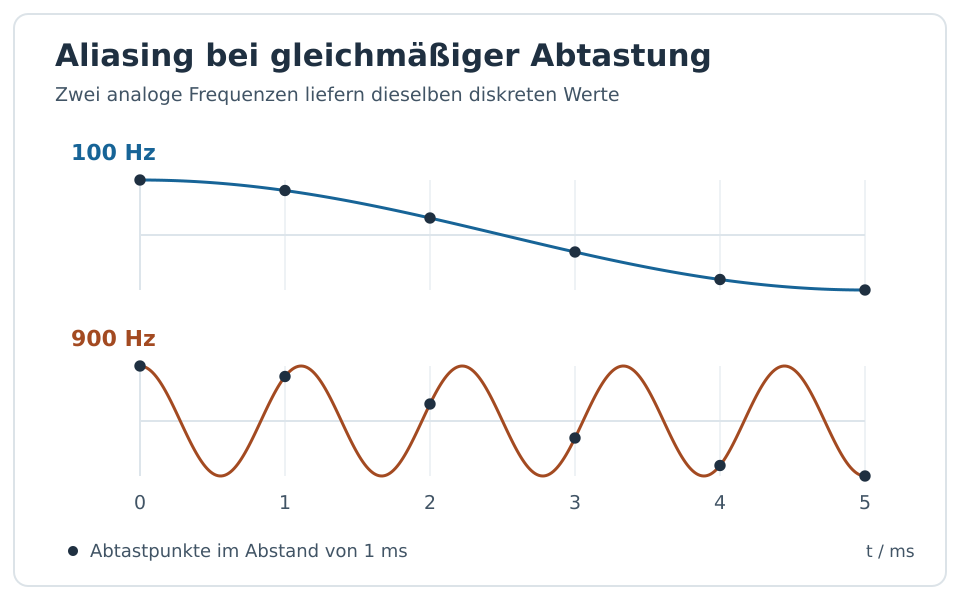

# M5-L5 – Abtastung, Aliasing und digitale Filter {#L5}

**Kursbereich:** M5 – Bachelor: Signale und Systeme

**Niveau:** Bachelor

**Vorwissen:** Abtastfolgen aus [M5-L1](M5-L1.md), DFT aus [M5-L3](M5-L3.md) und z-Variable aus [M5-L4](M5-L4.md).

**Lernziel:** Eine geeignete Abtastrate für ein bandbegrenztes Sensorsignal begründen, die Aliasfrequenz zweier Sinustöne nachrechnen und ein einfaches Digitalfilter bewerten.

## Vom Sensorsignal zur Zahlenfolge {#S1}

Bei gleichmäßiger Abtastung entstehen aus $x(t)$ die Proben $x[n]=x(n/f_\mathrm s)$. Ein zeitkontinuierliches Signal ohne Spektralanteile außerhalb von $[-B,B]$ ist durch ideale Abtastwerte eindeutig bestimmt und ideal rekonstruierbar, wenn $f_\mathrm s>2B$ gilt. Diese Aussage setzt ein exakt bandbegrenztes Modell, gleichmäßige Abtastung ohne Zeitfehler und die passende Rekonstruktion voraus. Die Frequenz $f_\mathrm s/2$ heißt Nyquist-Frequenz. Am Grenzfall kann etwa ein passend phasenverschobener Sinus ausschließlich an seinen Nulldurchgängen erfasst werden.

Für eine komplexe Schwingung gehört zur analogen Frequenz $f$ die diskrete Winkelfrequenz $\Omega=2\pi f/f_\mathrm s$. Weil $\mathrm e^{\mathrm j2\pi kn}=1$ für ganzzahlige $k,n$ gilt, sind Frequenzen $f+k f_\mathrm s$ nach dem Abtasten ununterscheidbar. Bei reellen Kosinussignalen gilt zusätzlich die Spiegelsymmetrie für positive und negative Frequenz bei Phase null.

## Rechenexperiment: Zwei Töne, dieselben Proben {#S2}

Bei $f_\mathrm s=1000\,\mathrm{Hz}$ ergeben ein Kosinus bei $100\,\mathrm{Hz}$ und einer bei $900\,\mathrm{Hz}$ dieselbe Folge. Zwischen den Stichproben unterscheiden sich ihre Verläufe. Mit $900\,\mathrm{Hz}=1000\,\mathrm{Hz}-100\,\mathrm{Hz}$ lautet der Winkel des zweiten Kosinus $2\pi n-2\pi n/10$. Sein Kosinus ist gleich $\cos(2\pi n/10)$.

{alt="Ein 100-Hertz-Kosinus und ein 900-Hertz-Kosinus verlaufen zwischen den Markern verschieden. Bei gleichmäßiger Abtastung mit 1000 Hertz treffen beide dieselben Marker."}

```python
from math import cos, isclose, pi

sample_rate = 1000
for n in range(6):
    t = n / sample_rate
    slow = cos(2 * pi * 100 * t)
    fast = cos(2 * pi * 900 * t)
    assert isclose(slow, fast, abs_tol=1e-12)
    print(f"{n}: {slow:+.6f}  {fast:+.6f}")
```

Die Folge beginnt mit $1$, $0{,}809017$, $0{,}309017$, $-0{,}309017$, $-0{,}809017$ und $-1$. Enthält der Sensorkanal beide Töne mit derselben Phase am Zeitnullpunkt, addieren sie sich nach der Abtastung bei der scheinbaren Frequenz $100\,\mathrm{Hz}$. Eine spätere Filterung beider Einzelanteile ist aus dieser einen Folge unmöglich.

## Analoges Vorfilter und digitales Nachfilter {#S3}

Das analoge **Antialiasing-Filter** dämpft Frequenzen oberhalb des vorgesehenen Nutzbands vor der Abtastung. Eine reale Filterflanke braucht Abstand zwischen dem Ende des Nutzbands und den zu unterdrückenden Frequenzen. Ein Digitalfilter kann aus den bereits abgetasteten Werten mögliche Störungen im repräsentierten Frequenzbereich abschwächen. Der gleitende Mittelwert $y[n]=(x[n]+x[n-1])/2$ aus [M5-L1](M5-L1.md) hat zum Beispiel den Frequenzgang

$$
H(\mathrm e^{\mathrm j\Omega})=\frac{1+\mathrm e^{-\mathrm j\Omega}}{2}
  =\mathrm e^{-\mathrm j\Omega/2}\cos(\Omega/2).
$$

Er lässt den Gleichanteil unverändert und löscht die alternierende Folge $(-1)^n$ bei $\Omega=\pi$. Beim gemeinsamen Alias bei $100\,\mathrm{Hz}$ ist der Betrag $\cos(\pi/10)\approx0{,}9511$. Das Filter dämpft beide zuvor verschmolzenen Beiträge gleich. Ein passendes analoges Vorfilter schützt die Information über den Nutzton.

## Selbstkontrolle {#S4}

1. Welche scheinbare Frequenz erhält man für einen phasenlosen $720$-Hz-Kosinus bei Abtastung mit $1000\,\mathrm{Hz}$?
2. Eine Messung enthält Nutzsignalanteile bis $180\,\mathrm{Hz}$ und Störungen oberhalb davon. Welche Mindestanforderung stellt das ideale Abtasttheorem an $f_\mathrm s$, und weshalb reicht die Zahl allein praktisch nicht?

### Lösungen

1. $720-1000=-280\,\mathrm{Hz}$. Für den phasenlosen reellen Kosinus erscheinen in einer einseitigen Darstellung $280\,\mathrm{Hz}$.
2. Im ideal bandbegrenzten Modell muss $f_\mathrm s>360\,\mathrm{Hz}$ gelten. In der Messkette sind Vorfilterung, gewünschte Stördämpfung und die reale Übergangsbreite zu berücksichtigen. Ein geringfügig größerer Wert garantiert diese Eigenschaften für sich genommen nicht.

## Gültigkeitsbereich und Weiterlernen {#S5}

Das Beispiel isoliert Aliasing bei gleichmäßiger Abtastung. Endliche Auflösung, Zeitjitter sowie Fenster- und Filtereffekte sind weitere Modellbestandteile. In [M5-L6](M5-L6.md) untersuchen wir, was eine Mittelung bei zufälligen Störungen bewirkt.

## Quellen {#S6}

- [MIT OpenCourseWare, 6.003 Signals and Systems, Lecture 21: Sampling](https://ocw.mit.edu/courses/6-003-signals-and-systems-fall-2011/resources/mit6_003f11_lec21/) · Abtasttheorem, Spektralkopien und Rekonstruktion · Zuletzt abgerufen: 2026-11-25
- [MIT OpenCourseWare, 6.003 Signals and Systems, Lecture Notes](https://ocw.mit.edu/courses/6-003-signals-and-systems-fall-2011/pages/lecture-notes/) · Einheiten 18 und 22 zu diskretem Frequenzgang und Quantisierung · Zuletzt abgerufen: 2026-11-25
