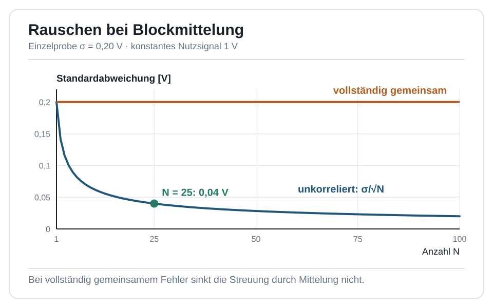

# M5-L6 – Zufallssignale, Rauschen und Signalqualität {#L6}

**Kursbereich:** M5 – Bachelor: Signale und Systeme

**Niveau:** Bachelor

**Vorwissen:** Erwartungswert und Varianz aus [M2-L6](M2-L6.md) sowie Frequenzgang aus [M5-L3](M5-L3.md).

**Lernziel:** Zufällige Störungen als Messmodell beschreiben, die Wirkung einer Mittelung bei unkorrelierten und korrelierten Proben berechnen und das Signal-Rausch-Verhältnis mit seinen Annahmen angeben.

## Messfolge als Realisierung eines Zufallssignals {#S1}

Ein Sensor liefert $x[n]=s[n]+w[n]$. Dabei bezeichnet $s[n]$ die interessierende Signalgröße und $w[n]$ eine zufällige Störung. Bei einer zweiten Aufzeichnung unter gleichen Bedingungen ändert sich der beobachtete Verlauf von $w[n]$. Das Modell beschreibt eine Familie möglicher Folgen. Eine konkrete Aufzeichnung ist eine Realisierung daraus.

Ein in weitem Sinn stationäres reelles Rauschen besitzt einen zeitlich konstanten Erwartungswert, endliche zweite Momente und eine Autokovarianz, die nur vom Abstand $k$ abhängt. Mit $\mu=\mathbb E[w[n]]$ ist diese

$$
C_w[k]=\mathbb E\bigl[(w[n]-\mu)(w[n-k]-\mu)\bigr].
$$

Bei mittelwertfreiem weißem Rauschen gilt $C_w[0]=\sigma^2$ und $C_w[k]=0$ für $k\ne0$. In diesem Modell sind verschiedene Proben unkorreliert. Unabhängigkeit folgt daraus im Allgemeinen erst mit zusätzlichen Verteilungsannahmen, etwa gemeinsamer Gauß-Verteilung. Ein konstanter Messoffset ist ein anderer Effekt. Mittelung ändert seinen Beitrag zum Erwartungswert nicht. Ein verbreiteter Diagnoseweg ist, den Mittelwert und die Streuung in aufeinanderfolgenden gleich langen Fenstern zu vergleichen. Stark wechselnde Kennwerte sprechen gegen das einfache stationäre Modell. Ein annähernd gleicher Fensterbefund garantiert Stationarität jedoch nicht.

## Beispiel: Mittelwert und Signal-Rausch-Abstand {#S2}

Für einen über den Beobachtungszeitraum konstanten Messwert $s=1\,\mathrm V$ sei der Fehler mittelwertfrei, von Probe zu Probe unkorreliert und habe die Standardabweichung $\sigma=0{,}2\,\mathrm V$. In einem Block aus $N=25$ Proben wird $\bar x$ geschätzt:

$$
\bar x=\frac1N\sum_{n=0}^{N-1}x[n],
\qquad
\mathbb E[\bar x]=s,\qquad
\operatorname{Var}(\bar x)=\frac{\sigma^2}{N}.
$$

Die Varianzformel folgt, weil die Varianz der Summe in diesem Fall $N\sigma^2$ ist und der Faktor $1/N$ quadriert wird. Die Ausgangsstandardabweichung beträgt $0{,}04\,\mathrm V$. Mit dem Verhältnis von Signalquadratswert zu mittlerem Rauschquadratswert ergibt sich am Eingang

$$
\mathrm{SNR}=\frac{s^2}{\sigma^2}=25,\qquad
\mathrm{SNR}_{\mathrm{dB}}=10\log_{10}(25)\approx13{,}98\,\mathrm{dB}.
$$

Am Ausgang stehen $s^2/(0{,}04\,\mathrm V)^2=625$ beziehungsweise $27{,}96\,\mathrm{dB}$. Bei einer Spannungsdarstellung setzt diese Umrechnung in ein Leistungsverhältnis gleiche Referenzbedingungen für Signal und Rauschen voraus. In anderen Anwendungen muss man die gemessene Bandbreite, die Messstelle und die Leistungsdefinition dokumentieren.

## Korrelation und Filterwahl {#S3}

Eine Blockmittelung hat allgemein die Rauschvarianz

$$
\operatorname{Var}(\bar w)=\frac1{N^2}
\sum_{n=0}^{N-1}\sum_{m=0}^{N-1}C_w[n-m].
$$

Bei vollständig gemeinsamem, zufälligem Offset gilt für alle Paare dieselbe Kovarianz $\sigma^2$. Dann bleibt die Varianz des Mittelwerts gleich $\sigma^2$. Positive Korrelation kann die erhoffte Verbesserung deutlich verkleinern. Ein längeres Mittelungsfenster verzögert zugleich die Reaktion auf reale Änderungen des Signals. Für eine schmalbandige Störung kann ein Frequenzfilter besser passen, sofern das Nutzsignal an der Störfrequenz wenig Energie trägt. Ein LTI-Filter mit Frequenzantwort $H$ multipliziert die spektrale Leistungsdichte stationären Eingangsrauschens mit $|H|^2$, wenn das Filter und die Spektraldarstellung für den Prozess definiert sind.

{alt="Kurven der Standardabweichung bei unkorrelierten Proben und bei vollständig gemeinsamem zufälligem Offset; markierter Wert 0,04 Volt bei 25 unkorrelierten Proben."}

Die fallende Kurve ist die theoretische Standardabweichung des Mittelwerts, nicht die Streuung der Einzelproben. Die horizontale Linie beschreibt den Extremfall eines vollständig gemeinsamen zufälligen Offsets. Beide Kurven setzen dieselbe Einzelvarianz voraus.

## Selbstkontrolle {#S4}

1. Wie viele unkorrelierte, gleich streuende Proben sind nötig, um die Rauschstandardabweichung auf ein Zehntel des Einzelwerts zu senken?
2. Zwei Fehlerproben haben Varianz $\sigma^2$ und Korrelationskoeffizient $\rho=0{,}6$. Welche Varianz hat ihr Mittelwert?

### Lösungen

1. Die Standardabweichung sinkt im Modell um den Faktor $1/\sqrt N$. Für $1/10$ benötigt man $N=100$. Der SNR-Gewinn beträgt bei konstantem Nutzsignal $20\,\mathrm{dB}$.
2. $\operatorname{Var}((w[0]+w[1])/2)=(2\sigma^2+2\rho\sigma^2)/4=0{,}8\sigma^2$. Bei unkorrelierten Proben wären es $0{,}5\sigma^2$.

## Gültigkeitsbereich und Weiterlernen {#S5}

Das Beispiel nimmt ein konstantes Nutzsignal und bekannte Fehlereigenschaften an. Stationarität und Mittelwertfreiheit sind bei Drift, Netzbrumm oder wechselnder Umgebung zu prüfen. [M16-L4](M16-L4.md) vertieft die Filterung und Schätzung verrauschter Messdaten in einer elektrotechnischen Messkette.

## Quellen {#S6}

- [MIT OpenCourseWare, 6.011 Signals, Systems and Inference, Lecture Notes](https://ocw.mit.edu/courses/6-011-signals-systems-and-inference-spring-2018/resources/lecture-notes/) · Einheiten 15–19 zu Zufallsprozessen, Stationarität, LTI-Filterung und spektraler Leistungsdichte · Zuletzt abgerufen: 2026-11-25
