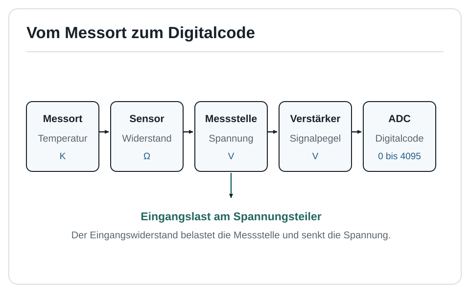

# M6-L1 – Messketten, Sensoren und Messstellen {#L1}

**Kursbereich:** M6 – Bachelor: Messung und Einstieg in die Regelung

**Niveau:** Bachelor

**Vorwissen:** [Widerstände und Spannungsteiler](M1-L2.md), [Thévenin-Ersatzschaltung](M1-L4.md), Einheiten und Größenordnungen aus [M2-L1](M2-L1.md).

**Lernziel:** Eine Messkette vom Sensor bis zum Schätzwert beschreiben, die Rückwirkung eines endlichen Eingangswiderstands berechnen und die Auflösung einer idealisierten Digitalisierung einordnen.

## Vom Messort zum Zahlenwert {#S1}

Die **Messgröße** ist die Größe, die du bestimmen willst. Bei der Temperatur eines Körpers muss beispielsweise klar sein, an welcher Stelle und für welches Zeitintervall der Wert gelten soll. Ein Sensor reagiert auf eine lokale physikalische Größe und setzt sie etwa in einen Widerstand oder eine Spannung um. Die Aufbereitung passt den Signalbereich an und kann unerwünschte Frequenzanteile dämpfen. Der Analog-Digital-Umsetzer (ADC) liefert einen zeitlich abgetasteten Code. Eine Auswertung übersetzt den Code anhand eines Modells zurück in die Einheit der Messgröße.

Kennzeichne in einem Blockbild jede Schnittstelle mit Signal und Einheit. So lässt sich eine Abweichung eingrenzen. Eine unerwartete Temperaturanzeige kann durch den Messort, eine Last an der Sensorschnittstelle, begrenzte ADC-Auflösung oder die Rückrechnung entstehen. Eine stabile Anzeige belegt nur, dass sich die angezeigten Zahlen wenig ändern.

## Die Eingangsbelastung berechnen {#S2}

Ersetze die Ausgangsschaltung des Sensors an der Messstelle durch ihre Leerlaufspannung $U_0$ und den Serienwiderstand $R_\mathrm{th}$. Das Messgerät erhält im Gleichstrommodell den Eingangswiderstand $R_\mathrm{in}$. Damit ergibt sich

$$
U_\mathrm{in}=U_0\frac{R_\mathrm{in}}{R_\mathrm{th}+R_\mathrm{in}},\qquad
\frac{U_\mathrm{in}-U_0}{U_0}=-\frac{R_\mathrm{th}}{R_\mathrm{th}+R_\mathrm{in}}.
$$

Der zweite Ausdruck gilt für $U_0\ne0$. Der Betrag des relativen Fehlers sinkt mit wachsendem Verhältnis $R_\mathrm{in}/R_\mathrm{th}$. Damit er höchstens ein Prozent beträgt, muss $R_\mathrm{in}\ge99R_\mathrm{th}$ gelten.

{alt="Messkette entlang von Temperatur, Sensorwiderstand, belasteter Eingangsspannung, Verstärkung und ADC-Code. Der Eingangswiderstand zieht Strom und senkt die Eingangsspannung."}

## Modellrechnung von der Messstelle bis zum ADC {#S3}

Im Modell liegt ein Sensor mit $10\,\mathrm{k\Omega}$ als unterer Widerstand in einem Spannungsteiler. Der obere Widerstand beträgt ebenfalls $10\,\mathrm{k\Omega}$ und die ideale Speisung $3{,}3\,\mathrm V$. Die Leerlaufspannung ist $1{,}65\,\mathrm V$, der Ausgangswiderstand der Parallelschaltung $5\,\mathrm{k\Omega}$. Mit $R_\mathrm{in}=100\,\mathrm{k\Omega}$ erhältst du $U_\mathrm{in}=1{,}57143\,\mathrm V$. Die Belastung verursacht also etwa $-78{,}6\,\mathrm{mV}$ oder $-4{,}76\,\%$ bezogen auf den Leerlaufwert. Auch das direkte Modell mit $R_\mathrm{Sensor}\parallel R_\mathrm{in}=9{,}0909\,\mathrm{k\Omega}$ ergibt diesen Wert.

Eine idealisierte Verstärkerstufe mit Verstärkung $2$ liefert $3{,}14286\,\mathrm V$. Der anschließende $12$-Bit-ADC teile den Bereich von $0$ bis $4{,}096\,\mathrm V$ in $2^{12}=4096$ gleich breite Intervalle. Die Schrittweite ist dann

$$
q=\frac{4{,}096\,\mathrm V}{4096}=1\,\mathrm{mV}.
$$

Bei Codierung mit der unteren Intervallgrenze als Übergang ist der Code $3142$. Rekonstruiert man mit der Mitte des Intervalls, erhält man $3{,}1425\,\mathrm V$. Die Differenz von rund $-0{,}36\,\mathrm{mV}$ liegt innerhalb einer halben Schrittweite. Ein zusätzliches ADC-Bit würde den Quantisierungsschritt verkleinern. Die bereits vor der Verstärkung entstandene Eingangslast bliebe dabei wirksam.

## Übungen und Lösungen {#S4}

1. Vergleiche $R_\mathrm{in}=1\,\mathrm{M\Omega}$ und $100\,\mathrm{k\Omega}$ für denselben Teiler.
2. Bestimme die Schrittweite eines idealen $10$-Bit-ADC mit demselben Eingangsspannungsbereich. Gib den maximalen Quantisierungsfehler bei Rekonstruktion zur Intervallmitte innerhalb des Messbereichs an.

**Lösung 1.** Für $1\,\mathrm{M\Omega}$ ergibt der Lastfaktor $1000/1005$ bezogen auf $1{,}65\,\mathrm V$ eine Eingangsspannung von rund $1{,}6418\,\mathrm V$. Der Fehlerbetrag fällt von $78{,}6\,\mathrm{mV}$ auf etwa $8{,}2\,\mathrm{mV}$.

**Lösung 2.** $4{,}096\,\mathrm V/1024=4\,\mathrm{mV}$. Im gewählten Modell liegt der Betrag des Fehlers höchstens bei $2\,\mathrm{mV}$. Ein Eingang außerhalb des zulässigen Bereichs führt zur Sättigung und fällt aus dieser Abschätzung heraus.

## Modellgrenzen und Weiterlernen {#S5}

Bei zeitabhängigen Signalen kann ein Eingang zusätzlich kapazitiv wirken. Dann hängt die Lastwirkung auch von der Frequenz und von der Zeit zwischen zwei Abtastungen ab. Die ADC-Rechnung hier setzt ideale, gleich breite Intervalle voraus. Die Ableitung der Temperatur aus einem Widerstand oder Code braucht außerdem eine Kalibrierbeziehung. [M6-L2](M6-L2.md) zeigt den Umgang mit Korrektur und Unsicherheit.

## Quellen {#S6}

- [OpenStax, University Physics Volume 2, § 10.4 – Electrical Measuring Instruments](https://openstax.org/books/university-physics-volume-2/pages/10-4-electrical-measuring-instruments) · Abschnitt 10.4 – Innenwiderstände und Messgerätebelastung. · Zuletzt abgerufen: 2026-11-25
- [MIT OpenCourseWare, 6.003 – Sampling and Quantization](https://ocw.mit.edu/courses/6-003-signals-and-systems-fall-2011/resources/lecture-22-sampling-and-quantization/) · Abtastung und Quantisierung. · Zuletzt abgerufen: 2026-11-25
