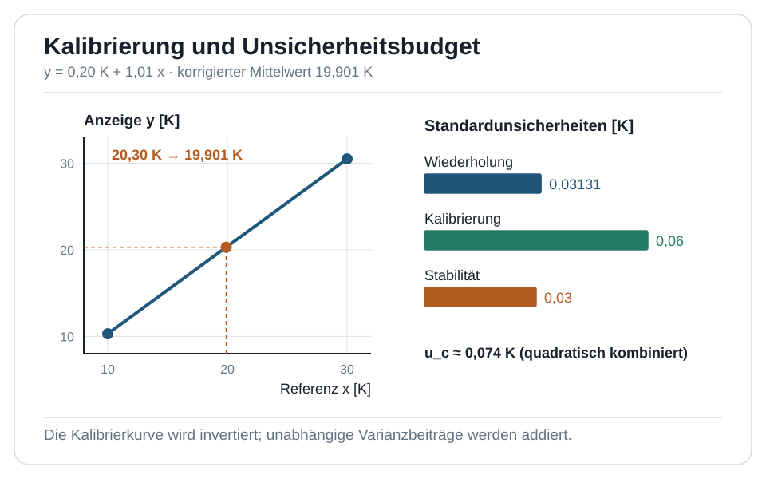

# M6-L2 – Kalibrierung, Fehler und Messunsicherheit {#L2}

**Kursbereich:** M6 – Bachelor: Messung und Einstieg in die Regelung

**Niveau:** Bachelor

**Vorwissen:** [Messketten und Auflösung](M6-L1.md) und [statistische Modellierung](M2-L6.md).

**Lernziel:** Aus zwei Referenzpunkten eine lineare Kalibrierbeziehung bestimmen, eine Messreihe korrigieren und unabhängige Unsicherheitsbeiträge zu einer Standardunsicherheit zusammenführen.

## Kalibrierung und Streuung {#S1}

Ein Temperatursensor zeigt bei wiederholter Messung ähnliche Werte. Ob diese Werte die Temperatur gut schätzen, zeigt ein Vergleich unter festgelegten Bedingungen mit einer Referenz. Eine **Kalibrierung** stellt die Beziehung zwischen den Referenzwerten und den zugehörigen Anzeigen fest, jeweils mitsamt Unsicherheitsangaben. Die Korrektur benutzt diese Beziehung anschließend zur Schätzung der Messgröße. Eine Änderung der Geräteeinstellung wäre eine Justierung.

Eine systematische Abweichung kann bei gleichbleibenden Bedingungen in ähnlicher Weise wiederkehren. Eine zufällige Abweichung verändert sich zwischen Wiederholungen. Der Mittelwert wiederholter Beobachtungen kann einen Teil der zufälligen Streuung verringern. Eine gemeinsame Verschiebung aller Anzeigen bleibt im Mittelwert erhalten.

## Eine Kalibrierfunktion invertieren {#S2}

Die Beispielwerte bezeichnen Temperaturabweichungen in Kelvin. Der Referenzwert sei $x$, die Anzeige $y$. Im Arbeitsbereich verwenden wir das Modell $y=a+bx$. Zwei Referenzpaare liefern

| Referenz $x$ in K | Anzeige $y$ in K |
| ---: | ---: |
| 10,00 | 10,30 |
| 30,00 | 30,50 |

Daraus folgen $b=(30{,}50-10{,}30)/(30{,}00-10{,}00)=1{,}01$ und $a=0{,}20\,\mathrm K$. Die korrigierte Schätzung für eine neue Anzeige ist $\hat x=(y-a)/b$.

Fünf Wiederholungen lauten $20{,}2$, $20{,}3$, $20{,}4$, $20{,}3$ und $20{,}3\,\mathrm K$. Der Mittelwert ist $\bar y=20{,}30\,\mathrm K$, also $\hat x\approx19{,}901\,\mathrm K$. Die Korrektur liegt zwischen den Referenzpunkten. Eine dritte Referenzmessung im selben Bereich wäre hilfreich, um die angenommene Linearität zu prüfen. Die beiden Stützpunkte selbst legen eine Gerade bereits eindeutig fest.

## Unsicherheitsbudget für den Mittelwert {#S3}

Für $n$ unabhängige Wiederholungen unter stabilen Bedingungen verwenden wir die Stichprobenstandardabweichung $s_y$ und die zugehörige Standardunsicherheit des Mittelwerts:

$$
s_y=\sqrt{\frac{\sum_{i=1}^{n}(y_i-\bar y)^2}{n-1}},\qquad
u(\bar y)=\frac{s_y}{\sqrt n}.
$$

In der Messreihe ist die Summe der quadrierten Abweichungen $0{,}02\,\mathrm{K^2}$ und $s_y\approx0{,}07071\,\mathrm K$. Der Beitrag der Wiederholung zur korrigierten Temperatur ist $u(\bar y)/|b|\approx0{,}03131\,\mathrm K$. Für den Lehrfall seien aus einer getrennten Kalibriercharakterisierung weitere Standardunsicherheiten von $0{,}060\,\mathrm K$ für den übertragenen Referenz- und Kalibriereinfluss und $0{,}030\,\mathrm K$ für einen unabhängigen Stabilitätseinfluss gegeben. Beide sind bereits in der Skala der korrigierten Temperatur ausgedrückt. Jede Wirkung erscheint einmal im Budget.

| Einfluss | Standardunsicherheit in K |
| --- | ---: |
| Wiederholung des Mittelwerts, korrigierte Skala | 0,03131 |
| Referenz und Kalibrierung im Lehrmodell | 0,060 |
| Separater Stabilitätseinfluss | 0,030 |

Für unabhängige Beiträge addieren sich die Varianzen. Damit erhältst du $u_c=\sqrt{0{,}03131^2+0{,}060^2+0{,}030^2}\,\mathrm K\approx0{,}074\,\mathrm K$. Als Ergebnis kannst du $\hat x=19{,}901\,\mathrm K$ mit kombinierter Standardunsicherheit $0{,}074\,\mathrm K$ angeben. Eine Überdeckungswahrscheinlichkeit lässt sich aus dieser Angabe allein nicht ableiten. Die Typ-A- bzw. Typ-B-Einstufung beschreibt die Art der Ermittlung eines Beitrags, etwa statistische Wiederholungsdaten oder eine Referenzangabe.

{alt="Kalibriergerade aus zwei Referenzpaaren mit eingezeichneter Inversion des Mittelwerts und Balken für die drei Standardunsicherheitsbeiträge."}

Die orangefarbenen Hilfslinien zeigen, wie aus der Anzeige der korrigierte Referenzwert geschätzt wird. Die drei Balken haben eine gemeinsame Skala und zeigen Standardunsicherheiten, nicht Varianzen. Ihre Längen werden deshalb nicht linear addiert.

## Übungen und Lösungen {#S4}

1. Wie lautet die korrigierte Schätzung für eine Anzeige von $25{,}45\,\mathrm K$?
2. Was geschieht mit dem Wiederholungsbeitrag und dem Kalibrierbeitrag, wenn statt fünf insgesamt 20 unabhängige Wiederholungen mit gleicher Streuung vorliegen?

**Lösung 1.** $(25{,}45-0{,}20)/1{,}01=25{,}00\,\mathrm K$.

**Lösung 2.** Der Wiederholungsbeitrag halbiert sich, weil im Nenner $\sqrt n$ steht. Der für alle Wiederholungen gemeinsame Kalibriereinfluss bleibt bestehen. Unter denselben übrigen Annahmen sinkt $u_c$ auf rund $0{,}069\,\mathrm K$.

## Modellgrenzen und Weiterlernen {#S5}

Im praktischen Unsicherheitsbudget können Parameter wie Nullpunkt und Steigung korreliert sein. Dann gehören ihre Kovarianzen in die Rechnung. Temperaturdrift über die Messreihe kann zudem die Unabhängigkeitsannahme verletzen. Das statische Modell beschreibt die Beziehung nach dem Einschwingen. [M6-L3](M6-L3.md) ergänzt die zeitliche Reaktion.

## Quellen {#S6}

- [BIPM/JCGM 200:2012, International Vocabulary of Metrology](https://www.bipm.org/en/doi/10.59161/jcgm200-2012) · Begriffe 2.16–2.19, 2.26 und 2.39. · Zuletzt abgerufen: 2026-11-25
- [BIPM/JCGM 100:2008, Guide to the Expression of Uncertainty in Measurement](https://www.bipm.org/en/doi/10.59161/jcgm100-2008e) · Abschnitte 4 und 5, Ermittlung und Kombination der Standardunsicherheiten. · Zuletzt abgerufen: 2026-11-25
