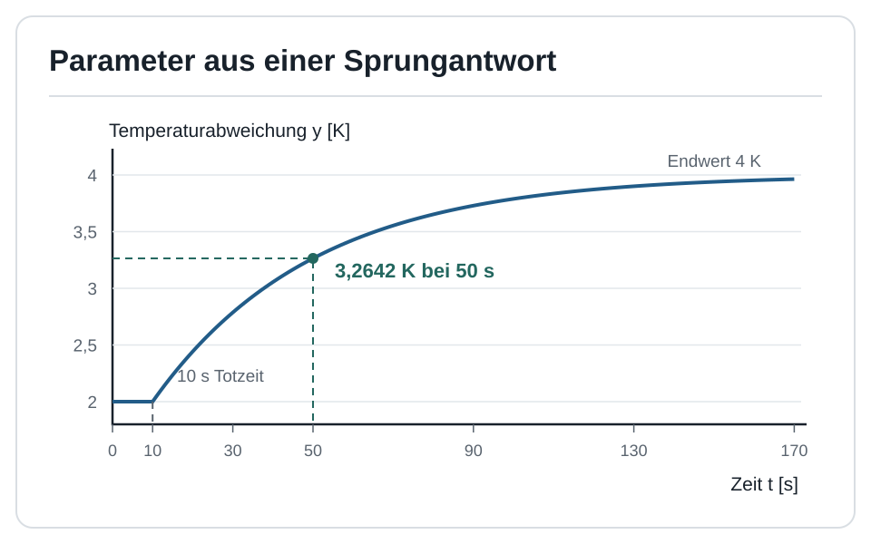

# M6-L3 – Modelle und Identifikation aus einer Sprungantwort {#L3}

**Kursbereich:** M6 – Bachelor: Messung und Einstieg in die Regelung

**Niveau:** Bachelor

**Vorwissen:** [Differentialgleichungen für Modelle](M2-L3.md), [Sprungantwort der Schaltung](M1-L5.md) und [Kalibrierung](M6-L2.md).

**Lernziel:** Aus einer idealisierten Sprungantwort die statische Verstärkung, die Zeitkonstante und eine gegebenenfalls erkennbare Totzeit bestimmen und deren Einfluss auseinanderhalten.

## Warum die Strecke Zeit braucht {#S1}

Der Eingang eines Modells kann sich sprunghaft ändern, während der Ausgang verzögert folgt. Eine träge Strecke glättet rasche Eingangsänderungen. Eine Totzeit verschiebt die Antwort zusätzlich, zum Beispiel aufgrund eines Transports oder der zeitlichen Zuordnung von Messdaten. Als Einstieg betrachten wir eine lineare Strecke erster Ordnung mit Verzögerung. Der Versuch beginnt im eingeschwungenen Zustand.

Mit der Stellgrößenänderung $\Delta u$, dem Anfangswert $y_0$, der Prozessverstärkung $K$, der Zeitkonstante $\tau>0$ und der Verzögerung $L\ge0$ lautet die ideale Antwort auf einen Eingangssprung bei $t=0$

$$
y(t)=
\begin{cases}
y_0,&0\le t<L,\\
y_0+K\Delta u\bigl(1-\exp(-(t-L)/\tau)\bigr),&t\ge L.
\end{cases}
$$

Der Endwert ist $y_\infty=y_0+K\Delta u$. $K$ trägt die Einheit der Ausgangsgröße geteilt durch die Einheit der Eingangsgröße. $\tau$ und $L$ werden in Zeiteinheiten angegeben.

{alt="Simulierte Kurve mit 10 Sekunden Totzeit. Bei 50 Sekunden erreicht die Temperatur knapp 3,26 Kelvin und damit 63,2 Prozent der Änderung von 2 auf 4 Kelvin."}

## Parameter aus den Daten lesen {#S2}

1. Ermittle den Anfangswert und einen stabilen Endwert aus den Zeitabschnitten vor und lange nach dem Sprung. Die Schätzung lautet $K=(y_\infty-y_0)/\Delta u$.
2. Schätze $L$ aus dem zeitlichen Abstand zwischen Eingangsänderung und dem Beginn der sichtbaren Ausgangsänderung. In verrauschten Daten braucht dieser Schritt eine begründete Regel.
3. Bestimme den Zielwert $y_{63}=y_0+(1-\exp(-1))(y_\infty-y_0)$. Den zugehörigen Kreuzungszeitpunkt $t_{63}$ erhältst du aus den Messpunkten oder einer geeigneten Interpolation. Dann ist $\tau=t_{63}-L$.

Die Angabe von $63{,}2\,\%$ bezieht sich auf die **Änderung**. Sie gilt auch bei einem fallenden Ausgang, indem $y_\infty-y_0$ sein negatives Vorzeichen behält. Die Beziehung folgt aus $t=L+\tau$, denn dann ist der exponentielle Rest $\exp(-1)$.

## Auswertung eines simulierten Stellgrößensprungs {#S3}

Eine dimensionslose Stellgröße springt bei $t=0$ von $0{,}25$ auf $0{,}50$. Der zuvor stabile Ausgang liegt bei $2{,}00\,\mathrm K$, das simulierte Langzeitplateau bei $4{,}00\,\mathrm K$. An einer dicht abgetasteten Kurve ist eine Verzögerung von $10\,\mathrm s$ erkennbar. Einige Stützwerte der Simulation sind:

| Zeit in s | Temperaturabweichung in K |
| ---: | ---: |
| 0 | 2,0000 |
| 10 | 2,0000 |
| 30 | 2,7869 |
| 50 | 3,2642 |
| 90 | 3,7293 |
| 170 | 3,9634 |

Aus $\Delta u=0{,}25$ und der Ausgangsänderung $2\,\mathrm K$ folgt $K=8\,\mathrm K$ je Stellwerteinheit. Der Zielwert $y_{63}$ beträgt rund $3{,}2642\,\mathrm K$. Die Kurve erreicht ihn bei $50\,\mathrm s$, somit $\tau=40\,\mathrm s$. Prüfe die Schätzung an einem zweiten Zeitpunkt. Bei $90\,\mathrm s$ sind seit Beginn der Ausgangsantwort zwei Zeitkonstanten vergangen. Das Modell liefert $2+2(1-\exp(-2))\approx3{,}7293\,\mathrm K$.

## Übungen und Lösungen {#S4}

1. Berechne für dasselbe Modell den Zeitpunkt, zu dem der Ausgang $3{,}00\,\mathrm K$ erreicht.
2. Eine andere Strecke liefert ausgehend von $10\,\mathrm K$ nach einem Eingangssprung von $-0{,}20$ einen Endwert von $9\,\mathrm K$. Die Antwort beginnt nach $5\,\mathrm s$ und erreicht $9{,}3679\,\mathrm K$ bei $25\,\mathrm s$. Welche Parameter schätzt du?

**Lösung 1.** Der verbleibende Anteil des anfänglichen Abstands ist $1/2$. Daher $t=10\,\mathrm s+40\,\mathrm s\ln 2\approx37{,}7\,\mathrm s$.

**Lösung 2.** Der Quotient aus $-1\,\mathrm K$ und $-0{,}20$ ergibt $K=5\,\mathrm K$ je Stellwerteinheit. Die Totzeit beträgt $5\,\mathrm s$ und die Zeitkonstante $25\,\mathrm s-5\,\mathrm s=20\,\mathrm s$.

## Modellgrenzen und Weiterlernen {#S5}

Ein unbekannter Endwert und eine nur grob aufgelöste Totzeit machen die grafische Schätzung empfindlich. Eine langsam beginnende Antwort höherer Ordnung kann wie eine Totzeit erscheinen. Prüfe daher das angepasste Modell an weiteren Datenpunkten oder einem zweiten Stellgrößensprung. [M6-L4](M6-L4.md) verbindet Messwert und Stellgröße zu einer Rückkopplung.

## Quellen {#S6}

- [APMonitor – First Order Plus Dead Time](https://apmonitor.com/pdc/index.php/Main/FirstOrderSystems) · FOPDT-Modellgleichung und Parameter: Prozessverstärkung, Zeitkonstante und Totzeit; eigene Lehrbeispiele. · Zuletzt abgerufen: 2026-11-25
- [University of Michigan – Control Tutorials, Introduction: System Analysis](https://ctms.engin.umich.edu/CTMS/index.php?example=Introduction&section=ControlPID&section=SystemAnalysis) · First-order systems: Zeitkonstante, Pol und Sprungantwort; Vergleich mit dem Lehrmodell. · Zuletzt abgerufen: 2026-11-25
