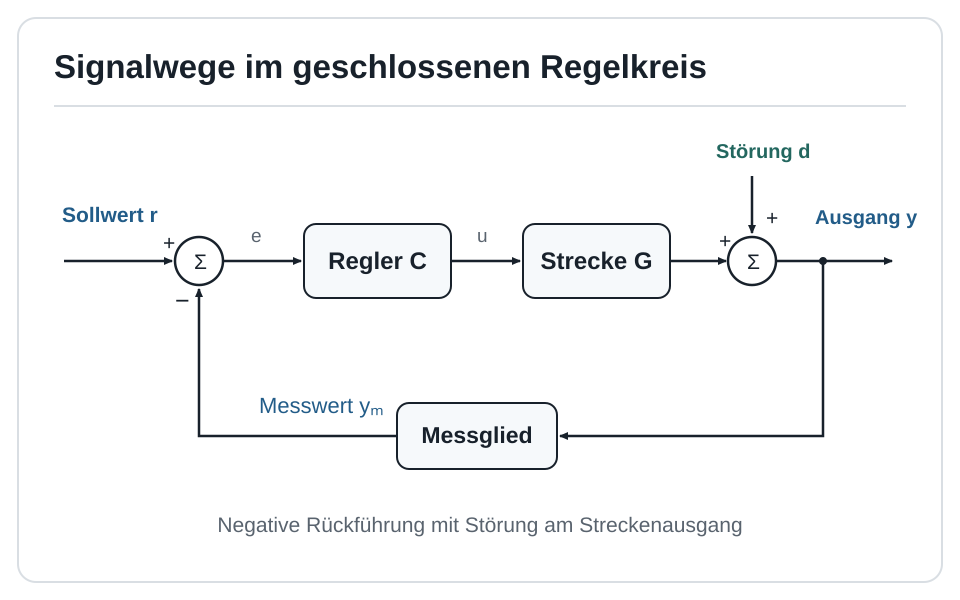

# M6-L4 – Offene und geschlossene Regelkreise {#L4}

**Kursbereich:** M6 – Bachelor: Messung und Einstieg in die Regelung

**Niveau:** Bachelor

**Vorwissen:** [Signale und Systeme](M5-L1.md), [Laplace-Transformation](M5-L4.md) und [Streckenmodell aus der Sprungantwort](M6-L3.md).

**Lernziel:** Führungsgröße, Regelabweichung, Stellgröße, Störung und Messwert in einem Blockbild zuordnen und die Wirkung einer einfachen negativen Rückkopplung berechnen.

## Steuerung und Regelung am selben Prozess {#S1}

Eine modellierte Heizstrecke soll eine gleichbleibende Temperaturabweichung erreichen. Bei einer **Steuerung** legt eine Vorgabe die Stellgröße fest. Bei einer **Regelung** wirkt die gemessene Ausgangsgröße auf die Stellgröße zurück. Wenn die Temperatur unter die Vorgabe fällt, erhöht eine passende negative Rückkopplung die Stellgröße.

Das Modell unterscheidet fünf Größen. Die Führungsgröße $r$ bestimmt den gewünschten Wert. Der Ausgang $y$ ist die zu regelnde Temperaturabweichung. Das Messglied liefert $y_m$, das im einfachsten Modell gleich $y$ ist. Die Abweichung $e=r-y_m$ geht an den Regler. Dessen Stellgröße $u$ wirkt auf die Strecke. Eine Störgröße $d$ beschreibt einen weiteren Einfluss, etwa einen Lastwechsel. Für jede Rechnung ist der Angriffspunkt der Störung wichtig.

{alt="Regelkreis mit negativem Messrückweg. Der Sollwert und der zurückgeführte Messwert werden verglichen, der Regler setzt die Abweichung in eine Stellgröße um und eine Störung wird am Ausgang addiert."}

## Rückführung in Gleichungen übersetzen {#S2}

Wir verwenden lineare Übertragungsglieder für Regler $C(s)$ und Strecke $G(s)$ bei verschwindenden Anfangsbedingungen. Die Störung $D(s)$ werde am Ausgang der Strecke addiert. Der Messwert entspricht in diesem Modell dem gestörten Ausgang. Großbuchstaben bezeichnen Laplace-Transformierte.

$$
U=C(R-Y),\qquad Y=GU+D.
$$

Einsetzen und Zusammenfassen ergibt

$$
Y=\frac{GC}{1+GC}R+\frac{1}{1+GC}D.
$$

Der erste Faktor beschreibt den Führungsweg, der zweite den Störweg. Die Schleifenverstärkung $GC$ bestimmt, bei welchen Frequenzen diese Faktoren groß oder klein sind. Bei einer additiven Eingangs­störung an der Strecke lautet der Störweg dagegen $G/(1+GC)$. Die Stelle im Blockbild entscheidet also über den Zähler. Die algebraische Formel liefert auch die charakteristische Bedingung für die Dynamik. Ob die Rückkopplung stabil arbeitet, wird in [M6-L5](M6-L5.md) geprüft.

## Beispiel mit Laständerung {#S3}

Für den statischen Vergleich sei $y=Ku+d$ mit $K=2\,\mathrm K$ je dimensionsloser Stellwerteinheit und $r=2\,\mathrm K$. Die Vorsteuerung setzt $u_0=r/K=1$. Ohne Rückführung bleibt $u=u_0$. Tritt $d=-0{,}4\,\mathrm K$ auf, sinkt der Ausgang dadurch auf $1{,}6\,\mathrm K$.

Ergänze eine proportionale Rückführung $u=u_0+k_p(r-y)$ mit $k_p=0{,}5\,\mathrm K^{-1}$. Dann gilt

$$
y=r+\frac{d}{1+Kk_p}=2\,\mathrm K-\frac{0{,}4\,\mathrm K}{2}=1{,}8\,\mathrm K.
$$

Der statische Störeffekt halbiert sich. Die Regelabweichung von $0{,}2\,\mathrm K$ erzeugt die zusätzliche Stellgröße $0{,}1$. Mit $u=1{,}1$ ergibt die Strecke erneut $2\cdot1{,}1\,\mathrm K-0{,}4\,\mathrm K=1{,}8\,\mathrm K$. Die dimensionslose Stellgröße ist in dieser algebraischen Aufgabe unbeschränkt.

## Übungen und Lösungen {#S4}

1. Welche Temperaturabweichung ergibt das Modell mit $k_p=1\,\mathrm K^{-1}$ bei derselben Störung?
2. Der Sensor addiert zu $y$ einen Fehler $n$. Leite bei sonst gleichen Voraussetzungen den Übertragungsfaktor von $N$ zum tatsächlichen Ausgang $Y$ her.

**Lösung 1.** Die Schleifenverstärkung bei Gleichgrößen ist $Kk_p=2$. Daher $y=2\,\mathrm K-0{,}4\,\mathrm K/3\approx1{,}867\,\mathrm K$. Die Restabweichung beträgt rund $0{,}133\,\mathrm K$.

**Lösung 2.** Aus $Y=GC(R-Y-N)+D$ folgt der Faktor $-GC/(1+GC)$. Ein positiver Messversatz kann den wirklichen Ausgang absenken, da der Regler den Messwert als zu hoch interpretiert.

## Grenzen und Weiterlernen {#S5}

Das statische Beispiel blendet Speicher, Totzeiten und Stellgrenzen aus. Für zeitabhängige Strecken kann eine größere Verstärkung das Störverhalten verbessern und zugleich die Stabilitätsreserve mindern. Messfehler und Ausgangsstörungen wirken über verschiedene Wege. In [M6-L5](M6-L5.md) vergleichst du die Dynamik von P-, PI- und PID-Reglern.

## Quellen {#S6}

- [MIT OpenCourseWare, 16.30 Feedback Control Systems, Vorlesung 24 – Closed-Loop System Analysis](https://ocw.mit.edu/courses/16-30-feedback-control-systems-fall-2010/resources/mit16_30f10_lec24/) · Rückkopplung und Analyse geschlossener Systeme. · Zuletzt abgerufen: 2026-11-25
- [Åström/Murray – Feedback Systems v2.10d, Chapter 10 PID Control](https://www.cds.caltech.edu/~murray/books/AM05/pdf/am08-pid_19Jul11.pdf) · § 10.1, S. 294–297 und § 10.5, S. 308: P-, I-, D-Wirkung und gefilterte Ableitung. · Zuletzt abgerufen: 2026-11-25
