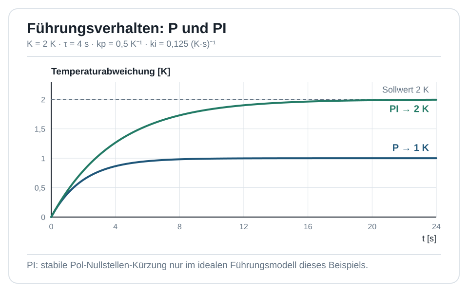

# M6-L5 – Stabilität und Reglereinstieg {#L5}

**Kursbereich:** M6 – Bachelor: Messung und Einstieg in die Regelung

**Niveau:** Bachelor

**Vorwissen:** [Laplace-Transformation und Pole](M5-L4.md), [Strecke erster Ordnung](M6-L3.md) und [negative Rückkopplung](M6-L4.md).

**Lernziel:** Die Pole eines einfachen kontinuierlichen Regelkreises bestimmen und bleibende Regelabweichung, Einschwingen und Rauschempfindlichkeit von P-, PI- und PID-Reglern vergleichen.

## Pole und Reglertypen {#S1}

Eine Strecke mit Verzögerung erster Ordnung sei $G(s)=K/(\tau s+1)$ mit $K>0$ und $\tau>0$. Wir betrachten kontinuierliche lineare Modelle mit negativer Einheitsrückführung. Ein Pol $p$ mit negativem Realteil erzeugt einen abklingenden Anteil $\exp(pt)$. Für asymptotische interne Stabilität müssen alle dynamisch relevanten Eigenwerte in der offenen linken Halbebene liegen. Eine gekürzte Übertragungsfunktion kann einen internen Modus verbergen, deshalb betrachten wir vor einer Kürzung das charakteristische Polynom.

In der parallelen Schreibweise besitzt ein PID-Regler die Form

$$
C(s)=k_p+\frac{k_i}{s}+k_d s.
$$

Der P-Anteil reagiert auf die aktuelle Abweichung. Der I-Anteil akkumuliert die Abweichung. Der D-Anteil berücksichtigt ihre Änderungsrate. Für ein festes Regelziel verschwindet der D-Beitrag bei konstanter Abweichung. Bei einer Stellgröße ohne Einheit und einem Temperaturfehler in Kelvin haben $k_p$, $k_i$ und $k_d$ die Einheiten $\mathrm K^{-1}$, $(\mathrm{K\,s})^{-1}$ und $\mathrm{s\,K^{-1}}$.

## P und PI an derselben Strecke {#S2}

Mit $C=k_p$ lautet die Führungsübertragung

$$
\frac{Y}{R}=\frac{Kk_p}{\tau s+1+Kk_p}.
$$

Der Pol liegt bei $p=-(1+Kk_p)/\tau$. Für eine stabile Schleife und einen konstanten Sollwert $r_0$ verbleibt die Abweichung $r_0/(1+Kk_p)$. Nun ergänzt ein PI-Regler $k_i/s$. Der ungekürzte Nenner der Führungsübertragung ist

$$
\tau s^2+(1+Kk_p)s+Kk_i .
$$

Für die reellen Koeffizienten zweiter Ordnung genügen hier positive Koeffizienten zur Stabilität. Bei positiver Stabilitätsreserve, erreichbarem Sollwert und unbeschränktem idealem Integrator muss im stationären Fall $e=0$ gelten: Eine dauerhaft von null verschiedene Abweichung würde die Integratorstellgröße weiter verändern. Dieses Argument setzt voraus, dass der betrachtete Zustand tatsächlich stationär geworden ist.

## Zahlenbeispiel mit gleichem P-Anteil {#S3}

Setze $K=2\,\mathrm K$ je Stellwerteinheit, $\tau=4\,\mathrm s$ und $k_p=0{,}5\,\mathrm K^{-1}$. Beim P-Regler liegt der Pol bei $-0{,}5\,\mathrm{s^{-1}}$. Ein Sollwertsprung von $2\,\mathrm K$ führt zu einer stationären Temperaturabweichung von $1\,\mathrm K$ und einem bleibenden Fehler von $1\,\mathrm K$.

Beim PI-Regler wählen wir $k_i=0{,}125\,(\mathrm{K\,s})^{-1}$. Die Zahlenkoeffizienten des Nenners lauten $4s^2+2s+0{,}25$, wenn $s$ in $\mathrm{s^{-1}}$ eingesetzt wird. Daraus folgt der doppelte Pol bei $-0{,}25\,\mathrm{s^{-1}}$. Der stationäre Ausgang entspricht dem Sollwert. Diese Wahl führt im idealen Führungsweg zu einer Pole-Nullstellen-Kürzung bei $-0{,}25\,\mathrm{s^{-1}}$. Beide ungekürzten Pole sind bereits stabil.

Ergänzt man den idealen D-Anteil $k_d=0{,}25\,\mathrm{s\,K^{-1}}$, ändert sich der führende Koeffizient zu $\tau+Kk_d=4{,}5\,\mathrm s$. Aus $4{,}5s^2+2s+0{,}25$ ergeben sich $p\approx(-0{,}2222\pm\mathrm j\,0{,}0786)\,\mathrm{s^{-1}}$. Die Pole bleiben stabil. Aus dieser Veränderung folgt keine allgemeine Verbesserung für andere Strecken.

{alt="Analytische Führungsantworten auf einen Sollwertsprung von zwei Kelvin: P nähert sich einem Kelvin, PI zwei Kelvin."}

Im idealen P-Modell gilt für den Sollwertsprung die Antwort $x(t)=1\,\mathrm K\,(1-\mathrm e^{-t/(2\,\mathrm s)})$. Beim hier gewählten PI-Regler ergibt die stabile Kürzung im Führungsweg $x(t)=2\,\mathrm K\,(1-\mathrm e^{-t/(4\,\mathrm s)})$. Die Grafik setzt Anfangswert null voraus und enthält keine Stellgrenzen.

## Übungen und Lösungen {#S4}

1. Welche P-Verstärkung liefert für dieselbe Strecke einen Pol bei $-1\,\mathrm{s^{-1}}$? Wie groß ist dann die bleibende Abweichung für $r_0=2\,\mathrm K$?
2. Woran erkennst du an einem idealen P- oder PI-Modell, ob der Ausgang einen konstanten Sollwert im stabilen Fall ohne bleibenden Fehler erreicht?

**Lösung 1.** $-(1+2k_p)/4=-1$ ergibt $k_p=1{,}5\,\mathrm K^{-1}$. Der Fehler ist $2\,\mathrm K/(1+2\cdot1{,}5)=0{,}5\,\mathrm K$.

**Lösung 2.** Die Führungsübertragung bei $s=0$ muss eins betragen. P ergibt für endliches $k_p$ den Faktor $Kk_p/(1+Kk_p)$. PI mit $k_i>0$ hat im beschriebenen Modell den Faktor eins, denn Zähler und Nenner besitzen denselben Gleichanteil $Kk_i$.

## Grenzen und Weiterlernen {#S5}

Ideale Differentiation verstärkt schnelle Störanteile. Reale Entwürfe verwenden häufig einen gefilterten D-Anteil und leiten den Messwert ab, um auf einen Sollwertsprung keine ideale Impulsanforderung zu erzeugen. Stellgrenzen können einen Integrator aufladen und danach das Einschwingen verschlechtern. [M6-L6](M6-L6.md) prüft P und PI mit einer modellierten Stellgrenze und einer Laststörung.

## Quellen {#S6}

- [Åström/Murray – Feedback Systems v2.10d, Chapter 10 PID Control](https://www.cds.caltech.edu/~murray/books/AM05/pdf/am08-pid_19Jul11.pdf) · § 10.1, S. 294–297 und § 10.5, S. 308: P-, I-, D-Wirkung und gefilterte Ableitung. · Zuletzt abgerufen: 2026-11-25
- [MIT OpenCourseWare, 16.30 Feedback Control Systems – Lecture Notes](https://ocw.mit.edu/courses/16-30-feedback-control-systems-fall-2010/pages/lecture-notes/) · Vorlesungen 2, 23 und 24 zu Polen, Integratorbegrenzung und geschlossenen Schleifen. · Zuletzt abgerufen: 2026-11-25
