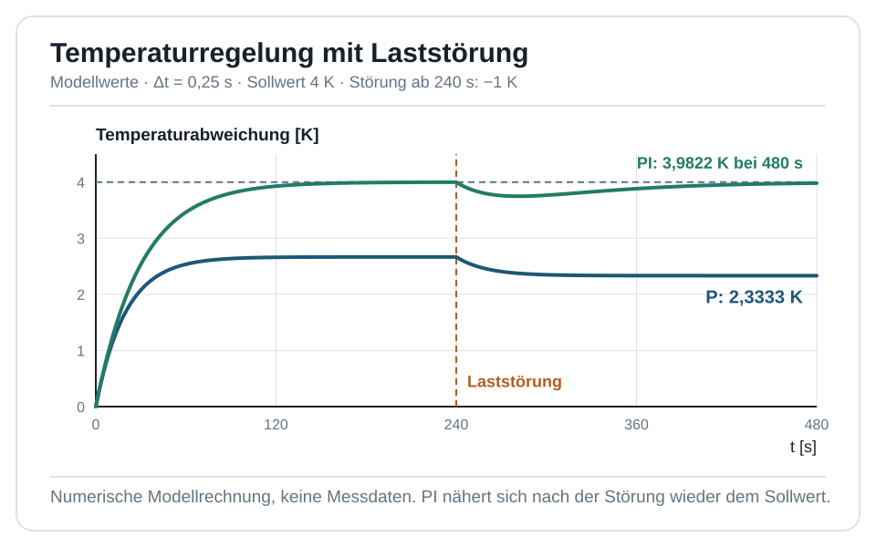

# M6-L6 – Fallstudie einer Temperaturregelung {#L6}

**Kursbereich:** M6 – Bachelor: Messung und Einstieg in die Regelung

**Niveau:** Bachelor

**Vorwissen:** [Streckenmodell](M6-L3.md), [Rückkopplung](M6-L4.md) und [P- und PI-Regler](M6-L5.md).

**Lernziel:** Eine simulierte Temperaturregelung reproduzieren, Führungs- und Störantwort mit definierten Kennzahlen vergleichen und den Gültigkeitsbereich der Ergebnisse dokumentieren.

## Ein prüfbares Temperaturmodell {#S1}

Der Zustand $x$ ist die Temperaturabweichung gegenüber einer als konstant angenommenen Umgebung. Für die dimensionslose Stellgröße $u$ und eine Störung $d$ in Kelvin setzen wir

$$
60\,\mathrm s\,\dot x+x=(10\,\mathrm K)u+d,\qquad 0\le u\le1.
$$

Bei $t=0$ startet $x$ bei $0\,\mathrm K$, der neue Sollwert $r$ ist $4\,\mathrm K$. Bei $t=240\,\mathrm s$ wird $d$ von $0$ auf $-1\,\mathrm K$ gesetzt. Der modellierte Sensor liefert $x$ direkt. Beide Varianten verwenden $k_p=0{,}20\,\mathrm K^{-1}$. Der PI-Regler ergänzt $k_i=k_p/(60\,\mathrm s)$. Seine Integratorstellgröße $z$ startet bei null. Die freie Stellgröße ist $u_\mathrm{roh}=k_p(r-x)+z$ und wird auf den Bereich von null bis eins begrenzt.

## Simulation mit Standard-Python {#S2}

Das Skript aktualisiert Zustand und Integrator im expliziten Euler-Schritt. Beide Rechnungen verwenden den Fehler vom Schrittanfang. Falls die Stellgröße eine Grenze erreicht, darf der Integrator nur weiterlaufen, wenn sein Beitrag in Richtung des nutzbaren Bereichs wirkt.

```python
def simulate(ki, dt=0.25):
    x = z = 0.0
    rows = []
    for k in range(round(480 / dt) + 1):
        t = k * dt
        d = 0.0 if t < 240 else -1.0
        e = 4.0 - x
        raw = 0.20 * e + z
        u = min(1.0, max(0.0, raw))
        rows.append((t, x, u))
        x += dt * (10.0 * u + d - x) / 60.0
        within = 0.0 < raw < 1.0
        returns = (raw <= 0.0 and e > 0.0) or (raw >= 1.0 and e < 0.0)
        if within or returns:
            z += dt * ki * e
    return rows

for name, ki, plateau in (("P", 0.0, 8.0 / 3), ("PI", 0.20 / 60, 4.0)):
    rows = simulate(ki)
    rise = [next(t for t, x, _ in rows if t < 240 and x >= f * plateau)
            for f in (0.10, 0.90)]
    pre = [x for t, x, _ in rows if t < 240]
    print(name, "Anstieg", round(rise[1] - rise[0], 2), "s")
    print("Ueberschwingen", max(0.0, max(pre) - plateau), "K")
    for t, x, _ in rows:
        if t in (240.0, 280.0, 480.0):
            print(f"t={t:.0f} s: x={x:.4f} K")
```

## Kennzahlen und Plausibilitätsprüfung {#S3}

Die Anstiegszeit misst hier den Zeitraum zwischen $10\,\%$ und $90\,\%$ des letzten stationären Werts ohne Störung für den jeweiligen Regler. Ein P-Regler kann bei dieser Definition schnell sein und trotzdem das eigentliche Soll verfehlen. Das Überschwingen bezieht sich auf denselben stationären Vergleichswert im Zeitfenster vor der Störung.

| Größe | P | PI |
| --- | ---: | ---: |
| Anstiegszeit in s | 43,75 | 65,75 |
| Überschwingen vor der Störung in K | 0 | 0 |
| $x(240\,\mathrm s)$ in K | 2,6667 | 3,9987 |
| $x(280\,\mathrm s)$ in K | 2,3779 | 3,7491 |
| $x(480\,\mathrm s)$ in K | 2,3333 | 3,9822 |

Die stationäre P-Referenz folgt aus $x=10k_p(4-x)+d$, also $x=(8+d)/3$ bei numerischer Angabe aller Temperaturen in Kelvin. Vor und nach der Störung sind daher $2{,}6667\,\mathrm K$ und $2{,}3333\,\mathrm K$ zu erwarten. Der PI-Regler kann langfristig auf $4\,\mathrm K$ zurückkehren. Die benötigte Stellgröße steigt dabei von $0{,}4$ auf $0{,}5$. Beide Werte liegen im erlaubten Bereich. Bei $480\,\mathrm s$ klingt die Störantwort noch ab. In beiden ausgewerteten Verläufen bleibt die Stellgröße zwischen null und eins, ohne die Grenzen zu erreichen.

{alt="Simulierte Temperaturverläufe für P und PI vom Start bis 480 Sekunden, mit Sollwert vier Kelvin und markierter Laststörung bei 240 Sekunden."}

Die Grafik verwendet die im Skript berechneten Zustandswerte. Der P-Regler behält vor und nach dem Lastsprung einen stationären Fehler. Der PI-Regler nähert sich nach dem Lastsprung erneut dem Sollwert. Die Werte sind numerische Modellergebnisse und keine Messkurven.

## Aufgaben und Lösungsskizzen {#S4}

1. Simuliere mit halber Schrittweite. Wähle als Vergleich die Werte bei $280\,\mathrm s$ und dokumentiere die Differenz.
2. Wann wäre bei dauerhaftem Störwert $d=-1\,\mathrm K$ selbst mit Integralanteil ein vorgegebener Sollwert unerreichbar?

**Lösung 1.** Setze im Aufruf $dt=0{,}125$. Bei $280\,\mathrm s$ liegen die Resultate weiterhin nahe bei $2{,}3779\,\mathrm K$ beziehungsweise $3{,}7491\,\mathrm K$. Die Abweichung durch die halbierte Schrittweite beträgt in beiden Fällen weniger als $0{,}001\,\mathrm K$. Für den Vergleich müssen Eingangszeitpunkte und Ausgangszeitpunkte übereinstimmen.

**Lösung 2.** Mit $u\in[0,1]$ kann stationär nur der Bereich von $-1$ bis $9\,\mathrm K$ erreicht werden. Ein Sollwert oberhalb $9\,\mathrm K$ oder unterhalb $-1\,\mathrm K$ bleibt außerhalb der stationär möglichen Werte.

## Modellgrenzen und Anschluss {#S5}

Diese Fallstudie untersucht ein idealisiertes Modell mit konstanter Umgebung und einer einzigen Zeitkonstante. Verzögerung, Messrauschen, Kalibrierfehler und zusätzliche Wärmespeicher können die Ergebnisse verändern. Für ein Folgeprojekt lässt sich jeweils ein Einfluss gezielt ergänzen und gegen die hier dokumentierte Referenz prüfen. Der [Studienweg](pages/studienweg.md) führt zu den Anschlussmodulen.

## Quellen {#S6}

- [MIT OpenCourseWare, 16.30 Feedback Control Systems – Lecture Notes](https://ocw.mit.edu/courses/16-30-feedback-control-systems-fall-2010/pages/lecture-notes/) · Vorlesungen 23 und 24 zu Integratorbegrenzung und geschlossenen Schleifen. · Zuletzt abgerufen: 2026-11-25
- [Åström/Murray – Feedback Systems v2.10d, Chapter 10 PID Control](https://www.cds.caltech.edu/~murray/books/AM05/pdf/am08-pid_19Jul11.pdf) · § 10.1, S. 294–297 und § 10.5, S. 308: P-, I-, D-Wirkung und gefilterte Ableitung. · Zuletzt abgerufen: 2026-11-25
- [APMonitor – First Order Plus Dead Time](https://apmonitor.com/pdc/index.php/Main/FirstOrderSystems) · FOPDT-Modellgleichung und Parameter: Prozessverstärkung, Zeitkonstante und Totzeit; eigene Lehrbeispiele. · Zuletzt abgerufen: 2026-11-25
