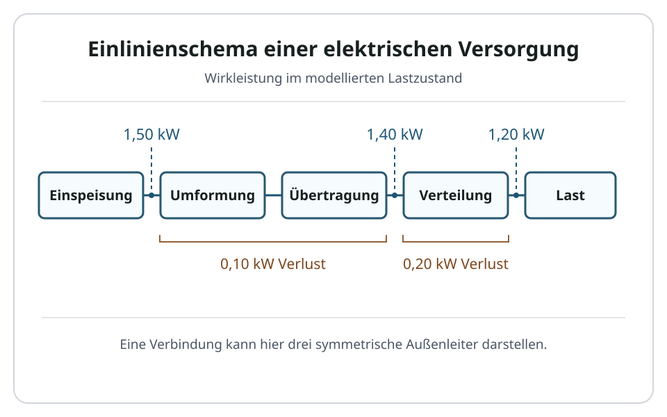

# M7-L1 – Energieversorgung und elektrische Leistungsbilanzen {#L1}

**Kursbereich:** M7 – Bachelor: Elektrische Energietechnik

**Niveau:** Bachelor

**Vorwissen:** [Wechselstromleistung und Frequenzgang](M1-L7.md). Ein Effektivwert und ein komplexer Zeiger sollten vertraut sein.

**Lernziel:** Erzeugung, Übertragung, Verteilung und Last in einem Einlinienschema zuordnen, eine Leistungsbilanz aufstellen und daraus Energieumsatz und Wirkungsgrad bestimmen.

## Leistung auf dem Weg zur Last {#S1}

Eine Energieversorgung verbindet Umwandlung, Transport und Nutzung. Ein Generator oder ein umrichtergekoppeltes System speist elektrische Leistung ein. Ein Transformator koppelt Spannungsebenen. Eine Übertragungsstrecke verbindet größere Versorgungsknoten, die Verteilung führt Leistung zu Lasten. Speicher und lokale Erzeuger können die Richtung des Leistungsflusses zeitweise umkehren. Ob ein Knoten gerade Verbraucher oder Einspeiser ist, ergibt sich aus der Bilanz am Anschluss.

Ein **Einlinienschema** zeigt die elektrische Verbindung und die Hauptbauteile mit jeweils einem Strich pro Verbindung. In einem Drehstromnetz kann der Strich drei Leiter repräsentieren. Die Zeichnung legt fest, welche Elemente unmittelbar verbunden sind. Die Phasenfolge, einzelne Leiterströme und die physische Leitungsführung müssen bei Bedarf separat angegeben werden.

{alt="Einlinienschema einer modellierten Versorgung. Von der Einspeisung führen ein Spannungsschritt, die Übertragungsstrecke und die Verteilung zur Last. An den Übergängen stehen bilanzierbare Leistungsgrößen."}

## Bilanz am Knoten und am Übergang {#S2}

Wirkleistung $P$ in Watt ist die über eine Periode gemittelte Energieübertragung pro Zeit. Für sinusförmige Größen im eingeschwungenen Zustand gilt pro Strang mit Effektivwertzeigern $\underline U$ und $\underline I$

$$
\underline S=\underline U\,\underline I^*=P+jQ,
\qquad
|\underline S|=\sqrt{P^2+Q^2}.
$$

Hier zeigt $\underline I$ in die betrachtete Last hinein. Positive Wirk- und Blindleistung beschreiben in dieser Verbraucherzählweise eine Leistungsaufnahme. Ein induktiver Laststrom eilt der Spannung nach und ergibt $Q>0$. $Q$ wird in var und $|\underline S|$ in VA angegeben. Blindleistung bezeichnet im Sinusmodell den periodischen Energieaustausch. Sie kann den Effektivstrom und damit die Leitungsverluste erhöhen.

Für unsere Energiebilanz zählen die in Flussrichtung angegebenen **Wirkleistungsbeträge**. In einem stationären Abschnitt ohne weitere Einspeisung gilt

$$
P_{\mathrm{ein}}=P_{\mathrm{aus}}+P_{\mathrm{V}},
\qquad
\eta=\frac{P_{\mathrm{aus}}}{P_{\mathrm{ein}}}.
$$

Der Wirkungsgrad ist dimensionslos und setzt $P_{\mathrm{ein}}>0$ voraus. Ändert sich innerhalb der Grenze zusätzlich die gespeicherte Energie, ergänzt $\mathrm{d}W_{\mathrm{ges}}/\mathrm{d}t$ die rechte Seite der momentanen Energiebilanz. Für zeitlich konstante mittlere Wirkleistung gilt $W=P\,\Delta t$. Bei Lastprofilen addiert man die Energiebeiträge der Zeitabschnitte.

## Rechenbeispiel mit drei Bilanzgrenzen {#S3}

In einem Modell liefert eine Quelle konstant $1{,}50\,\mathrm{kW}$ an den elektrischen Netzanschluss. Nach Umformung und Leitung bleiben $1{,}40\,\mathrm{kW}$, und der Nutzer erhält hinter der Verteilung $1{,}20\,\mathrm{kW}$.

| Abschnitt | Eingang | Ausgang | Verluste | Wirkungsgrad |
|---|---:|---:|---:|---:|
| Umformung plus Leitung | $1{,}50\,\mathrm{kW}$ | $1{,}40\,\mathrm{kW}$ | $0{,}10\,\mathrm{kW}$ | $93{,}33\,\%$ |
| Verteilung | $1{,}40\,\mathrm{kW}$ | $1{,}20\,\mathrm{kW}$ | $0{,}20\,\mathrm{kW}$ | $85{,}71\,\%$ |
| Ganze elektrische Strecke | $1{,}50\,\mathrm{kW}$ | $1{,}20\,\mathrm{kW}$ | $0{,}30\,\mathrm{kW}$ | $80{,}00\,\%$ |

Das Produkt der beiden Abschnittswirkungsgrade ist $0{,}80$, weil sich die Zwischenleistung beim Multiplizieren der Quotienten herauskürzt. In vier Stunden erhält der Nutzer $4{,}8\,\mathrm{kWh}$, die Quelle liefert $6{,}0\,\mathrm{kWh}$ und die Strecke setzt $1{,}2\,\mathrm{kWh}$ als Verlustenergie um. Der Wirkungsgrad beginnt am elektrischen Quellenanschluss. Ein Primärenergieaufwand für die Erzeugung gehört zu einer entsprechend größeren Bilanzgrenze.

## Grenzen des Modells {#S4}

Einlinienschema und Wirkleistungsbilanz beantworten verschiedene Fragen. Das Schema zeigt die Verbindung. Die Bilanz bestimmt, wie viel mittlere Energie pro Zeit über die Grenze gelangt. Für Spannungsfall und Stromgrenzen braucht man zusätzlich Spannungen, Impedanzen und Lastverhalten. Bei unsymmetrischem Drehstrom untersucht man die Stränge einzeln. Bei stark verzerrten Verläufen kommen die relevanten Oberschwingungen oder eine Rechnung im Zeitbereich hinzu.

## Übungen mit Lösungen {#S5}

1. Eine Last bezieht zwei Stunden lang $0{,}60\,\mathrm{kW}$ und in der nächsten Stunde $1{,}50\,\mathrm{kW}$. Wie groß sind Energie und mittlere Leistung?  
   **Lösung** $W=2\cdot0{,}60+1\cdot1{,}50=2{,}70\,\mathrm{kWh}$. Die mittlere Leistung über drei Stunden beträgt $0{,}90\,\mathrm{kW}$.
2. Ein Strang hat $P=300\,\mathrm W$ und $Q=400\,\mathrm{var}$. Wie groß sind Scheinleistung, Leistungsfaktor und Strom bei $100\,\mathrm V$?  
   **Lösung** $|\underline S|=500\,\mathrm{VA}$, $P/|\underline S|=0{,}60$ und $I=5\,\mathrm A$. Ein ohmscher Strang bei derselben Spannung und derselben Wirkleistung braucht $3\,\mathrm A$.

**Weiterführend:** [Drehstrom, Stern und Dreieck](M7-L2.md)

## Quellen {#S6}

- [J. L. Kirtley, MIT 6.061, Review of Network Theory](https://ocw.mit.edu/courses/6-061-introduction-to-electric-power-systems-spring-2011/d79822ef5fbdb21b1c44e1b3b8282453_MIT6_061S11_ch1.pdf) · Kapitel 1, S. 1–2: Netzwerktopologie, Knoten und Kirchhoffsche Gesetze; Teilaspekt. · Zuletzt abgerufen: 2026-11-25
- [U.S. Department of Energy, Electric Transmission and Distribution](https://www.energy.gov/sites/default/files/2023-11/FINAL_CESER%20Electricity%20Grid%20Backgrounder_508.pdf) · S. 1, Exhibit 1 und Substations: Struktur von Erzeugung, Übertragung und Verteilung am US-Beispiel. · Zuletzt abgerufen: 2026-11-25
