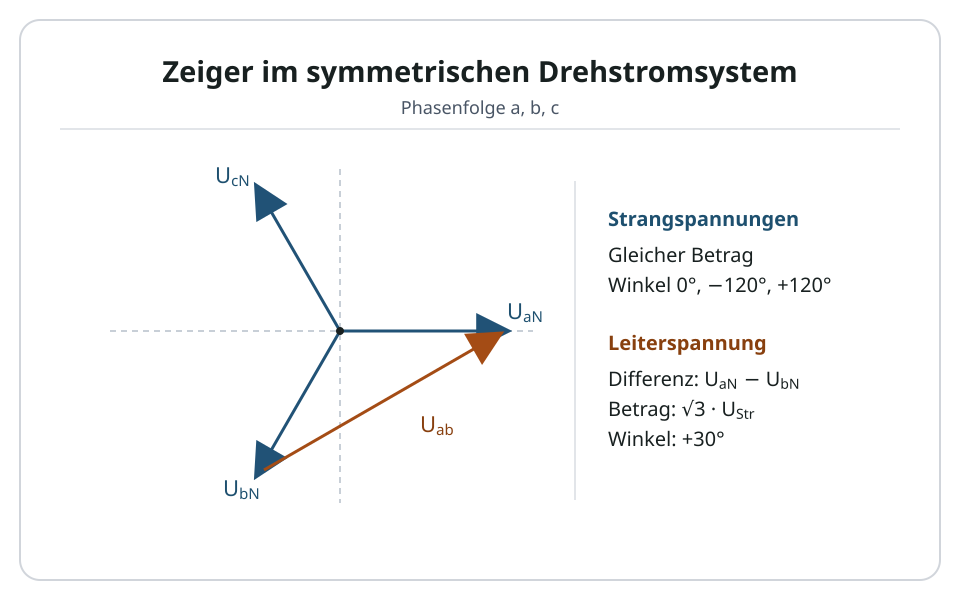

# M7-L2 – Drehstrom, Stern und Dreieck {#L2}

**Kursbereich:** M7 – Bachelor: Elektrische Energietechnik

**Niveau:** Bachelor

**Vorwissen:** [Sinusförmiger Wechselstrom und komplexe Impedanz](M1-L6.md) sowie [Leistungsbilanzen](M7-L1.md).

**Lernziel:** Im symmetrischen Drehstrommodell Strang- und Leitergrößen unterscheiden, die Beziehungen für Stern und Dreieck herleiten und die Gesamtleistung berechnen.

## Drei Stränge mit fester Phasenlage {#S1}

Ein symmetrisches Dreiphasensystem hat drei gleich große Spannungszeiger mit $120^\circ$ Abstand. Für die Reihenfolge $a,b,c$ nutzen wir als Beispiel $\underline U_{aN}=U_\mathrm{Str}\angle 0^\circ$, $\underline U_{bN}=U_\mathrm{Str}\angle -120^\circ$ und $\underline U_{cN}=U_\mathrm{Str}\angle 120^\circ$. Alle Beträge sind Effektivwerte. Die Reihenfolge der Phasen bestimmt etwa die Drehrichtung eines erzeugten Drehfelds. Die Wahl des Winkelnullpunkts verändert keinen Spannungsbetrag.

{alt="Zeigerdiagramm eines symmetrischen Systems mit drei Strangspannungen im Abstand von 120 Grad. Der Pfeil von der Spitze des Zeigers b zur Spitze von a ist die Leiterspannung Uab."}

Im **Stern** liegt je ein Laststrang zwischen einem Außenleiter und dem gemeinsamen Sternpunkt. Die Außenleiterspannung ist eine Differenz. Für $a$ und $b$ erhält man

$$
\underline U_{ab}=\underline U_{aN}-\underline U_{bN}
  =\sqrt{3}\,U_\mathrm{Str}\angle 30^\circ,
\qquad I_\mathrm{L}=I_\mathrm{Str}.
$$

Der Leiterstrom fließt unmittelbar durch den Strang. Bei drei gleichen Impedanzen ergeben die um $120^\circ$ versetzten Ströme in Summe null. Ein vorhandener Neutralleiter führt in diesem ideal symmetrischen Sinusfall keinen Strom. Bei unsymmetrischer Last ergibt sich die Aussage über den Neutralleiterstrom erst aus den einzelnen Strömen.

## Dreieck und Leistungsbeziehung {#S2}

Im **Dreieck** liegt jeder Strang zwischen zwei Außenleitern. Daher ist $U_\mathrm{Str}=U_\mathrm{LL}$. Mit den Strömen im Dreieck in Umlaufrichtung ist beispielsweise $\underline I_a=\underline I_{ab}-\underline I_{ca}$. Weil die beiden Strangströme betragsgleich und um $120^\circ$ versetzt sind, ergibt sich $I_\mathrm L=\sqrt{3}\,I_\mathrm{Str}$. Die Größe $U_\mathrm{LL}$ bezeichnet den Betrag einer Leiterspannung und $I_\mathrm L$ den Betrag eines Außenleiterstroms.

Für drei gleiche Stränge gilt in beiden Schaltungen

$$
\begin{aligned}
P &= 3 U_\mathrm{Str} I_\mathrm{Str}\cos\varphi
   = \sqrt{3}\, U_\mathrm{LL}I_\mathrm L\cos\varphi,\\
Q &= \sqrt{3}\, U_\mathrm{LL}I_\mathrm L\sin\varphi .
\end{aligned}
$$

Der Winkel $\varphi$ ist der Winkel der **Strangspannung zum zugehörigen Strangstrom**, gleich dem Argument der Strangimpedanz bei passiver Zählung. Bei Verwendung von Leitergrößen zur Winkelbestimmung muss man die zusätzliche geometrische Winkelverschiebung herausrechnen.

## Rechenbeispiel mit gleichen Widerständen {#S3}

Ein idealer Drehstromanschluss liefert $U_\mathrm{LL}=120\sqrt{3}\,\mathrm V\approx207{,}85\,\mathrm V$. Drei Ohm’sche Stränge besitzen je $R=24\,\Omega$.

Im Stern entfallen auf jeden Strang $120\,\mathrm V$ und $5\,\mathrm A$. Damit ist $P=3\cdot120\cdot5=1\,800\,\mathrm W$. Im Dreieck misst jeder Strang $120\sqrt3\,\mathrm V$ und führt $5\sqrt3\,\mathrm A$. Jeder Außenleiter führt dann $15\,\mathrm A$ und $P=5\,400\,\mathrm W$. Die dreifache Gesamtleistung ergibt sich aus dem Quadrat der um $\sqrt3$ größeren Strangspannung an denselben Widerständen. Soll das Dreieck am gleichen Anschluss die Leistung des Sterns aufnehmen, müssen seine Widerstände je $72\,\Omega$ betragen.

## Grenzen und Kontrolle {#S4}

Die Beziehungen mit $\sqrt3$ für Beträge setzen hier Symmetrie und sinusförmige Grundschwingung voraus. Bei unsymmetrischen Zweigen bleiben Zeigerdifferenzen und Kirchhoff-Regeln anwendbar. Die Leistung summiert man dann aus den einzelnen komplexen Anschlussleistungen. Wenn der Sternpunkt einer unsymmetrischen Sternlast frei ist, muss sein Potential im Modell mitberechnet werden. Sind mehrere Harmonische vorhanden, können sich besonders Ströme in der dritten Harmonischen und ihren ganzzahligen Vielfachen mit gleicher Phasenlage im Neutralleiter addieren.

## Übungen mit Lösungen {#S5}

1. Eine symmetrische Sternlast hat $\underline Z_\mathrm{Str}=(24+j18)\,\Omega$ an $U_\mathrm{Str}=120\,\mathrm V$. Berechne $I_\mathrm L$, $P$ und $Q$.  
   **Lösung** $|Z|=30\,\Omega$ und $I_\mathrm L=4\,\mathrm A$. $\cos\varphi=0{,}8$ und $\sin\varphi=0{,}6$ ergeben $P=1\,152\,\mathrm W$ und $Q=864\,\mathrm{var}$.
2. Der Sternpunkt derselben Last ist ideal mit dem Quellensternpunkt verbunden. Wie groß ist sein Neutralleiterstrom?  
   **Lösung** $0\,\mathrm A$. Alle Strangströme haben gleichen Effektivwert und paarweise $120^\circ$ Abstand. Die drei Zeiger summieren sich vektoriell zu null.

**Weiterführend:** [Transformator und Spannungsanpassung](M7-L3.md)

## Quellen {#S6}

- [J. L. Kirtley, MIT 6.061, Polyphase Networks](https://ocw.mit.edu/courses/6-061-introduction-to-electric-power-systems-spring-2011/c6393a58319200a5344752de0cf47ec4_MIT6_061S11_ch3.pdf) · Kapitel 3, Three Phase Systems und Line-Line Voltages, gedruckte S. 3–7: 120-Grad-Phasenlage, Wurzel-3-Verhältnis und Stern/Dreieck; S. 1 und 7 visuell geprüft. · Zuletzt abgerufen: 2026-11-25
