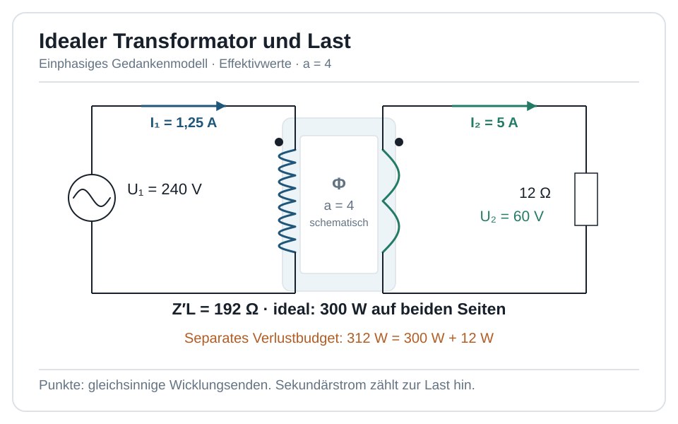

# M7-L3 – Transformator und Spannungsanpassung {#L3}

**Kursbereich:** M7 – Bachelor: Elektrische Energietechnik

**Niveau:** Bachelor

**Vorwissen:** [Drehstrom, Stern und Dreieck](M7-L2.md) sowie [Induktion und elektromagnetische Energie](M4-L4.md).

**Lernziel:** Ein Spannungsübersetzungsverhältnis und eine transformierte Lastimpedanz berechnen, die Stromrichtung eindeutig wählen und ideale Übersetzung von Verlusten und Spannungsfall unterscheiden.

## Zwei Wicklungen mit gekoppeltem Fluss {#S1}

Ein Transformator koppelt zwei Wicklungen magnetisch. Im idealen Modell durchsetzt derselbe zeitabhängige magnetische Fluss $\Phi$ jede Windung beider Wicklungen. Das Induktionsgesetz verknüpft die induzierte Spannung mit der zeitlichen Änderung der Flussverkettung. Bei $N_1$ und $N_2$ Windungen und konsistenter Polarität gilt für sinusförmige Effektivwertzeiger

$$
a=\frac{N_1}{N_2},
\qquad
\frac{\underline U_1}{\underline U_2}=a.
$$

Die Spannungen werden von den gleichsinnig gepunkteten Anschlüssen zu den jeweils anderen Anschlüssen gezählt. Der Primärstrom $\underline I_1$ zeigt in den Primärpunkt hinein. Der Sekundärstrom $\underline I_2$ wird hier als an die Last abgegebener Strom vom Sekundärpunkt weg gezählt. Mit dieser Orientierung gilt im idealen Modell

$$
\underline I_1=\frac{\underline I_2}{a},
\qquad
\underline U_1\underline I_1^*
=\underline U_2\underline I_2^*.
$$

Wählt man beide Ströme in die gepunkteten Anschlüsse hinein, wechselt das Vorzeichen der Strombeziehung. Die Gleichheit der übertragenen komplexen Leistung gilt mit der jeweiligen Ein- und Austrittskonvention. Für einen Drehstromtransformator gelten die Übersetzungsbeziehungen zunächst je Wicklungsstrang. Leiterspannungsverhältnis und Phasenverschiebung hängen zusätzlich von den Schaltungen beider Seiten ab.

## Impedanz auf die Primärseite beziehen {#S2}

Aus $\underline U_2=Z_\mathrm L\underline I_2$ folgt für die aus dem Primärkreis gesehene Last

$$
Z'_\mathrm L=\frac{\underline U_1}{\underline I_1}
            =a^2Z_\mathrm L .
$$

Die Beziehung gilt auch für komplexe Lasten bei linearer Kopplung. Sie verändert Betrag und $R/X$-Skala gemeinsam. Eine auf die Primärseite bezogene Impedanz ist ein elektrisches Ersatzmodell. Physisch liegt die Last weiterhin auf der Sekundärseite. In Leitungsmodellen erlaubt die Umrechnung, die an verschiedenen Spannungsebenen angegebenen Komponenten auf einer gemeinsamen Seite zu summieren.

## Rechenbeispiel zur Ausgangsleistung und zu Verlusten {#S3}

Wir verwenden eine gedachte einphasige Quelle mit $240\,\mathrm V$ und einen idealen Transformator mit $a=4$. Ein Widerstand von $12\,\Omega$ liegt auf der Sekundärseite. Damit ergeben sich $U_2=60\,\mathrm V$, $I_2=5\,\mathrm A$ und $I_1=1{,}25\,\mathrm A$. Die Nutzleistung beträgt $300\,\mathrm W$. Auf der Primärseite ist $Z'_\mathrm L=4^2\cdot12\,\Omega=192\,\Omega$. Die unabhängige Probe $240\,\mathrm V/192\,\Omega=1{,}25\,\mathrm A$ liefert denselben Eingangsstrom.

Ein vereinfachtes Verlustbudget addiert am selben Ausgangsarbeitspunkt $12\,\mathrm W$ für Kern und Wicklung. Unter der Annahme, dass die Ausgangsleistung durch eine entsprechende Quellenanpassung $300\,\mathrm W$ bleibt, beträgt die Leistungsaufnahme $312\,\mathrm W$ und der Wirkungsgrad etwa $96{,}15\,\%$. Diese **Leistungsbilanz** liefert den Wirkungsgrad. Für einen Spannungsfall unter Last müssen die Komponenten des Ersatzschaltbilds bekannt sein.

{alt="Schaltbild eines idealen Transformators mit eingezeichneten Stromrichtungen, Punktkonvention und einer Last von zwölf Ohm; umgerechnete Eingangsimpedanz 192 Ohm."}

Die Wicklungen sind symbolisch dargestellt; die acht beziehungsweise zwei Bögen veranschaulichen lediglich das Verhältnis 4:1 und keine realen Windungszahlen. Beide Spannungen beziehen sich auf das gepunktete Wicklungsende. Die ideale Leistungsübertragung und das separat angenommene Verlustbudget sind verschiedene Modelle am gleichen Ausgangsarbeitspunkt.

## Ein genaueres Ersatzbild {#S4}

Wicklungswiderstände beschreiben stromabhängige Kupferverluste. Streureaktanzen bilden Flussanteile ab, die jeweils nur eine Wicklung verkoppeln. Ein Magnetisierungszweig in Parallelform erfasst den Aufbau des Flusses. Ein paralleler Verlustwiderstand repräsentiert in einem vereinfachten Sinusmodell Kernverluste. Die Spannungsabweichung unter Last hängt deshalb auch von der Phase des Stromes ab. Über Frequenzen und Betriebszustände können sich die Ersatzparameter ändern.

Das ideale Modell vernachlässigt Kernsättigung, Frequenzabhängigkeit und dynamische Einschaltvorgänge. Die Spannungsübersetzung beruht auf einem zeitlich veränderlichen Fluss. Bei konstantem Fluss ist die induzierte Spannung null. Eine konstante angelegte Wicklungsspannung kann im realen System zunächst eine Flussänderung bis zur Sättigung bewirken. Für diesen Vorgang braucht man ein zeitabhängiges Modell.

## Übungen mit Lösungen {#S5}

1. Eine Last $Z_\mathrm L=(6+j2)\,\Omega$ liegt an einem idealen Transformator mit $a=3$. Was sieht die Quelle?  
   **Lösung** $Z'_\mathrm L=9(6+j2)\,\Omega=(54+j18)\,\Omega$. Der Impedanzwinkel bleibt gleich.
2. Ein vereinfachtes Modell liefert $450\,\mathrm W$ Nutzleistung bei $15\,\mathrm W$ Verlust. Wie groß ist $\eta$?  
   **Lösung** $\eta=450/(450+15)\approx0{,}9677$. Zur Bestimmung des tatsächlichen Spannungsverhältnisses braucht man Laststrom und Ersatzparameter.

**Weiterführend:** [Elektrische Maschinen im Überblick](M7-L4.md)

## Quellen {#S6}

- [OpenStax, University Physics Volume 2, Transformers](https://openstax.org/books/university-physics-volume-2/pages/15-6-transformers) · Abschnitt 15.6: Spannungs-, Strom- und Windungszahlverhältnis sowie Übertragungsverluste (Grundmodell). · Zuletzt abgerufen: 2026-11-25
- [J. L. Kirtley, MIT 6.061, Polyphase Networks](https://ocw.mit.edu/courses/6-061-introduction-to-electric-power-systems-spring-2011/c6393a58319200a5344752de0cf47ec4_MIT6_061S11_ch3.pdf) · Kapitel 3, S. 12–13: ideales Übersetzungsverhältnis und Drehstromtransformatoren. · Zuletzt abgerufen: 2026-11-25
