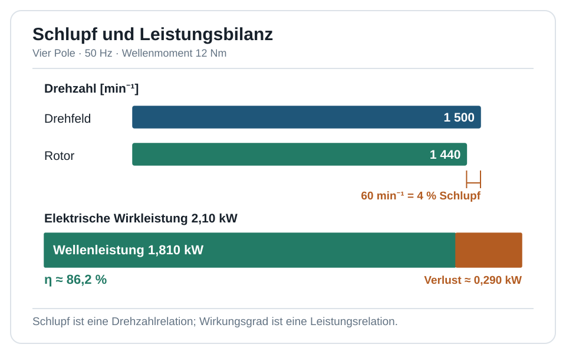

# M7-L4 – Elektrische Maschinen im Überblick {#L4}

**Kursbereich:** M7 – Bachelor: Elektrische Energietechnik

**Niveau:** Bachelor

**Vorwissen:** [Induktion und elektromagnetische Energie](M4-L4.md) sowie [Drehstrom, Stern und Dreieck](M7-L2.md).

**Lernziel:** Drehfeld, synchrone Drehzahl und Schlupf unterscheiden, Drehmoment in mechanische Leistung umrechnen und die Verluste eines motorischen Arbeitspunkts bilanzieren.

## Von der elektrischen zur mechanischen Seite {#S1}

Eine elektrische Maschine koppelt elektrische Größen und Bewegung über ein Magnetfeld. Im **Motorbetrieb** nimmt die Maschine elektrische Wirkleistung auf und gibt Wellenleistung ab. Im **Generatorbetrieb** nimmt sie mechanische Wellenleistung auf und liefert elektrische Wirkleistung. Dasselbe physikalische Prinzip kann beide Richtungen erlauben. Die Richtung folgt aus den Drehmomenten, den Anschlussbedingungen und dem Arbeitspunkt.

Das am Umfang wirkende elektromagnetische Kraftsystem erzeugt am Rotor ein Drehmoment. Umgekehrt verändert eine bewegte Wicklung oder ein bewegtes Magnetfeld ihre Flussverkettung. Die dadurch induzierte Spannung beeinflusst den Strom. Das einfache Modell einer Gleichstrommaschine drückt diese Kopplung mit Gegen-EMK $E=k_\mathrm{e}\omega$ und elektromagnetischem Moment $T_\mathrm{e}=k_\mathrm{t}I$ bei konstantem Erregerfluss aus. Die Gegen-EMK wächst mit der Drehzahl. Ein Drehmoment am Luftspalt und das an der Welle nutzbare Drehmoment können durch mechanische Verluste verschieden sein.

## Drehfeld, Polpaare und Schlupf {#S2}

Ein räumlich und zeitlich symmetrisches Ständersystem mit sinusförmigen Strömen erzeugt im idealen Grundwellenmodell ein rotierendes Magnetfeld. Eine elektrische Periode dreht das Feld bei $p$ Polpaaren mechanisch um $1/p$ Umdrehungen. Bei Frequenz $f$ in Hertz ist daher

$$
\frac{n_\mathrm{s}}{1\,\mathrm{min}^{-1}}
=\frac{60}{p}\,\frac{f}{1\,\mathrm{Hz}}.
$$

Vier Pole ergeben zwei Polpaare. Eine Synchronmaschine dreht im synchronen stationären Betrieb mit $n=n_\mathrm{s}$. Zwischen Rotor- und Ständerfeld kann dabei ein stationärer Winkel bestehen, der mit dem ausgetauschten Moment zusammenhängt.

Bei der gewöhnlichen Asynchronmaschine im Motorbetrieb bewegt sich das Drehfeld gegenüber dem Rotor schneller. Die relative Bewegung induziert Rotorströme, deren Wechselwirkung mit dem Feld Drehmoment erzeugt. Den relativen Drehzahlunterschied bezeichnet der **Schlupf**

$$
s=\frac{n_\mathrm{s}-n}{n_\mathrm{s}}.
$$

Am synchronen Punkt verschwindet in diesem idealisierten Modell die stationäre Induktion durch das Ständerdrehfeld im kurzgeschlossenen Rotor. Bei Antrieb der Maschine über die synchrone Drehzahl hinaus wird $s<0$. Unter passenden elektrischen Bedingungen erlaubt dieser Betriebspunkt Generatorbetrieb.

## Rechenbeispiel zur Wellenleistung einer Asynchronmaschine {#S3}

Ein Modellmotor mit vier Polen läuft bei $f=50\,\mathrm{Hz}$ und $n=1\,440\,\mathrm{min}^{-1}$. Damit ergeben sich $n_\mathrm{s}=1\,500\,\mathrm{min}^{-1}$ und $s=4\,\%$. Die Welle treibt eine Last mit $T_\mathrm{W}=12\,\mathrm{Nm}$ an. Für die Winkelgeschwindigkeit und die Wellenleistung gilt

$$
\omega=\frac{2\pi\cdot1\,440}{60}\approx150{,}80\,\mathrm{rad/s},
\qquad
P_\mathrm{W}=T_\mathrm{W}\omega\approx1{,}810\,\mathrm{kW}.
$$

Beträgt die elektrische Wirkleistungsaufnahme $2{,}10\,\mathrm{kW}$, so ergibt sich der motorische Wirkungsgrad $\eta=P_\mathrm{W}/P_\mathrm{el}\approx86{,}2\,\%$. Der gesamte Unterschied beträgt etwa $0{,}290\,\mathrm{kW}$. Eine Aufteilung in Kupfer-, Kern-, Reibungs- und Lüftungsverluste erfordert weitere Modellparameter. Der Schlupf und der Gesamtwirkungsgrad sind unterschiedliche dimensionslose Kennzahlen.

{alt="Zwei Drehzahlbalken für Drehfeld und Rotor sowie ein Leistungsbalken mit Wellenleistung und Gesamtverlust."}

Die beiden Balkengruppen benutzen getrennte Maßstäbe. Die Drehzahldifferenz beträgt vier Prozent der synchronen Drehzahl. Der orange Anteil der elektrischen Leistung ist der Gesamtverlust und lässt sich nicht allein aus dem Schlupf bestimmen.

## Geltungsbereich {#S4}

Die Drehzahlformel beruht auf der Feldgrundwelle. Wicklungsanordnung, Oberwellen, Magnetisierungszustand und Versorgung können das Moment beeinflussen. Das Produkt aus Winkelgeschwindigkeit und Wellenmoment liefert auch bei dynamischem Betrieb die momentane mechanische Leistung am betrachteten Anschluss. Für eine dynamische Bilanz kommen Änderungen gespeicherter kinetischer und magnetischer Energie hinzu. Die stationäre Differenzbilanz liefert nur den Gesamtverlust beim betrachteten Arbeitspunkt.

## Übungen mit Lösungen {#S5}

1. Eine Maschine mit sechs Polen läuft bei $50\,\mathrm{Hz}$ und $960\,\mathrm{min}^{-1}$. Wie groß sind synchrone Drehzahl und Schlupf?  
   **Lösung** $p=3$, damit $n_\mathrm{s}=1\,000\,\mathrm{min}^{-1}$ und $s=(1\,000-960)/1\,000=4\,\%$.
2. Ein Motor nimmt $1\,250\,\mathrm W$ auf und verliert insgesamt $150\,\mathrm W$. Bestimme Wirkungsgrad und Wellenmoment bei $1\,200\,\mathrm{min}^{-1}$.  
   **Lösung** $P_\mathrm{W}=1\,100\,\mathrm W$, also $\eta=88\,\%$. Mit $\omega=40\pi\,\mathrm{rad/s}$ ergibt sich $T_\mathrm W=1\,100/(40\pi)\,\mathrm{Nm}\approx8{,}75\,\mathrm{Nm}$.

**Weiterführend:** [Leitungen, Lasten und vereinfachte Netzmodelle](M7-L5.md)

## Quellen {#S6}

- [MIT OpenCourseWare – 6.061 Introduction to Electric Power Systems, Readings](https://ocw.mit.edu/courses/6-061-introduction-to-electric-power-systems-spring-2011/pages/readings/) · Kapitelübersicht 9–12: Synchron-, Asynchron-, Gleichstrom- und Permanentmagnetmaschinen; verlinkte Kapitel hier nicht erneut geprüft. · Zuletzt abgerufen: 2026-11-25
- [OpenStax, Electric Generators and Back Emf](https://openstax.org/books/university-physics-volume-2/pages/13-6-electric-generators-and-back-emf) · University Physics 2 § 13.6: Generatorinduktion und Gegen-EMK des Motors; nur Teilüberblick über Maschinen. · Zuletzt abgerufen: 2026-11-25
