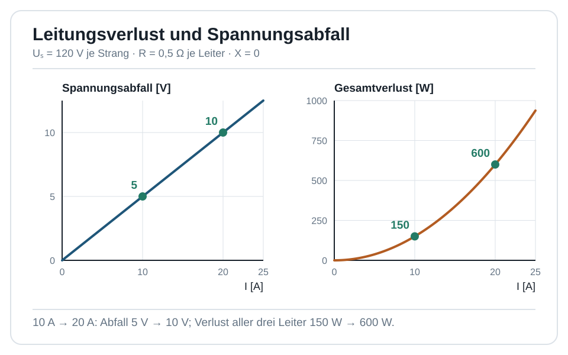

# M7-L5 – Leitungen, Lasten und vereinfachte Netzmodelle {#L5}

**Kursbereich:** M7 – Bachelor: Elektrische Energietechnik

**Niveau:** Bachelor

**Vorwissen:** [Drehstrom, Stern und Dreieck](M7-L2.md), [Transformator und Spannungsanpassung](M7-L3.md) sowie [Impedanzen im Sinusbetrieb](M1-L6.md).

**Lernziel:** Eine radiale Verbindung als Strang-Ersatzschaltung modellieren, Spannungsfall und Leitungsverlust berechnen und erklären, welche Annahmen Last- und Fehlerberechnung voneinander unterscheiden.

## Der radiale Zweiknotenfall {#S1}

Die einfachste Netzskizze mit Leitung besitzt einen speisenden Knoten und einen Lastknoten. In einem symmetrischen Drehstromsystem kann man alle drei gleichen Stränge mit einem einzigen Strangersatz berechnen. Die Quelle hat den festen Strangspannungszeiger $\underline U_\mathrm S$. Die Leitung erhält je Strang eine Reihenimpedanz $Z_\mathrm{Ltg}=R+jX$, die Last eine Strangimpedanz $Z_\mathrm{Last}$. Die Queradmittanz gegen Erde bleibt im kurzen Leitungsmodell unberücksichtigt. Alle Impedanzen liegen auf derselben Spannungsebene, bei Bedarf nach einer Umrechnung über ein ideales Übersetzungsverhältnis.

Der Zweigstrom zählt von der Quelle zur Last. Das lineare Gleichungssystem reduziert sich auf

$$
\underline I=\frac{\underline U_\mathrm S}{Z_\mathrm{Ltg}+Z_\mathrm{Last}},
\qquad
\underline U_\mathrm R=\underline U_\mathrm S-Z_\mathrm{Ltg}\underline I .
$$

Der Zeigerabfall über der Leitung ist $Z_\mathrm{Ltg}\underline I$. Der Unterschied der Spannungsbeträge hängt zusätzlich von der Richtung dieses Zeigers gegenüber der Empfangsspannung ab. Für einen kleinen relativen Abfall kann man in Richtung von $\underline U_\mathrm R$ projizieren. Eilt der Strom der Lastspannung um $\varphi$ nach, gilt näherungsweise

$$
|\underline U_\mathrm S|-|\underline U_\mathrm R|
 \approx I(R\cos\varphi+X\sin\varphi).
$$

Der Queranteil des Abfalls verändert den Winkel. Die Näherung vernachlässigt dessen Beitrag zum Betrag in erster Ordnung. Bei großem Spannungsabfall rechnet man mit den vollständigen Zeigern.

## Verlustleistung der drei Leiter {#S2}

Für drei gleiche Leiterimpedanzen gilt $P_\mathrm V=3RI^2$. Der Faktor drei addiert die Wirkleistungsverluste der drei Außenleiter. Die Größe $R$ ist der Widerstand eines Stranges im Ersatzmodell. Eine ideale induktive Reaktanz verbraucht im Sinusmittel keine Wirkleistung. Sie verändert Spannung und Strom und tauscht im Modell Blindleistung $Q_\mathrm{Ltg}=3XI^2$ mit dem restlichen Netz aus.

## Rechenbeispiel zum Verlustanstieg bei größerem Strom {#S3}

Ein symmetrisches Modell hat $U_\mathrm S=120\,\mathrm V$ je Strang, $R=0{,}5\,\Omega$ und $X=0$. Drei Lastwiderstände von je $11{,}5\,\Omega$ sind sternförmig angeschlossen. Daraus folgen $I=10\,\mathrm A$, $U_\mathrm R=115\,\mathrm V$, $P_\mathrm{Last}=3\cdot115\cdot10\,\mathrm W=3\,450\,\mathrm W$ und $P_\mathrm V=150\,\mathrm W$. Die eingespeiste Wirkleistung beträgt $3\,600\,\mathrm W$ und erfüllt die Bilanz.

Setzt man als zweiten Zustand je $5{,}5\,\Omega$ an, ergibt sich $I=20\,\mathrm A$. Dann betragen der Spannungsabfall $10\,\mathrm V$ und der Leiterverlust $600\,\mathrm W$. Der Lastanschluss erhält $110\,\mathrm V$ je Strang. Verdopplung des Strombetrags vervierfacht bei konstantem Widerstand die Wärmeleistung.

{alt="Lineares Diagramm des Spannungsabfalls und quadratisches Diagramm der Verlustleistung mit Punkten bei zehn und zwanzig Ampere."}

Die Diagramme halten den Leitungswiderstand konstant und variieren den Strom als Parameter. Im Zweiknotenmodell entsteht der jeweilige Strom durch die Lastimpedanz. Die linke Achse zeigt die Differenz der Strangspannungen, die rechte die Summe der drei ohmschen Leiterverluste.

## Geltungsbereich und idealisierte Fehlerfälle {#S4}

Bei einer Störung kann das reguläre Lastmodell durch eine neue Randbedingung ersetzt werden. Ein angenommener idealer symmetrischer Kurzschluss setzt im Modell die drei Klemmenpotentiale gleich. Der Strom ergibt sich dann aus den verbleibenden Ersatzimpedanzen einschließlich der Quelle. Eine Nullimpedanz in einem idealen Quellenkreis ergibt eine singuläre Rechnung. Unsymmetrische Fehler verlangen ein Mehrphasenmodell oder eine Zerlegung in symmetrische Komponenten. Lichtbogen, Dynamik, Erdung, Schutzverhalten und Phasenunsymmetrie sind im betrachteten Ersatzmodell unberücksichtigt.

Für geregelte Verbraucher kommt je nach Betrachtung auch ein Konstantleistungsmodell infrage. Die Annahme konstanter komplexer Leistung $\underline I=\overline{\underline S/\underline U_\mathrm R}$ macht die Stromberechnung spannungsabhängig. Aus der linearen Zweiggleichung und dieser Lastbedingung entsteht ein nichtlineares Gleichungssystem. Die Modellannahme muss daher zusammen mit dem Ergebnis dokumentiert werden.

## Übungen mit Lösungen {#S5}

1. Wie groß sind Verlustleistung und Lastspannung im zweiten Zustand des Beispiels bei gleicher Quelle und doppeltem Leitungswiderstand?  
   **Lösung** $R=1\,\Omega$ und $I=120/(1+5{,}5)\,\mathrm A\approx18{,}46\,\mathrm A$. Daraus folgen $U_\mathrm R\approx101{,}54\,\mathrm V$ und $P_\mathrm V\approx1\,022{,}49\,\mathrm W$.
2. Verdoppelt sich der Verlust, wenn der Widerstand bei gleicher Lastimpedanz verdoppelt wird?  
   **Lösung** Im Allgemeinen ändert sich auch der Strom. Hier würde eine reine Verdopplung des alten Verlusts $1\,200\,\mathrm W$ ergeben. Die neue Stromberechnung ergibt rund $1\,022{,}49\,\mathrm W$.

**Weiterführend:** [Systemfall einer Energieversorgung](M7-L6.md)

## Quellen {#S6}

- [J. L. Kirtley, MIT 6.061, AC Power Flow in Linear Networks](https://ocw.mit.edu/courses/6-061-introduction-to-electric-power-systems-spring-2011/9cf8de165233601f547b284cee5c2131_MIT6_061S11_ch2.pdf) · Kapitel 2, S. 14–15: komplexe Leistung und Effektivwerte; Teilaspekt. · Zuletzt abgerufen: 2026-11-25
- [J. L. Kirtley, MIT 6.061, Introduction to Symmetrical Components](https://ocw.mit.edu/courses/6-061-introduction-to-electric-power-systems-spring-2011/7603169f5d8514b769a46fa900b79a57_MIT6_061S11_ch4.pdf) · Kapitel 4, S. 2: symmetrische Komponenten als Erweiterung für unsymmetrische Netze; Teilaspekt. · Zuletzt abgerufen: 2026-11-25
