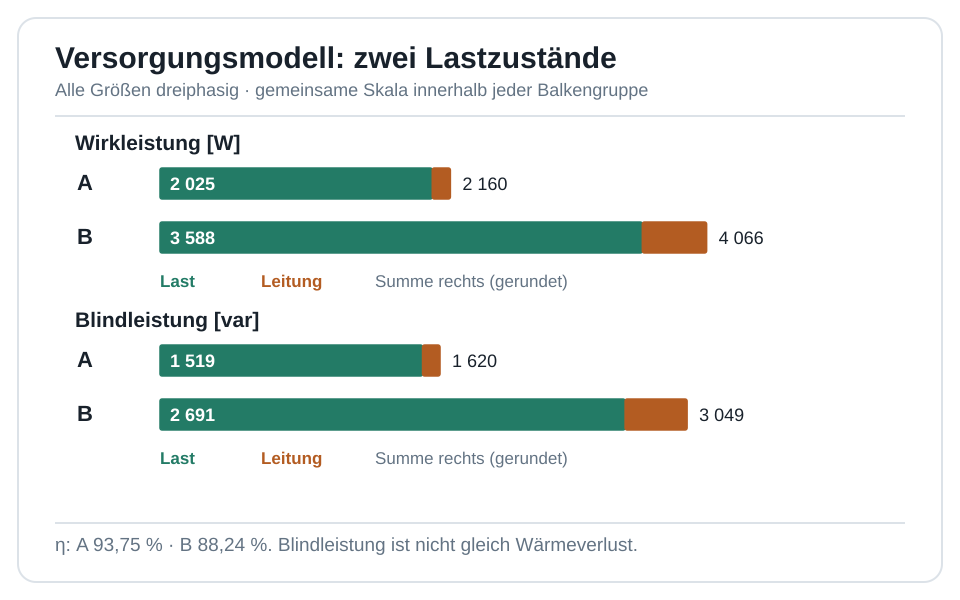

# M7-L6 – Systemfall einer Energieversorgung {#L6}

**Kursbereich:** M7 – Bachelor: Elektrische Energietechnik

**Niveau:** Bachelor

**Vorwissen:** [Elektrische Leistungsbilanzen](M7-L1.md), [Spannungsübersetzung](M7-L3.md) und [der radiale Zweiknotenfall](M7-L5.md).

**Lernziel:** Zwei Lastzustände eines symmetrischen Versorgungsmodells reproduzierbar vergleichen, Wirk- und Blindleistungsflüsse bilanzieren und Änderungen von Spannung, Verlusten und Wirkungsgrad erklären.

## Modell und Vergleichsfrage {#S1}

Das Gedankenmodell verbindet eine ideale dreiphasige Einspeisung mit einer symmetrischen Last. Ein idealer Transformator stellt sekundär $120\,\mathrm V$ Strangspannung bereit. Alle folgenden Impedanzen sind auf die Sekundärseite bezogen. Die Reihenimpedanz $Z_\mathrm{Ltg}=(0{,}8+j0{,}6)\,\Omega$ je Strang fasst Leitung und passive Serienanteile zusammen. Der ideale Transformator selbst nimmt keine Wirkleistung auf.

In Zustand A beträgt die Lastimpedanz $Z_A=(12+j9)\,\Omega$ pro Strang. In Zustand B wird sie zu $Z_B=(6+j4{,}5)\,\Omega$. Kleinere Impedanz bedeutet in diesem Vergleich höheren Strom. Die Spannung direkt an der Last und ihre aufgenommene Wirkleistung ergeben sich aus demselben Strom. Der Vergleich umfasst zwei getrennte eingeschwungene Zustände.

## Leistungsbilanz in Zeigern {#S2}

Die konstante Referenz ist $\underline U_\mathrm S=120+j0$ in Volt. Bei $Z=Z_\mathrm{Ltg}+Z_\mathrm{Last}$ lauten die Beziehungen

$$
\begin{aligned}
\underline I &= \underline U_\mathrm S/Z,\\
\underline U_\mathrm R &= Z_\mathrm{Last}\underline I,\\
\underline S_\mathrm{ein} &= 3\,\underline U_\mathrm S\underline I^*,\\
\underline S_\mathrm{Last} &= 3\,\underline U_\mathrm R\underline I^*,\\
\underline S_\mathrm{Ltg} &= 3\,|\underline I|^2 Z_\mathrm{Ltg}.
\end{aligned}
$$

Die Größen sind Effektivwertzeiger. Die Einspeiseleistung zählt vom Quellenanschluss in das Netz. Wegen $\underline U_\mathrm S=\underline U_\mathrm R+Z_\mathrm{Ltg}\underline I$ ist $\underline S_\mathrm{ein}=\underline S_\mathrm{Last}+\underline S_\mathrm{Ltg}$. Das ergibt je eine Kontrolle für Wirk- und Blindleistung. Für den Wirkungsgrad $\eta=P_\mathrm{Last}/P_\mathrm{ein}$ verwenden wir ausschließlich Realteile.

## Reproduzierbare Modellrechnung {#S3}

Dieses Python-Programm nutzt die eingebaute komplexe Arithmetik. Die Identität für komplexe Leistungen wird für beide Fälle direkt geprüft.

```python
u_source = 120 + 0j
z_line = 0.8 + 0.6j

cases = [("A", 12 + 9j), ("B", 6 + 4.5j)]
for label, z_load in cases:
    current = u_source / (z_line + z_load)
    u_load = z_load * current
    s_source = 3 * u_source * current.conjugate()
    s_load = 3 * u_load * current.conjugate()
    s_line = 3 * abs(current)**2 * z_line
    assert abs(s_source - s_load - s_line) < 1e-9
    efficiency = s_load.real / s_source.real
    print(
        f"{label}: I={abs(current):.2f} A, U={abs(u_load):.2f} V, "
        f"Pin={s_source.real:.2f} W, Pload={s_load.real:.2f} W, "
        f"Ploss={s_line.real:.2f} W, Qin={s_source.imag:.2f} var, "
        f"eta={efficiency:.2%}"
    )
```

| Zustand | Strombetrag | Lastspannung je Strang | Einspeiseleistung $P_\mathrm{ein}$ | Lastleistung | Leitungsverlust | Wirkungsgrad |
|---|---:|---:|---:|---:|---:|---:|
| A | $7{,}50\,\mathrm A$ | $112{,}50\,\mathrm V$ | $2\,160{,}00\,\mathrm W$ | $2\,025{,}00\,\mathrm W$ | $135{,}00\,\mathrm W$ | $93{,}75\,\%$ |
| B | $14{,}12\,\mathrm A$ | $105{,}88\,\mathrm V$ | $4\,065{,}88\,\mathrm W$ | $3\,587{,}54\,\mathrm W$ | $478{,}34\,\mathrm W$ | $88{,}24\,\%$ |

Die Quelle liefert etwa $1\,620{,}00\,\mathrm{var}$ in A und $3\,049{,}41\,\mathrm{var}$ in B. In diesem gewählten Vergleich haben Last- und Leitungsimpedanz denselben Winkel, sodass auch der Leistungsfaktor an der Einspeisung in beiden Fällen $0{,}8$ beträgt. Der Wirkungsgrad sinkt dennoch, weil mit kleinerer Lastimpedanz der Anteil der Leitungswiderstände am Gesamtwiderstand steigt. Die absolute Lastleistung wächst, weil der stärkere Laststrom den Rückgang der Lastspannung in diesem Modell überwiegt.

{alt="Gestapelte Balken für Wirkleistung und Blindleistung der Last und der Leitung in zwei Zuständen; Einspeisesummen rechts."}

Die Balkenlängen entsprechen den ungerundeten Rechenwerten; die Zahlen in der Grafik sind auf ganze Watt beziehungsweise var gerundet. Die Skalen für Wirk- und Blindleistung sind getrennt. Der orange Blindleistungsanteil zeigt den Blindleistungsaustausch der Leitung, nicht eine zusätzliche Wärmeleistung.

## Grenzen und weiterführende Aufgabe {#S4}

Die Rechnung fixiert Quellspannung, Frequenz und Impedanzen. Lastkennlinien elektrischer Maschinen und geregelte Konstantleistungsverbraucher verlangen eigene Lastmodelle. Ein detaillierter Lastfluss kann mehrere Knoten, modellierte Generatorbedingungen, Parallelpfade und spannungsabhängige Lasten aufnehmen. Aus der Beispielrechnung lassen sich Spannungsabweichungen und Verlustanteile dieses Ersatzmodells ableiten.

**Übung 1** Rechne Zustand B mit $Z_\mathrm{Ltg}=(1{,}2+j0{,}9)\,\Omega$.  
**Lösung** Der Betrag der Gesamtimpedanz ist $9\,\Omega$. Damit erhält man $I=13{,}33\,\mathrm A$, $U_\mathrm R=100\,\mathrm V$, $P_\mathrm{Last}=3\,200\,\mathrm W$ und $P_\mathrm V=640\,\mathrm W$. Die Bilanz liefert $P_\mathrm{ein}=3\,840\,\mathrm W$ und $\eta=83{,}33\,\%$.

**Übung 2** Warum wird in der Verlustformel für die Leitung der Strombetrag verwendet?  
**Lösung** $\underline I\underline I^*=|\underline I|^2$ ist reell und unabhängig von der Phasenreferenz. Mit dem Realteil der Leitungsimpedanz ergibt sich der positive ohmsche Verlust, mit ihrem Imaginärteil die Blindleistung der Leitung.

**Weiterführend:** [Studienweg mit dem nächsten Anwendungsprojekt](pages/studienweg.md)

## Quellen {#S5}

- [J. L. Kirtley, MIT 6.061, AC Power Flow in Linear Networks](https://ocw.mit.edu/courses/6-061-introduction-to-electric-power-systems-spring-2011/9cf8de165233601f547b284cee5c2131_MIT6_061S11_ch2.pdf) · Kapitel 2, S. 14–15: Wirk-, Blind- und Scheinleistung; Teilaspekt. · Zuletzt abgerufen: 2026-11-25
- [J. L. Kirtley, MIT 6.061, Introduction to Load Flow](https://www.ocw.mit.edu/courses/6-061-introduction-to-electric-power-systems-spring-2011/2f9042dd664b5bd07e4b5d4cb4930062_MIT6_061S11_ch5.pdf) · Kapitel 5, § 2, S. 1: Knotenspannungen und komplexe Leistungsbilanz; Teilaspekt. · Zuletzt abgerufen: 2026-11-25
