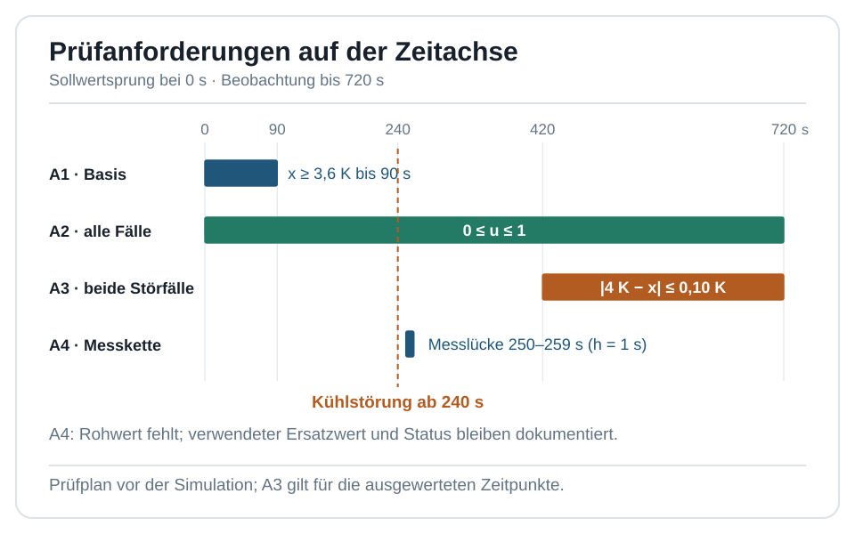

# M8-L1 – Anforderungen, Quellen und Projektfrage {#L1}

**Kursbereich:** M8 – Bachelor: Ingenieurpraxis und Bachelor-Projekt

**Niveau:** Bachelor

**Vorwissen:** [Messketten](M6-L1.md), [Rückkopplung](M6-L4.md) und [Temperaturregelung](M6-L6.md).

**Lernziel:** Eine technische Frage in überprüfbare Anforderungen zerlegen und für jedes Ziel eine geeignete Evidenz festlegen.

## Die Projektfrage {#S1}

Ein Temperaturregler soll in einem simulierten Prüfraum einen konstanten Temperaturanstieg gegenüber der Umgebung halten. Eine zeitweilige Umgebungswirkung senkt die Temperatur. Die Sensoranzeige hat eine kleine periodische Abweichung und fällt vorübergehend aus. Die Projektfrage lautet: **Welche der vorher festgelegten Anforderungen erfüllt der modellierte Regler unter diesen drei Testfällen?**

Der Test bezieht sich auf den Temperaturanstieg $x=T-T_\mathrm{amb}$ in Kelvin. Bei $T_\mathrm{amb}=20\,^\circ\mathrm C$ entsprechen $x=4\,\mathrm K$ einer absoluten Temperaturanzeige von $24\,^\circ\mathrm C$. Der Sollwert bleibt bei $4\,\mathrm K$. Die Strecke, die Messkette und der Stellwert sind Rechenmodelle. Im Projekt zählt, ob sich eine Behauptung auf eine Anforderung, eine Datei und ein überprüfbares Ergebnis zurückführen lässt.

## Anforderungen vor dem Rechnen festlegen {#S2}

Frequenz, Dauer und Stärke einer Störung verändern die Aussage eines Tests. Wir legen daher drei explizite Szenarien fest:

- **Basis:** Sollwertsprung bei $t=0$, idealisierte kalibrierte Messung, ohne äußere Störung.
- **Störung:** Ab $t=240\,\mathrm s$ wirkt eine konstante modellierte Kühlung, in der Streckengleichung als $d=-1\,\mathrm K$.
- **Messkette:** Dieselbe Kühlung, periodische Messabweichung und eine Messlücke auf $250\,\mathrm s\le t<260\,\mathrm s$.

| Kennung | Prüfobjekt | Nachweis im Rechenversuch |
| --- | --- | --- |
| A1 | Annäherung im Basisfall | Der simulierte Zustand $x$ erreicht erstmals mindestens $3{,}6\,\mathrm K$ bis $t=90\,\mathrm s$. |
| A2 | Stellwert in allen Fällen | Für jeden protokollierten Stellwert gilt $0\le u\le1$. |
| A3 | Abweichung nach dem Störbeginn | In beiden gestörten Fällen ist $|4\,\mathrm K-x|\le0{,}10\,\mathrm K$ für alle geprüften Zeitpunkte von 420 bis 720 s. |
| A4 | Dokumentation des Messausfalls | Die Rohwerte fehlen im festgelegten Zeitraum, der Ersatzwert und der damit verbundene Status sind separat erkennbar. |

A3 gilt an den untersuchten Zeitpunkten. Ein weiterer Test mit kleinerem Zeitschritt beurteilt die Abhängigkeit von der rechnerischen Auflösung. A4 sagt aus, ob die Datenlücke im Protokoll korrekt behandelt wird. Ob der Raum unter diesen Bedingungen auch die Temperatur hält, prüft A3.

{alt="Zeitachse von null bis 720 Sekunden mit Anforderungen A1 bis A4, Störbeginn bei 240 Sekunden und Messlücke ab 250 Sekunden."}

Die farbigen Bereiche zeigen die vorgesehenen Prüfzeitpunkte beziehungsweise Zeitfenster, nicht den Ausgang des Tests. A1 verlangt mindestens eine passende Probe bis 90 Sekunden; A3 verlangt dagegen die Einhaltung der Grenze an jedem geprüften Zeitpunkt des angegebenen Intervalls. Für A4 ist das Ende bei 260 Sekunden ausgeschlossen.

## Beispiel: Ein präzises Kriterium aus einer Beobachtung entwickeln {#S3}

„Am Ende stabil“ beschreibt in der Umgangssprache unterschiedliche Dinge. Ein Test zeigt etwa in zwei Zeilen $x(400\,\mathrm s)=3{,}86\,\mathrm K$ und $x(720\,\mathrm s)=4{,}01\,\mathrm K$. Der Endwert liegt nur $0{,}01\,\mathrm K$ vom Sollwert entfernt. Daraus lässt sich A3 nicht entscheiden, denn A3 verlangt den **größten Betrag des Fehlers in einem Intervall**. Eine dritte Zeile mit $x(480\,\mathrm s)=3{,}88\,\mathrm K$ würde A3 sofort widerlegen.

Wir unterscheiden außerdem Prüfzweck und anzuwendenden Maßstab. Das Protokollfeld für einen Ersatzwert ist unmittelbar testbar. Ein Nachweis über reale Temperaturqualität würde unter anderem ein geeignetes Thermometer, die Frage nach räumlicher Temperaturverteilung und einen unabhängigen Versuch verlangen. Ein positives Simulationsergebnis ist eine Aussage über diese Konfiguration und diese Störungen.

## Selbstkontrolle {#S4}

1. Formuliere für einen zusätzlichen Fall einen konkreten Grenzwert für ein einmaliges Überschwingen von höchstens $0{,}20\,\mathrm K$. Welchen Wert musst du aus den Daten bestimmen?
2. Eine halbe Sekunde wird als Zeitabstand genutzt. Wie viele Rohwerte fehlen, wenn das Intervall $[250,260)$ genau getroffen wird?
3. Warum kann ein im Protokoll abgelehntes Datenfeld A4 verletzen, obwohl die Kurve von A3 erfüllt ist?

### Lösungen

1. In diesem Fall muss für den gesamten zuvor festgelegten Beobachtungszeitraum $\max x\le4{,}20\,\mathrm K$ gelten. Beim Auswerten wird der größte simulierte Zustandswert mit seinem Zeitpunkt protokolliert.
2. Es fehlen $10/0{,}5=20$ Rohwerte. Der erste fehlende Wert liegt bei $250\,\mathrm s$, der letzte bei $259{,}5\,\mathrm s$.
3. A4 prüft die Nachvollziehbarkeit der Messinformation. Eine plausible Kurve beweist nicht, dass im Protokoll der Herkunftsunterschied zwischen Mess- und Ersatzwert sichtbar ist.

## Projektgrenzen und Weiterlernen {#S5}

Der Vergleich beweist die Eignung für die festgelegten Szenarien mit einem skalaren Zustandsmodell. Aussagen über die Betriebssicherheit einer Heizanlage brauchen andere Nachweise und fachliche Verantwortliche. In [M8-L2](M8-L2.md) entstehen die Teilmodelle und ihre Schnittstellen.

## Quellen {#S6}

- [KIT, B.Sc. Elektrotechnik und Informationstechnik, Modulhandbuch WiSe 2026/27](https://s.kit.edu/mhb-etit-bsc23) · Modul Projektarbeit M-ETIT-106629, § 13.56. · Zuletzt abgerufen: 2026-11-25
- [TUM, Studienführer Elektrotechnik und Informationstechnik](https://www.cit.tum.de/fileadmin/w00byx/cit/Studium/Studiengaenge/Bachelor_Elektrotechnik_Informationstechnik/Studienfuehrer_Bachelor_EI.pdf) · §§ 5.6–5.7 zu Ingenieurpraxis und Bachelorarbeit. · Zuletzt abgerufen: 2026-11-25
- [NASA Systems Engineering Handbook, Appendix D](https://www.nasa.gov/reference/appendix-d-requirements-verification-matrix/) · eindeutige Verknüpfung von Anforderungen und Nachweisen. Abruf 19.11.2026. · Zuletzt abgerufen: 2026-11-25
