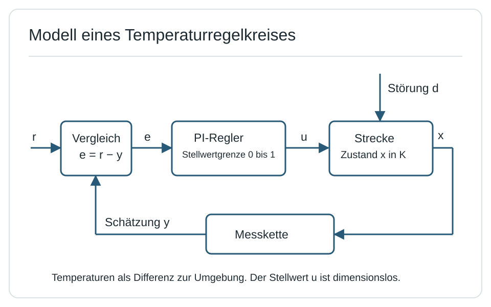

# M8-L2 – Entwurf der Mess- und Regelstrecke {#L2}

**Kursbereich:** M8 – Bachelor: Ingenieurpraxis und Bachelor-Projekt

**Niveau:** Bachelor

**Vorwissen:** [Projektanforderungen](M8-L1.md), [Sprungantwort](M6-L3.md) und [Stabilität und Reglereinstieg](M6-L5.md).

**Lernziel:** Ein Strecken-, Mess- und Reglermodell mit konsistenten Größen aufstellen. Die wichtigsten Erwartungswerte vor der Simulation berechnen.

## Vom Aufgabentext zur Schnittstelle {#S1}

Die Strecke liefert den Temperaturanstieg $x$ in Kelvin. Die Messkette wandelt $x$ in ein Rohsignal $m$ und schätzt daraus den kalibrierten Messwert $y$. Der Regler bildet mit $y$ den Fehler $e=r-y$. Er liefert den dimensionslosen, auf das Intervall $[0,1]$ beschränkten Stellwert $u$. Der Sollwert $r$ und die Störung $d$ werden in Kelvin modelliert. $d$ ist ein äquivalenter Eingang der Strecke, der ihren Gleichgewichtswert verschiebt.

{alt="Blockschaltbild mit einer rückgekoppelten Strecke. Der numerische Temperaturzustand wird in der Messkette erfasst und zum Regler zurückgeführt."}

## Streckenmodell und Einheiten {#S2}

Die Zustandsdynamik ist

$$
\tau\dot x+x=K_u u+d,\qquad \tau=60\,\mathrm s,\quad K_u=10\,\mathrm{K}.
$$

Da $u$ dimensionslos ist, darf $K_u$ als Kelvin angegeben werden. $\tau\dot x$ hat die Einheit Kelvin. Ein konstanter Stellwert $\bar u$ und eine konstante Störung $\bar d$ ergeben den stationären Wert $\bar x=K_u\bar u+\bar d$. Für $r=4\,\mathrm K$ müsste im störungsfreien Gleichgewicht $u=0{,}4$ anliegen. Bei $d=-1\,\mathrm K$ braucht es $u=0{,}5$.

Die Reglerrechnung nutzt den Zustand $z$ des Integrators in Stellwerteinheiten. Der Proportionalfaktor ist $K_p=0{,}20\,\mathrm K^{-1}$, der Integralfaktor $K_i=K_p/\tau$. Im linearen Modell gilt $\dot z=K_i e$. Der unkorrigierte Stellwert ist $K_p e+z$. Beim Begrenzen wird die Integration in Richtung einer bereits erreichten Stellwertgrenze ausgesetzt. Sinkt der unkorrigierte Stellwert zurück, kann der Integrator normal weiterarbeiten. Diese bedingte Integration ist die hier verwendete Anti-Windup-Regel.

## Messmodell und Kalibrierung {#S3}

Für das Rohsignal in Volt wird angenommen:

$$
m=b+g x+n,\qquad
b=0{,}30\,\mathrm V,\quad
g=1{,}02\,\mathrm{V/K}.
$$

Die kalibrierte Schätzung ist $y=(m-b)/g$. Die Simulation nutzt für den Fall **Messkette** eine vorgegebene Abweichung $n=0{,}05\,\mathrm V\sin(2\pi t/(20\,\mathrm s))$. Der daraus entstehende Messfehler hat den Scheitelwert $0{,}05\,\mathrm V/g\approx0{,}0490\,\mathrm K$. Die sinusförmige Störung dient dazu, dieselbe Abweichung in jedem Lauf exakt nachzubilden.

Während der zehn Sekunden langen Messlücke bleibt $y$ am letzten gültigen Wert. Der Zustand $x$ wird weiter integriert. Jeder Ersatzwert erhält eine Statusmarkierung. Dieses Verhalten modelliert einen begrenzten Testfall. Für eine längere Lücke wäre eine eigene Anforderung an die Fehlerbehandlung nötig.

## Beispiel: Erste Werte und Plausibilität {#S4}

Zu Beginn sind $x(0)=z(0)=0$. Ohne Messabweichung ergibt die Kalibrierung $y(0)=0$. Der erste Stellwert beträgt $u(0)=0{,}20\cdot4=0{,}8$. Die Zustandsrate ist bei $d=0$

$$
\dot x(0)=\frac{10\,\mathrm K\cdot0{,}8}{60\,\mathrm s}
=0{,}1333\ldots\,\mathrm{K/s}.
$$

Ein expliziter Euler-Schritt von einer Sekunde führt daher zu $x(1\,\mathrm s)=0{,}1333\ldots\,\mathrm K$. Er startet mit den Werten zu $t=0$. Würde der Code vor dieser Berechnung $z$ aktualisieren und den neu berechneten Stellwert sofort einsetzen, erhielte man ein anderes diskretes Verfahren. Der erste Handwert ist darum ein brauchbarer Test für die Aktualisierungsreihenfolge.

## Selbstkontrolle {#S5}

1. Ein Rohwert beträgt $m=3{,}36\,\mathrm V$. Bestimme $y$ für die festgelegte Kalibrierung.
2. Welche Störung $d$ liegt im Gleichgewicht bei $u=0{,}65$ und $x=4\,\mathrm K$ vor?
3. Bei $e=1\,\mathrm K$ und $z=0{,}9$ schlägt der Regler $u=1{,}1$ vor. Was liefert die Begrenzung und wie verhält sich der Integrator?

### Lösungen

1. $(3{,}36-0{,}30)/1{,}02=3\,\mathrm K$.
2. $d=x-K_u u=4\,\mathrm K-6{,}5\,\mathrm K=-2{,}5\,\mathrm K$.
3. Der gültige Stellwert ist $u=1$. Da $e>0$ den unkorrigierten Stellwert weiter vergrößern würde, bleibt $z$ bei diesem Schritt unverändert.

## Grenzen und Weiterlernen {#S6}

Verlustleistung, Raumgröße und Heizleistung sind hier im stationären Faktor $K_u$ und in $\tau$ zusammengefasst. Die Messkette nutzt bekannte Kalibrierwerte. Die Unsicherheit dieser Parameter wäre in einem realen Messprojekt zu ermitteln. [M8-L3](M8-L3.md) führt die Modelle zu einem reproduzierbaren Rechenversuch zusammen.

## Quellen {#S7}

- [Åström/Murray – Feedback Systems, Second Edition](https://fbswiki.org/wiki/index.php/Feedback_Systems%3A_An_Introduction_for_Scientists_and_Engineers) · Kapitelübersicht 3, 5, 6, 9 und 11: Modellierung, Dynamik, lineare Systeme, Übertragungsfunktionen und PID; verlinkte Kapitel nicht erneut geprüft. · Zuletzt abgerufen: 2026-11-25
- [JCGM 100:2008, Guide to the Expression of Uncertainty in Measurement](https://www.bipm.org/en/doi/10.59161/jcgm100-2008e) · Messmodell, Eingangsgrößen und Unsicherheit. Abruf 19.11.2026. · Zuletzt abgerufen: 2026-11-25
