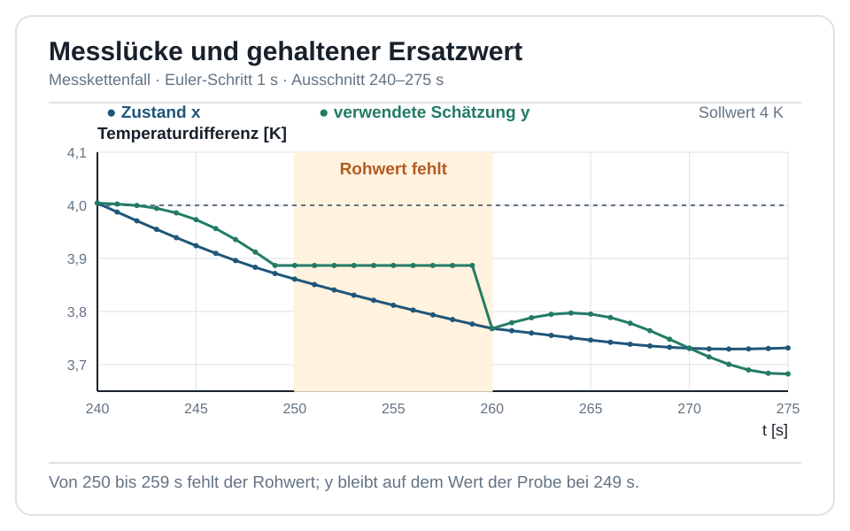

# M8-L3 – Simulation, Referenzwerte und Messdaten {#L3}

**Kursbereich:** M8 – Bachelor: Ingenieurpraxis und Bachelor-Projekt

**Niveau:** Bachelor

**Vorwissen:** [Projektanforderungen](M8-L1.md), [Strecken- und Messmodell](M8-L2.md) und [Rechenexperimente](M2-L7.md).

**Lernziel:** Einen reproduzierbaren Simulationslauf mit dokumentierten Eingaben, Rohwerten, Zustandsgrößen und daraus berechneten Prüfmerkmalen erzeugen.

## Datenfluss und Zeitachse {#S1}

Das Modell verwendet einheitlich Sekunden, Kelvin für Temperaturdifferenzen und Volt für den Rohwert des Sensors. Pro Zeitpunkt wird zuerst der aktuelle Zustand $x_k$ gemessen, dann der Stellwert $u_k$ berechnet und anschließend mit den Werten dieses Zeitpunkts integriert. Beim Euler-Verfahren mit Schrittweite $h$ gilt

$$
x_{k+1}=x_k+\frac{h}{\tau}\left(K_u u_k+d_k-x_k\right).
$$

Das Protokoll enthält sowohl den simulierten Zustand $x_k$ als auch die Messschätzung $y_k$. Der simulierte Zustand dient hier als Referenz für die Prüfmerkmale. In einer realen Anlage kennt der Regler diesen Zustand in der Regel nur über Messungen oder eine Schätzung. Während der Messlücke steht bei $m_k$ ein leeres Feld. Der verwendete Ersatzwert bleibt in $y_k$ sichtbar.

## Reproduzierbarer Rechenversuch {#S2}

Das Programm benötigt die Python-Standardbibliothek. Es berechnet für die Schrittweite von einer Sekunde je 721 Zeilen pro Fall einschließlich des Zeitpunkts 720 s. Der dort angegebene Stellwert wird protokolliert. Für das berichtete Zeitintervall zählt nur, welche Eingaben vor diesem letzten Zeitpunkt zur Zustandsentwicklung beitrugen. Beim Speichern werden die Datenzeilen durch den Namen des jeweiligen Testfalls unterschieden.

```python
import csv
import math

TAU, GAIN, REF = 60.0, 10.0, 4.0
KP, KI = 0.2, 0.2 / TAU
OFFSET, SCALE = 0.30, 1.02
CASES = ("basis", "stoerung", "messkette")

def simulate(case, dt=1.0):
    if case not in CASES or dt not in (1.0, 0.5):
        raise ValueError("Unbekannter Fall oder Zeitschritt")
    x, z, y = 0.0, 0.0, 0.0
    samples = []
    for k in range(int(720 / dt) + 1):
        t = k * dt
        missing = case == "messkette" and 250 <= t < 260
        n = 0.05 * math.sin(2 * math.pi * t / 20) if case == "messkette" else 0.0
        raw = None if missing else OFFSET + SCALE * x + n
        if raw is not None:
            y = (raw - OFFSET) / SCALE
        d = -1.0 if case != "basis" and t >= 240 else 0.0

        e = REF - y
        proposal = KP * e + z
        u = min(1.0, max(0.0, proposal))
        deeper = (proposal >= 1 and e > 0) or (proposal <= 0 and e < 0)
        samples.append((t, x, raw, y, u, d, int(missing)))
        if not deeper:
            z += dt * KI * e
        x += dt * (GAIN * u + d - x) / TAU
    return samples

def metrics(rows):
    arrival = next(t for t, x, *_ in rows if x >= 3.6)
    max_after = max(abs(x - REF) for t, x, *_ in rows if t >= 420)
    return arrival, max_after, sum(row[-1] for row in rows)

with open("temperaturprojekt.csv", "w", encoding="utf-8", newline="") as file:
    writer = csv.writer(file)
    writer.writerow(("fall", "t_s", "x_K", "roh_V", "y_K", "u", "d_K", "luecke"))
    for case in CASES:
        rows = simulate(case)
        assert all(0 <= row[4] <= 1 for row in rows)
        writer.writerows((case, *row) for row in rows)
        print(case, metrics(rows))
```

Die Datei *temperaturprojekt.csv* wird im Arbeitsverzeichnis erstellt. Die drei Spalten für Rohwert, verwendeten kalibrierten Wert und Lückenstatus helfen, die Datenbehandlung separat zu prüfen. Für einen Vergleich mit einer anderen Schrittweite kann man dieselbe Funktion mit $h=0{,}5\,\mathrm s$ ausführen und die Resultate separat protokollieren.

## Erwartete Prüfwerte {#S3}

| Fall bei $h=1\,\mathrm s$ | Erste Probe mit $x\ge3{,}6\,\mathrm K$ | Größter absoluter Sollwertfehler ab 420 s | Fehlende Rohwerte |
| --- | ---: | ---: | ---: |
| Basis | 68 s | etwa $0{,}000003\,\mathrm K$ | 0 |
| Störung | 68 s | $0{,}046309\,\mathrm K$ | 0 |
| Messkette | 69 s | $0{,}045113\,\mathrm K$ | 10 |

Im Fall **Messkette** beträgt die Schätzung zum Ausfallbeginn bei 250 s etwa $3{,}886769\,\mathrm K$. Sie bleibt bis einschließlich 259 s gleich. Der tatsächliche simulierte Zustand fällt in diesem Zeitraum von ungefähr $3{,}861068\,\mathrm K$ auf $3{,}776376\,\mathrm K$. Der Unterschied macht sichtbar, weshalb ein gehaltenes Signal in der Datei gekennzeichnet werden muss.

{alt="Zeitverläufe des simulierten Zustands und der verwendeten Messschätzung im Bereich 240 bis 275 Sekunden; zehn Sekunden ohne Rohwert sind hinterlegt."}

Die Punkte stammen aus dem in dieser Lektion enthaltenen Programm. Die Linien verbinden die diskreten Proben zur Orientierung; sie stellen keine zusätzliche Messauflösung dar. Während der schattierten Phase liegen keine Rohwerte vor. Die grüne Kurve beschreibt nicht neue Sensormessungen, sondern den gehaltenen Ersatzwert.

## Selbstkontrolle {#S4}

1. Wie viele Datenzeilen entstehen für drei Fälle und einen Zeitschritt von einer Sekunde? Zähle die Kopfzeile separat.
2. Im Fall Messkette ist der wahre Zustand bei 250 s etwa $3{,}861068\,\mathrm K$, der Ersatzwert $3{,}886769\,\mathrm K$. Wie groß ist die Differenz $y-x$?
3. Warum kann der Klima-Sollwert in der Rohwertspalte eines Protokolls weder unmittelbar mit $4\,\mathrm K$ verglichen noch aus einer leeren Zelle abgelesen werden?

### Lösungen

1. Pro Fall gibt es 721 Zeilen, insgesamt also 2163 Datenzeilen zuzüglich einer Kopfzeile.
2. Die Differenz ist ungefähr $+0{,}025701\,\mathrm K$. Der weiter verwendete Wert überschätzt in dieser Zeile den simulierten Zustand.
3. Der Rohwert ist eine Spannung und bedarf der Kalibrierung. Eine leere Zelle bedeutet Messlücke. Für den verwendeten Ersatzwert und den Status sind eigene Spalten vorgesehen.

## Grenzen und Weiterlernen {#S5}

Der Vergleich ist deterministisch. Andere Sensorabweichungen, längere Ausfälle und veränderte Modellparameter sind eigene Testfälle. Aus einer reproduzierbaren Datei folgt zunächst, dass dieselbe Rechnung bei gleichen Eingaben wiederholt werden kann. [M8-L4](M8-L4.md) prüft zusätzlich, ob das Modell die ausgewählten Referenzen und Annahmen erfüllt.

## Quellen {#S6}

- [National Academies, Reproducibility and Replicability in Science](https://www.nationalacademies.org/read/25303/chapter/3) · Zusammenfassung zur rechnerischen Wiederholbarkeit mit denselben Eingaben, Verarbeitungsschritten und Bedingungen. Abruf 19.11.2026. · Zuletzt abgerufen: 2026-11-25
- [Åström/Murray – Feedback Systems, Second Edition](https://fbswiki.org/wiki/index.php/Feedback_Systems%3A_An_Introduction_for_Scientists_and_Engineers) · Kapitelübersicht 3, 5, 6, 9 und 11: Modellierung, Dynamik, lineare Systeme, Übertragungsfunktionen und PID; verlinkte Kapitel nicht erneut geprüft. · Zuletzt abgerufen: 2026-11-25
