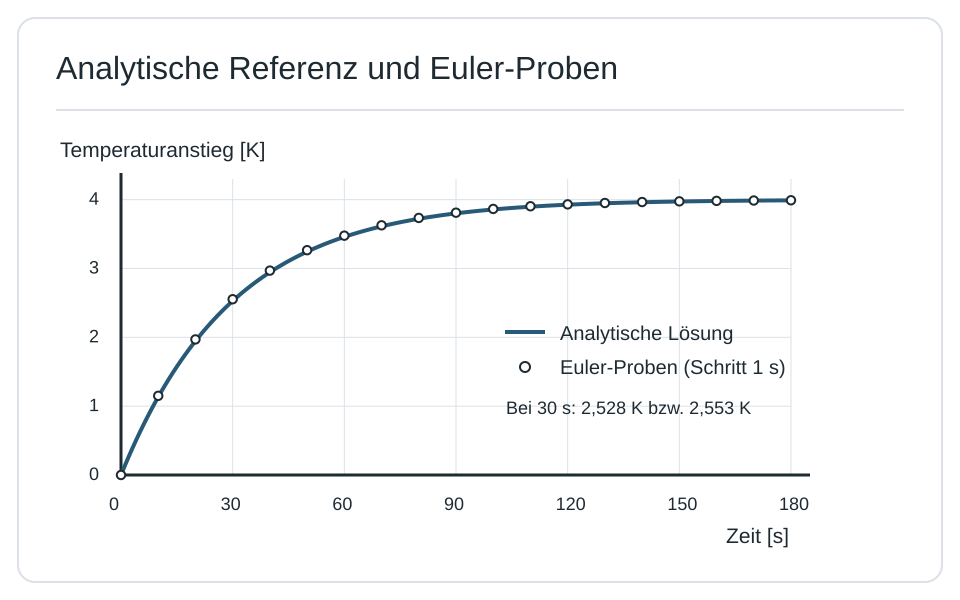

# M8-L4 – Modellvalidierung und Fehlersuche {#L4}

**Kursbereich:** M8 – Bachelor: Ingenieurpraxis und Bachelor-Projekt

**Niveau:** Bachelor

**Vorwissen:** [Rechenversuch und Datensätze](M8-L3.md), [Lineare Differentialgleichungen](M2-L3.md) und [Stabilität](M6-L5.md).

**Lernziel:** Rechenfehler, Modellabweichungen und Messprobleme anhand unterschiedlicher Vergleichsdaten eingrenzen.

## Verschiedene Fragen brauchen verschiedene Belege {#S1}

Die Implementierung ist konsistent, wenn der Code die beschriebenen Gleichungen richtig löst. Die Eignung des Modells ist eine darüber hinausgehende Frage. Ein Rechenergebnis kann präzise zu einem unvollständigen Modell passen. Daher prüfen wir einen analytisch lösbaren Referenzfall, die Empfindlichkeit gegenüber dem Zahlenschritt sowie die Abweichung von einer getrennt gesetzten Teststrecke.

| Frage | Geeigneter Vergleich |
| --- | --- |
| Stimmt die Aktualisierung des Zustands? | Handrechnung des ersten Zeitschritts und analytischer Basisfall. |
| Hängen Prüfwerte stark vom Zeitschritt ab? | Wiederholung mit 1 s und 0,5 s. |
| Erklärt das Modell eine anders parametrierte Teststrecke? | Vergleich des Modellverlaufs mit unabhängigen Referenzwerten und Dokumentation des Residuums. |
| Sind fehlende Rohdaten erkennbar? | Direkter Test von Zeitgrenzen, leerem Feld und Kennzeichnung. |

## Analytische Probe und Schrittvergleich {#S2}

Im Basisfall mit idealer Messung bleibt der Stellwert innerhalb seiner Grenzen. Mit Strecke $10/(60s+1)$ und PI-Regler $0{,}20+0{,}20/(60s)$ ergibt sich die geschlossene Führungsübertragung $1/(30s+1)$. Die exakte kontinuierliche Lösung zum Sollwertsprung lautet

$$
x(t)=4\,\mathrm K\left(1-\mathrm e^{-t/(30\,\mathrm s)}\right).
$$

Für $t=30\,\mathrm s$ liefert sie rund $2{,}5285\,\mathrm K$. Der Euler-Lauf mit einer Sekunde ergibt dort $2{,}5534\,\mathrm K$. Die Differenz von rund $0{,}0249\,\mathrm K$ lässt sich als Diskretisierungseffekt eingrenzen. Sie entsteht im deterministischen Basisfall vor jeder Messlücke. Als erste Probe ab $3{,}6\,\mathrm K$ liefert der gröbere Lauf 68 s, der halbierte Lauf 69 s. Die analoge Gleichung erreicht die Schwelle bei $30\,\mathrm s\ln 10\approx69{,}08\,\mathrm s$.

Im Störfall steigt der höchste Fehler nach 420 s von $0{,}046309\,\mathrm K$ auf $0{,}046812\,\mathrm K$, wenn der Zeitschritt halbiert wird. Beide Ergebnisse liegen unter $0{,}10\,\mathrm K$. Im Messkettenfall werden 10 beziehungsweise 20 Zeilen in der Lücke markiert. Ihre Dauer bleibt gleich.

{alt="Kurve der Temperaturabweichung im Basisfall. Die analytische Referenz und die Punkte des Euler-Verfahrens werden anhand des Werts bei 30 Sekunden verglichen."}

## Gegentest: Die Teststrecke reagiert langsamer {#S3}

Für einen zusätzlichen synthetischen Versuch liegt ein konstanter Stellwert $u=0{,}4$ an, der PI-Regler ist dabei durch diese konstante Eingabe ersetzt. Die Teststrecke hat $\tau=72\,\mathrm s$. Sie liefert bei 60 s ungefähr $2{,}262\,\mathrm K$. Das Ausgangsmodell mit $\tau=60\,\mathrm s$ liefert $2{,}528\,\mathrm K$. Das Residuum $x_\mathrm{Test}-x_\mathrm{Modell}$ ist damit ungefähr $-0{,}267\,\mathrm K$.

Das Vorzeichen passt zur langsameren Teststrecke. Zeigt sich die Abweichung an mehreren Zeitpunkten mit ähnlichem Muster, kann die Zeitkonstante ein Erklärungsansatz sein. Eine einzelne Zahl lässt zusätzlich eine andere stationäre Verstärkung, Messkalibrierfehler oder eine falsch gestartete Zeitachse zu. Man betrachtet daher mehrere Proben, den Endwert und einen zweiten Lauf. Das synthetische Gegenbeispiel prüft die Fehlersuche. Ein Nachweis an einem realen Raum erfordert reale Vergleichsdaten.

## Selbstkontrolle {#S4}

1. Für $x(0)=0$ und $x_\infty=4\,\mathrm K$ liefert ein offener Test bei 60 s $x=2{,}5285\,\mathrm K$. Schätze die Zeitkonstante mit dem Modell erster Ordnung.
2. In einem Log fehlen bei $h=1\,\mathrm s$ die Rohwerte von 250 s bis 260 s einschließlich. Wo liegt die Abweichung zur Anforderung?
3. Warum ist ein Vergleich von zwei Euler-Schritten allein schwächer als ein Vergleich mit der analytischen Lösung?

### Lösungen

1. Die normierte Abweichung vom Endwert beträgt ungefähr $1-2{,}5285/4=0{,}3679$. Damit ist $\tau=-60\,\mathrm s/\ln(0{,}3679)\approx60\,\mathrm s$.
2. Die Obergrenze des Intervalls ist exklusiv. 260 s muss bereits einen gültigen Rohwert haben. Elf markierte Zeilen würden einen Grenzfehler in der Umsetzung zeigen.
3. Ein gemeinsamer Implementierungsfehler kann in beiden Euler-Läufen stecken. Die unabhängig hergeleitete Lösung ist eine Referenz für die Modellrechnung im vereinfachten Fall.

## Grenzen und Weiterlernen {#S5}

Die Schwellen werden an diskreten Stichproben geprüft. Seltene Abweichungen zwischen zwei Proben wären mit dichterer Simulation oder einer analytischen Schranke zu untersuchen. [M8-L5](M8-L5.md) ordnet die Befunde in Bericht und Nachweismatrix ein.

## Quellen {#S6}

- [Åström/Murray – Feedback Systems, Second Edition](https://fbswiki.org/wiki/index.php/Feedback_Systems%3A_An_Introduction_for_Scientists_and_Engineers) · Kapitelübersicht 3, 5, 6, 9 und 11: Modellierung, Dynamik, lineare Systeme, Übertragungsfunktionen und PID; verlinkte Kapitel nicht erneut geprüft. · Zuletzt abgerufen: 2026-11-25
- [NASA Systems Engineering Handbook, Appendix D](https://www.nasa.gov/reference/appendix-d-requirements-verification-matrix/) · Rückverfolgung zu Nachweisen und Prüfmethoden. Abruf 19.11.2026. · Zuletzt abgerufen: 2026-11-25
