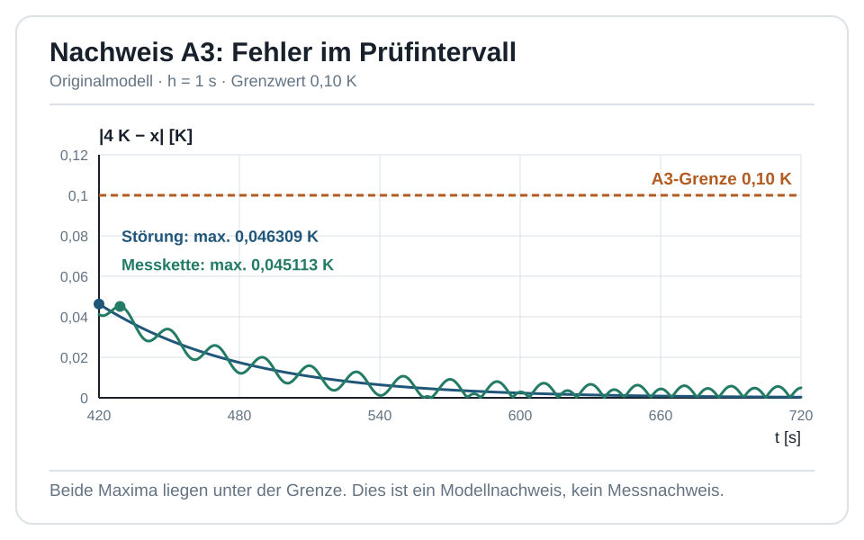

# M8-L5 – Technischer Bericht und Reproduzierbarkeit {#L5}

**Kursbereich:** M8 – Bachelor: Ingenieurpraxis und Bachelor-Projekt

**Niveau:** Bachelor

**Vorwissen:** [Anforderungsmatrix](M8-L1.md), [Datenprotokoll](M8-L3.md) und [Referenztests](M8-L4.md).

**Lernziel:** Einen überprüfbaren technischen Projektbericht formulieren, der Entscheidungen, Ergebnisse, Unsicherheiten und Grenzen klar benennt.

## Bericht und Prüfbelege {#S1}

Beginne den Bericht mit der Projektfrage und dem wichtigsten Ergebnis. Beschreibe die Temperaturdifferenz als Zielgröße, die geprüften Fälle, die Modellannahmen und die Datengrundlage. Die Details der Simulationsschleife gehören in die Methode oder einen Anhang. Im Haupttext genügt eine Grafik, wenn sie die Prüfentscheidung stützt und Zeitachse, Einheiten, Sollwert und Störbeginn erkennen lässt. In der Nachweismatrix zeigt jede Zeile, auf welchem Test die Aussage beruht.

| Kennung | Befund für $h=1\,\mathrm s$ | Beleg |
| --- | --- | --- |
| A1 | Erfüllt. Die erste Stichprobe ab $3{,}6\,\mathrm K$ liegt im Basisfall bei 68 s. | Spalte $x$ der Basisdaten. |
| A2 | Erfüllt. Alle protokollierten Stellwerte liegen in $[0,1]$. | Bereichstest der Stellwertspalte für alle drei Testfälle. |
| A3 | Erfüllt. Größter geprüfter Sollwertfehler $0{,}046309\,\mathrm K$ im Störfall und $0{,}045113\,\mathrm K$ im Messkettenfall. | Maximum der absoluten Fehler über die Zeilen ab 420 s. |
| A4 | Erfüllt. Genau zehn Rohwerte fehlen. Status und gehaltene Schätzung sind sichtbar. | Zeitvergleich für die Zeilen von 250 bis 259 s. |

Die Aussage „A2 erfüllt“ ist schmaler als eine Aussage über die Machbarkeit der Heizleistung. A2 prüft eine dimensionslose Eingabe des Modells, bei der die Grenze Teil des Programms ist. Die Frage, ob eine realisierte Anlage einen entsprechenden Stellwert sicher und ausreichend genau umsetzt, braucht zusätzliche Anforderungen und Nachweise.

{alt="Absoluter Sollwertfehler der beiden gestörten Fälle im Prüfintervall 420 bis 720 Sekunden, mit Anforderungsgrenze 0,10 Kelvin."}

Der dargestellte Ausschnitt enthält sämtliche 301 Prüfproben pro Fall. Der größte absolute Fehler wird jeweils aus diesen Werten bestimmt, nicht aus dem Endwert. Die Grafik liefert damit eine direkte Evidenz für A3 im numerischen Modell; andere Anforderungen und die reale Anlage benötigen eigene Nachweise.

## Zahlen mit passender Genauigkeit berichten {#S2}

In der Nachweismatrix lässt sich die programminterne Zahl wiederfinden. In der Ergebniszusammenfassung genügt „rund $0{,}05\,\mathrm K$ maximaler Fehler nach 420 s“. Im Störfall verändert die Halbierung des Zeitschritts diesen Prüfwert um ungefähr $0{,}0005\,\mathrm K$. Das beschreibt in diesem Vergleich die numerische Empfindlichkeit. Es ist keine ermittelte Messunsicherheit eines realen Geräts.

Für Unsicherheiten trennst du die Annahmen nach ihrer Herkunft. Die Zeitauflösung stammt aus dem Berechnungsverfahren. Sensorverstärkung, Offset und mögliche Drift stammen aus der Messkette. Eine nicht modellierte räumliche Temperaturverteilung betrifft die Modellwahl. Setze nur für Größen mit nachvollziehbaren Eingangsangaben ein quantitatives Unsicherheitsbudget an.

## Reproduktionsanleitung und Abschlussprüfung {#S3}

Eine andere Person braucht den Programmtext aus der Lektion, die verwendete Python-Version, die Eingaben der drei Fälle und eine Beschreibung der erzeugten Datei. Sie sollte dieselbe Schwellenentscheidung nachvollziehen können. Eine kurze Wiederholungsanleitung hält fest, in welchem Verzeichnis der Lauf seine CSV erzeugt und welche Spalten und Zeitbereiche auszuwerten sind. Beim späteren Vergleichen zweier Fassungen sollte erkennbar sein, ob das Modell, die Datenaufbereitung oder allein die Darstellung geändert wurde.

Ein kompakter Abschlussbericht kann so aufgebaut sein:

1. Frage, Geltungsbereich, Prüfkriterien.
2. Strecken-, Mess- und Reglermodell mit Einheiten.
3. Testfälle, Programmversion und Datenherkunft.
4. Ergebnisse, Nachweismatrix und Vergleichsläufe.
5. Grenzen, offene Fragen und Wiederholungsanleitung.

Die gute wissenschaftliche Praxis beginnt schon beim Aufzeichnen der Versuche. Bewahre auch einen Lauf auf, der eine Anforderung verfehlt hat, sofern er eine technische Erkenntnis liefert. Erkläre Korrekturen am Modell oder an der Rechnung mit ihren Auswirkungen auf die Schlussfolgerung.

## Selbstkontrolle {#S4}

1. Formuliere eine belastbare Zusammenfassung zu A3 in einem Satz. Sie soll Ergebnis, Szenarien und Zeitintervall enthalten.
2. Ein Bericht enthält zwei gerundete Zahlen zu A3. Wie überprüfst du die Aussage ohne den Programmtext erneut laufen zu lassen?
3. Schlage einen ergänzenden Test für eine deutlich längere Messlücke vor. Welche Angaben gehören vor der Durchführung in die Anforderung?

### Lösungen

1. „In den beiden simulierten Fällen mit Kühlstörung lag der absolute Sollwertfehler an allen geprüften Zeitpunkten von 420 bis 720 s unter $0{,}10\,\mathrm K$.“
2. Verwende die gespeicherte CSV, filtere nach den zwei Testfällen und $420\le t\le720$, berechne $|4\,\mathrm K-x|$ pro Zeile und vergleiche die jeweiligen Maxima mit der Schwelle.
3. Lege Lückenbeginn, Lückendauer, Ersatzstrategie, Beobachtungsintervall und eine zulässige Abweichung fest. Lege getrennt fest, wann der Ausfallstatus sichtbar sein muss. Die Bewertung hängt vom Testzweck ab.

## Abschluss und Weiterlernen {#S5}

Mit diesem Projekt kann eine Leserin oder ein Leser den fachlichen Weg von Anforderung und Modell über Daten bis zum Bericht nachvollziehen. Im [Studienweg](pages/studienweg.md) findest du die anschließenden Wahlmodule, für die sich dieselbe Nachweisstruktur verwenden lässt.

## Quellen {#S6}

- [KIT, B.Sc. Elektrotechnik und Informationstechnik, Modulhandbuch WiSe 2026/27](https://s.kit.edu/mhb-etit-bsc23) · § 13.56, Projektarbeit mit guter wissenschaftlicher Praxis. · Zuletzt abgerufen: 2026-11-25
- [National Academies, Reproducibility and Replicability in Science](https://www.nationalacademies.org/read/25303/chapter/3) · Zusammenfassung zu reproduzierbaren Rechenstudien. Abruf 19.11.2026. · Zuletzt abgerufen: 2026-11-25
- [JCGM 100:2008, Guide to the Expression of Uncertainty in Measurement](https://www.bipm.org/en/doi/10.59161/jcgm100-2008e) · Umfang und Dokumentation von Messunsicherheit. Abruf 19.11.2026. · Zuletzt abgerufen: 2026-11-25
