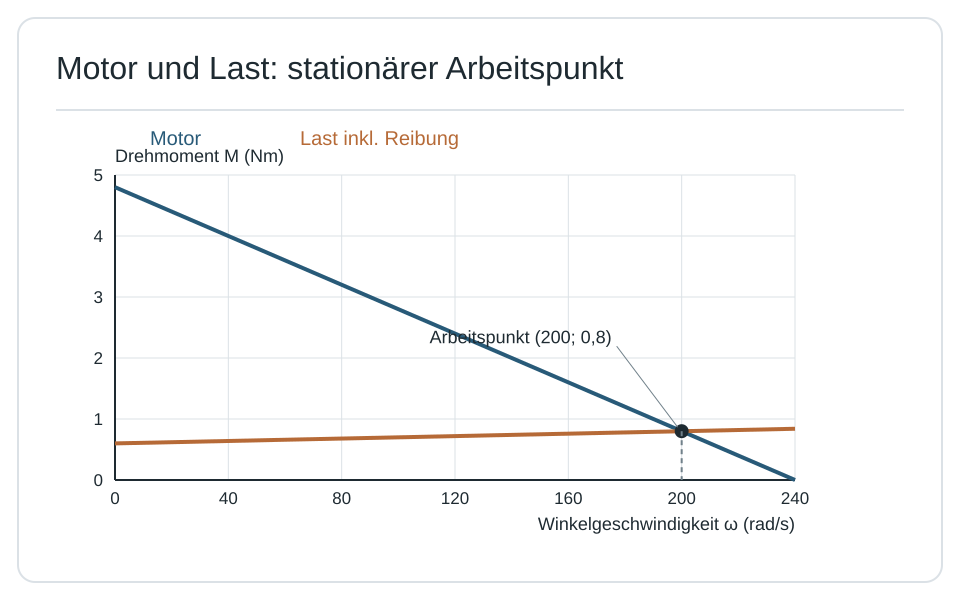

# M9-L1 – Motor, Last und mechanischer Arbeitspunkt {#L1}

**Kursbereich:** M9 – Bachelor: Elektrische Antriebe und Leistungselektronik

**Niveau:** Bachelor · Wahlbereich

**Vorwissen:** [Elektrische Maschinen im Überblick](M7-L4.md), [Leistungsbilanz](M1-L1.md).

**Lernziel:** Drehmoment, Drehzahl, mechanische Lastkennlinie und Wirkungsgrad an einem Gleichstrommaschinenmodell bestimmen; stationären und dynamischen Betrieb unterscheiden.

## Vom elektrischen zum mechanischen Port {#S1}

Ein Antrieb besteht aus Energiequelle, Umrichter, Maschine und mechanischer Last. Beim Heben einer Last muss die Maschine Energie gegen die Schwerkraft übertragen; beim Absenken kann die Last Energie an die Maschine abgeben. Die Bewegungsrichtung allein entscheidet daher nicht darüber, ob die Maschine als Motor oder Generator arbeitet.

Wir zählen den Ankerstrom $i$ in den positiven Spannungsanschluss und das elektromagnetische Drehmoment $M$ in Richtung der positiven Winkelgeschwindigkeit $\omega$. Für eine Gleichstrommaschine mit konstantem Erregerfluss und idealisierter Kommutierung gilt

$$
u=Ri+L\frac{di}{dt}+k_e\omega,\qquad M=k_t i.
$$

Der letzte Spannungsterm ist die Gegen-EMK (elektromotorische Kraft). In konsistenten SI-Einheiten haben $k_e$ in $\mathrm{V\,s/rad}$ und $k_t$ in $\mathrm{N\,m/A}$ denselben Zahlenwert $k$, sofern das Wandlungsmodell verlustfrei ist: $k_e\omega i=M\omega$. Die mechanische Leistung beträgt $P_\mathrm{mech}=M\omega$; die Drehzahl $n$ in Umdrehungen pro Minute ist über $\omega=2\pi n/60$ umzurechnen. Im Stillstand kann ein Motor ein Drehmoment erzeugen, aber keine mechanische Leistung abgeben.

## Lastkennlinie und stationärer Arbeitspunkt {#S2}

Für eine starre Welle mit Trägheitsmoment $J$, viskoser Reibung $B$ und äußerem, in positiver Drehrichtung entgegenwirkendem Lastmoment $M_L$ gilt

$$
J\dot\omega=M-B\omega-M_L.
$$

Bei konstanter Spannung und stationärem Strom folgt $M=k(u-k\omega)/R$. Die Motorkennlinie fällt linear mit $\omega$. Die benötigte Lastkennlinie $M_\mathrm{erf}=M_L+B\omega$ steigt bei $B>0$. Ihr Schnittpunkt ist der stationäre Arbeitspunkt. Wird die Welle bei konstantem $u$ etwas langsamer, wächst im stationären elektrischen Modell das Motormoment; dies wirkt der Verlangsamung entgegen. Die dynamische Stabilität mit endlichem $L$ muss gesondert untersucht werden.

{alt="Fallende Motorkennlinie und steigende Lastkennlinie mit Schnittpunkt bei 200 rad/s und 0,8 Nm."}

Ein Lüfter kann näherungsweise ein mit $\omega^2$ wachsendes Gegenmoment (für positive Drehung) besitzen, während ein Förderband häufig ein annähernd konstantes Lastmoment benötigt. Die ideale unbelastete Drehzahl $u/k$ setzt auch $B=0$ voraus. Der Stillstandsstrom $u/R$ ist lediglich ein Modellwert und kann real thermisch unzulässig sein.

## Rechenbeispiel: Arbeitspunkt und Leistung {#S3}

Gegeben seien $u=24\,\mathrm V$, $R=0{,}5\,\Omega$, $k=0{,}1$ in den obigen SI-Einheiten, $B=0{,}001\,\mathrm{N\,m\,s/rad}$ und $M_L=0{,}6\,\mathrm{N\,m}$. Aus $k(u-k\omega)/R=B\omega+M_L$ folgt

$$
\omega=\frac{ku/R-M_L}{B+k^2/R}=200\,\mathrm{rad/s},\qquad i=8\,\mathrm A.
$$

Das sind etwa 1910 Umdrehungen pro Minute. Das elektromagnetische Moment beträgt $0{,}8\,\mathrm{N\,m}$. Die Leistung an der äußeren Last ist $P_L=M_L\omega=120\,\mathrm W$. Die elektrische Eingangsleistung ist $192\,\mathrm W$. Im stationären Modell entfallen $32\,\mathrm W$ auf $Ri^2$ und $40\,\mathrm W$ auf $B\omega^2$. Die Bilanz $192=120+32+40$ stimmt. Der Wirkungsgrad bezogen auf die äußere Last beträgt $62{,}5\,\%$. Die innere Wandlungsleistung von 160 W darf nicht mit der Nutzleistung verwechselt werden.

## Betriebsquadranten und Modellgrenzen {#S4}

| Winkelgeschwindigkeit | Elektromagnetisches Moment | Wandlungsleistung |
| --- | --- | --- |
| positiv | positiv | Motorbetrieb |
| positiv | negativ | Generatorisches Bremsen |
| negativ | negativ | Motorbetrieb rückwärts |
| negativ | positiv | Generatorisches Bremsen rückwärts |

Die Tabelle beschreibt die innere Wandlungsleistung. Nutzbare elektrische Rückspeisung setzt voraus, dass die gewandelte Leistung die Verluste übersteigt und Quelle sowie Umrichter Energie aufnehmen können. Das Gleichstrommodell lässt sich nicht direkt auf Asynchronmaschinen oder feldorientiert geregelte Synchronmaschinen übertragen. Sättigung, Bürstenabfall und temperaturabhängiger Widerstand sind hier nicht erfasst.

## Übungen mit Lösungen {#S5}

1. Wie verändert sich der Arbeitspunkt des Beispiels bei $M_L=0{,}81\,\mathrm{N\,m}$?  
   **Lösung** $\omega=(4{,}8-0{,}81)/0{,}021=190\,\mathrm{rad/s}$; $i=10\,\mathrm A$ und $M=1\,\mathrm{N\,m}$.
2. Ein Motor erzeugt bei $\omega=-50\,\mathrm{rad/s}$ ein positives Moment von $2\,\mathrm{N\,m}$. Welche Leistung wird intern gewandelt?  
   **Lösung** $M\omega=-100\,\mathrm W$. Die Maschine nimmt mechanische Energie auf; der elektrische Nettoertrag hängt von Verlusten und Umrichter ab.
3. Warum ist der Wirkungsgrad des Beispiels bei blockierter Welle null, sofern eine positive Eingangsleistung fließt?  
   **Lösung** $P_L=M_L\omega=0$; ohne Bewegung wird keine äußere mechanische Arbeit verrichtet.

**Weiterführend:** [Leistungshalbleiter und Schaltzustände](M9-L2.md)

## Quellen {#S6}

- [KIT – Elektrische Antriebe und Leistungselektronik](https://www.eti.kit.edu/studium_ems.php) · Bachelor EAL, WS 25/26, Veranstaltung 2306660: Antriebe und Umwandlung; kein mathematisches Drehmoment-Drehzahl-Modell. · Zuletzt abgerufen: 2026-11-25
- [TU Delft OpenCourseWare, Electrical machines and drives, Lecture 4](https://ocw.tudelft.nl/course-lectures/4-dc-machines-and-drives/) · Vorlesung 04, Themenliste: Ankerspannung, Drehmoment, Drehzahlsteuerung; Folien nicht geprüft. · Zuletzt abgerufen: 2026-11-25
- [MIT OpenCourseWare, 6.685 Electric Machines, Kursnotizen](https://ocw.mit.edu/courses/6-685-electric-machines-fall-2013/pages/course-notes/) · (Kapitel 6) · Zuletzt abgerufen: 2026-11-25
