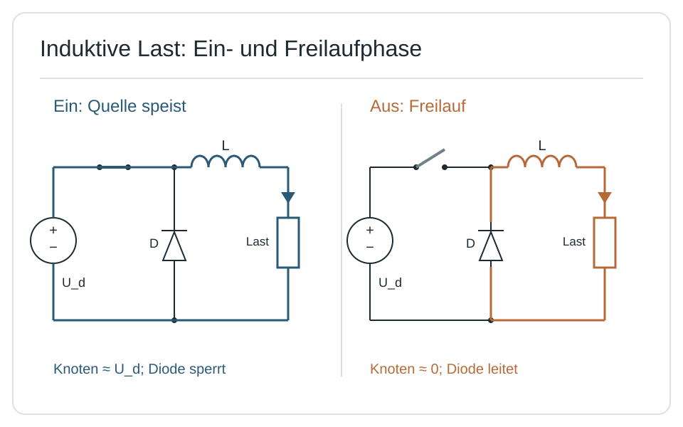

# M9-L2 – Leistungshalbleiter und Schaltzustände {#L2}

**Kursbereich:** M9 – Bachelor: Elektrische Antriebe und Leistungselektronik

**Niveau:** Bachelor · Wahlbereich

**Vorwissen:** [Diode und Gleichrichtung](M3-L2.md), [Transistoren](M3-L3.md), [Speicherbauteile](M1-L5.md).

**Lernziel:** Schaltzustände einer induktiven Last bilanzieren und Leit-, Schalt- und thermische Verluste in einem vereinfachten Modell abschätzen.

## Schalten statt linearer Spannungsregelung {#S1}

Ein linear betriebenes Stellglied kann gleichzeitig eine beträchtliche Spannung und einen beträchtlichen Strom aufnehmen. Der ideale Leistungsschalter besitzt dagegen zwei Zustände: Im leitenden Zustand ist der Spannungsabfall null, im sperrenden Zustand der Strom null. Damit ist $p=ui$ in beiden Zuständen null. Über die Dauer der Zustände lässt sich der Energiefluss steuern. Die Schaltfrequenz $f_s=1/T_s$ bezeichnet die Wiederholrate eines vollständigen Schaltzyklus.

Eine Diode leitet im Modell nur in Vorwärtsrichtung; ein gesteuerter MOSFET kann im eingeschalteten Kanal in beiden Stromrichtungen leiten. Seine Body-Diode kann auch bei abgeschaltetem Gate einen Strompfad eröffnen. Ein IGBT wird häufig mit einer antiparallelen Diode kombiniert. Die Eignung eines Bauteils hängt von Sperrspannung, Strom, Verlusten, Temperatur und Schaltverhalten ab, nicht allein vom Bauteiltyp.

## Induktive Last und Freilauf {#S2}

Für eine Induktivität gilt $u_L=L\,di/dt$. Ist der Spulenstrom positiv, kann er sich bei endlicher Spannung nicht sprunghaft ändern. Nach dem Abschalten des oberen Schalters eines Tiefsetzstellers übernimmt die Freilaufdiode zunächst den Strom. Im eingeschalteten Zustand liefert die Quelle Energie an die Last und gegebenenfalls die Spule; im Freilauf gibt die Spule gespeicherte Energie ab.

{alt="Zwei Schaltzustände des Tiefsetzstellers: links Quelle und Spule, rechts Freilaufpfad durch die Diode."}

| Zustand | Oberer Schalter | Freilaufdiode bei positivem Strom | Knotenpotential gegen Masse (ideal) |
| --- | --- | --- | --- |
| Ein | leitend | sperrt | $U_d$ |
| Aus | sperrt | leitet | $0$ |

Bei aussetzendem Spulenstrom endet der Freilauf. Ein dritter Zustand mit stromloser Spule wird dann erforderlich. Bei einer synchronen Halbbrücke ersetzt ein aktiv gesteuerter Schalter den Freilaufpfad. Beide Schalter dürfen nicht gleichzeitig eingeschaltet sein (Brückenkurzschluss); eine Totzeit trennt die Ansteuerungen. Während der Totzeit hängt die Knotenspannung von Stromrichtung und Diodenpfad ab. Reale induktive Schaltkreise brauchen zusätzlich Schutz gegen parasitäre Überspannungen. Dieses Modul verwendet ausschließlich gedachte Schaltungen und Simulationen, keine Aufbauanleitung.

## Verlustmodelle {#S3}

Für einen MOSFET mit konstant angenommenem Einschaltwiderstand $R_\mathrm{DS,on}$ ergibt sich die mittlere Leitverlustleistung aus dem quadratischen Strommittel über den gesamten Zyklus. Für annähernd konstanten Strom $I$ und Einschaltdaueranteil $D$ gilt $P_\mathrm{leit}\approx D R_\mathrm{DS,on}I^2$. Für eine Diode mit konstantem Vorwärtsabfall $U_F$ ergibt sich dagegen näherungsweise $P_D=(1-D)U_F I$.

Während realer Schaltübergänge überlappen Strom und Spannung. Ein einfaches Modell mit linearer Überlappung ergibt

$$
E_\mathrm{sw}\approx\frac12 U I(t_r+t_f),\qquad P_\mathrm{sw}=f_s E_\mathrm{sw}.
$$

Dabei fassen $t_r$ und $t_f$ die wirksamen Überlappungsdauern zusammen. Die Gleichung setzt passende Strom- und Spannungsverläufe voraus; reale Datenblatt-Schaltenergien können davon abweichen. Gate-Ansteuerung, Ausgangskapazität und Dioden-Rückerholung sind zusätzliche Verlustbeiträge, soweit nicht bereits in den verwendeten Schaltenergien enthalten.

## Rechenbeispiel: Verlust und Temperatur {#S4}

Ein hypothetischer Tiefsetzsteller arbeitet mit $U=48\,\mathrm V$, $I=10\,\mathrm A$, $D=0{,}5$, $f_s=20\,\mathrm{kHz}$, $R_\mathrm{DS,on}=20\,\mathrm{m}\Omega$, $U_F=0{,}8\,\mathrm V$ und $t_r+t_f=100\,\mathrm{ns}$. Daraus ergeben sich $P_\mathrm{leit}=1\,\mathrm W$, $P_D=4\,\mathrm W$, $E_\mathrm{sw}=24\,\mathrm{\mu J}$ und $P_\mathrm{sw}=0{,}48\,\mathrm W$. Die Summe beträgt $5{,}48\,\mathrm W$.

Bei angenommener Nutzleistung von 240 W und ausschließlich diesen Verlusten gilt $\eta=240/(240+5{,}48)\approx97{,}77\,\%$. Diese separate Leistungsbilanz setzt einen entsprechend angepassten Eingangsstrom voraus. Für den MOSFET allein gilt bei einer angenommenen thermischen Gesamtresistenz von $R_\theta=25\,\mathrm{K/W}$ zur konstanten Umgebung mit $T_a=40\,^\circ\mathrm C$:

$$
T_j\approx T_a+R_\theta(P_\mathrm{leit}+P_\mathrm{sw})=77\,^\circ\mathrm C.
$$

Die Diode braucht eine eigene thermische Bilanz. Gegenseitige Erwärmung ist nicht im Modell enthalten. Ein Grenzwertnachweis erfordert reale Daten, Kühlbedingungen und Temperaturabhängigkeiten. Verdopplung der Schaltfrequenz verdoppelt unter konstanten Annahmen die Schaltverluste, nicht die Leitverluste.

## Übungen mit Lösungen {#S5}

1. Wie groß ist die Summe der drei Verluste bei 40 kHz und sonst unveränderten Daten?  
   **Lösung** $1+4+0{,}96=5{,}96\,\mathrm W$.
2. Weshalb kann ein geöffnetes Schaltelement bei fehlendem Freilaufpfad einer hohen Spannung ausgesetzt sein?  
   **Lösung** Eine erzwungene schnelle Stromänderung erzeugt nach $u_L=L\,di/dt$ eine hohe Induktionsspannung.
3. Welchen Leitverlust liefert eine Verdopplung des Stromes bei konstantem $D$ und $R_\mathrm{DS,on}$?  
   **Lösung** Vierfachen MOSFET-Leitverlust. Der Diodenverlust verdoppelt sich im konstanten Spannungsabfallmodell.

**Weiterführend:** [DC/DC-Wandler und Pulsweitenmodulation](M9-L3.md)

## Quellen {#S6}

- [MIT OpenCourseWare, 6.334 Power Electronics, Vorlesungsnotizen](https://ocw.mit.edu/courses/6-334-power-electronics-spring-2007/pages/lecture-notes/) · (Kapitel 1, 5, 11 und 13) · Zuletzt abgerufen: 2026-11-25
