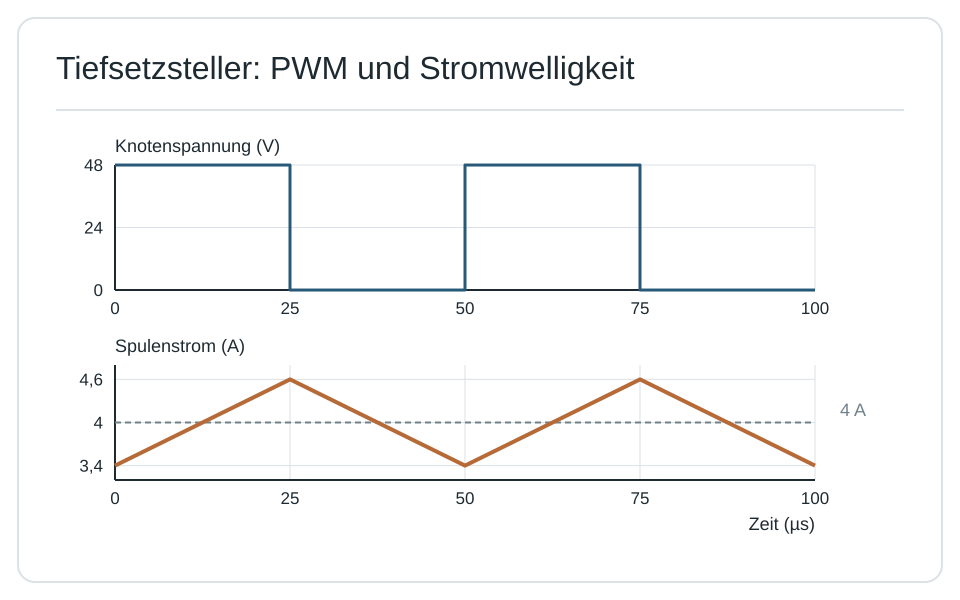

# M9-L3 – DC/DC-Wandler und Pulsweitenmodulation {#L3}

**Kursbereich:** M9 – Bachelor: Elektrische Antriebe und Leistungselektronik

**Niveau:** Bachelor · Wahlbereich

**Vorwissen:** [Schaltzustände](M9-L2.md), [Kondensator und Spule](M1-L5.md).

**Lernziel:** Spannungsübersetzung aus periodischer Speicherbilanz herleiten und die Stromwelligkeit sowie die Gültigkeit des kontinuierlichen Betriebs prüfen.

## Mittelwert und periodischer Zustand {#S1}

Die Pulsweitenmodulation (PWM) verändert die Dauer $DT_s$ des Einschaltzustands, bei hier festem $T_s$. Ein periodisch stationärer Betrieb besitzt zu Beginn und Ende jeder Periode identische Speicherzustände. Daraus folgen die Voltsekunden- und Ladungsbilanz

$$
\int_0^{T_s}u_L(t)\,dt=0,\qquad \int_0^{T_s}i_C(t)\,dt=0.
$$

Die erste Beziehung folgt aus $L\Delta i_L$, die zweite aus $C\Delta u_C$. Sie gelten auch bei nichtsinusförmigen Signalen. Wir betrachten idealisierte, nichtisolierte Wandler im kontinuierlichen Strombetrieb (CCM) und nehmen eine kleine Ausgangsspannungswelligkeit an. Die Ausgangsspannung kann dann während einer Periode näherungsweise als konstant angesehen werden.

## Tiefsetzsteller (Buck) {#S2}

Die Schaltzustände aus [M9-L2](M9-L2.md) liefern $u_L=U_d-U_o$ beim Einschalten und $u_L=-U_o$ im Freilauf. Die Voltsekundenbilanz ergibt

$$
D(U_d-U_o)+(1-D)(-U_o)=0,\qquad U_o=D U_d.
$$

Der Spulenstrom steigt und fällt im idealisierten Modell linear. Die Spitze-Spitze-Welligkeit beträgt

$$
\Delta i_{L,pp}=\frac{(U_d-U_o)D}{Lf_s}.
$$

{alt="PWM-Knotenspannung 48/0 V und dreieckförmiger Spulenstrom von 3,4 bis 4,6 A bei D = 0,5."}

Beispiel: $U_d=48\,\mathrm V$, $D=0{,}5$, $L=500\,\mathrm{\mu H}$, $f_s=20\,\mathrm{kHz}$ und $R_L=6\,\Omega$. Es folgen $U_o=24\,\mathrm V$, $I_o=4\,\mathrm A$ und $\Delta i_{L,pp}=1{,}2\,\mathrm A$. Der minimale Spulenstrom ist $3{,}4\,\mathrm A$; CCM ist damit konsistent. Ein idealer Wandler liefert $P_o=96\,\mathrm W$ und nimmt im Mittel $2\,\mathrm A$ bei 48 V auf. Der mittlere Eingangsstrom ist nicht identisch mit dem mittleren Spulenstrom.

Mit $C=100\,\mathrm{\mu F}$ und idealem Kondensator gilt näherungsweise $\Delta u_{o,pp}=\Delta i_{L,pp}/(8Cf_s)=75\,\mathrm{mV}$. Die Formel folgt aus der positiven Dreiecksfläche des Kondensatorstromes $i_C=i_L-I_o$ über eine halbe Periode. Ein Serienwiderstand (ESR) des Kondensators erzeugt einen zusätzlichen Welligkeitsbeitrag.

## Hochsetzsteller (Boost) {#S3}

Beim Einschalten des unteren Schalters liegt $U_d$ an der Spule; die Diode zum Ausgang sperrt und der Kondensator versorgt die Last. Beim Ausschalten addiert sich die Induktionswirkung zur Quelle; die Diode führt Spulenstrom zum Ausgang. In CCM gilt $u_L=U_d-U_o$ für die Ausschaltphase. Somit

$$
D U_d+(1-D)(U_d-U_o)=0,\qquad U_o=\frac{U_d}{1-D}.
$$

Die Welligkeit beträgt $\Delta i_{L,pp}=U_dD/(Lf_s)$. Bei $U_d=24\,\mathrm V$, $D=0{,}5$, $L=500\,\mathrm{\mu H}$ und $f_s=20\,\mathrm{kHz}$ folgt $U_o=48\,\mathrm V$ und $\Delta i_{L,pp}=1{,}2\,\mathrm A$. Für eine Last von 24 Ω ergibt sich $I_o=2\,\mathrm A$ und im verlustfreien Modell $I_d=4\,\mathrm A$. Der Spulenstrom ist hier zugleich Eingangsstrom. CCM ist erfüllt. Das scheinbare Anwachsen der Ausgangsspannung gegen unendlich für $D\to1$ ist eine Modellgrenze: Ohne Ausschaltphase kann keine periodische Energieabgabe über die Diode erfolgen.

## Modellwahl an der CCM-Grenze {#S4}

Für den Tiefsetzsteller mit Diodenfreilauf und ohmscher Last gilt an der CCM-Grenze $I_o=\Delta i_{L,pp}/2$. Im ersten Beispiel ist dies $0{,}6\,\mathrm A$. Die zugehörige Last beträgt $R_\mathrm{krit}=24/0{,}6=40\,\Omega$. Bei größerem Lastwiderstand würde das CCM-Modell einen negativen Strom vorhersagen. Die Diode verhindert diesen; es gilt dann ein lastabhängiges Modell mit stromloser Phase (DCM). Ein aktiv bidirektionaler synchroner Wandler kann dagegen negative Ströme zulassen.

Die Schaltwelligkeit ist nicht dasselbe wie die langsamere Regelabweichung. Für eine Regelung ist häufig das gemittelte Wandlermodell zweckmäßig; für Stromspitzen, Verluste und elektromagnetische Störungen muss der Schaltverlauf genauer betrachtet werden.

## Übungen mit Lösungen {#S5}

1. Wie groß ist $D$ für einen idealen Buck mit 36 V Eingang und 12 V Ausgang?  
   **Lösung** $D=1/3$.
2. Wie verändern sich bei konstantem Arbeitspunkt und doppelt so großer Induktivität die Stromwelligkeit und die ideale mittlere Ausgangsspannung?  
   **Lösung** Die Welligkeit halbiert sich; der Mittelwert bleibt unverändert, solange das CCM-Modell gilt.
3. Ein idealer Boost liefert aus 12 V eine Ausgangsspannung von 36 V. Bestimme $D$ und bei $I_o=1\,\mathrm A$ den mittleren Eingangsstrom.  
   **Lösung** $D=2/3$, $I_d=3\,\mathrm A$ aus der Leistungsbilanz. Ob CCM gilt, muss anhand von $L$ und $f_s$ noch geprüft werden.

**Weiterführend:** [Wechselrichter und Maschinenversorgung](M9-L4.md)

## Quellen {#S6}

- [MIT OpenCourseWare, 6.334 Power Electronics, Vorlesungsnotizen](https://ocw.mit.edu/courses/6-334-power-electronics-spring-2007/pages/lecture-notes/) · (Kapitel 5 und 8) · Zuletzt abgerufen: 2026-11-25
