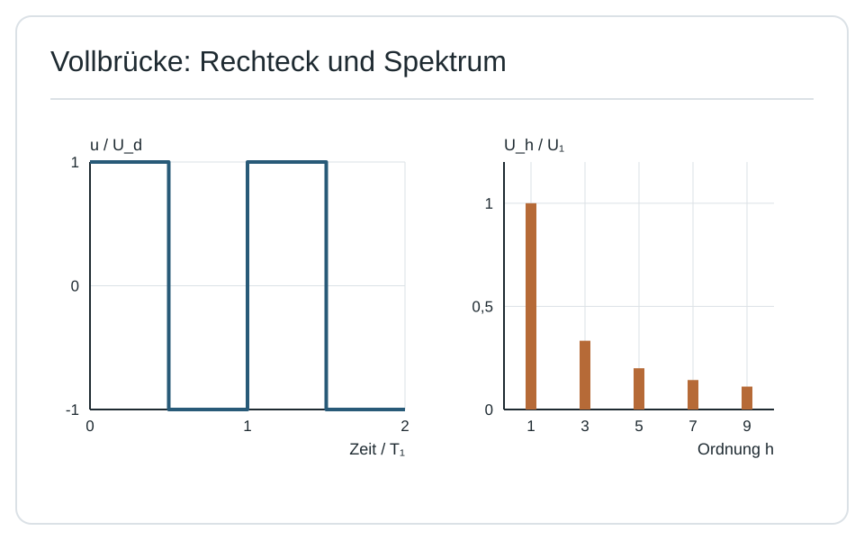

# M9-L4 – Wechselrichter und Maschinenversorgung {#L4}

**Kursbereich:** M9 – Bachelor: Elektrische Antriebe und Leistungselektronik

**Niveau:** Bachelor · Wahlbereich

**Vorwissen:** [Drehstrom](M7-L2.md), [Fourier-Analyse](M5-L3.md), [PWM](M9-L3.md).

**Lernziel:** Die Ausgangszustände einer Vollbrücke erklären, Grundschwingung und Oberwellen berechnen und die Wechselwirkung zwischen Umrichter und Maschine einordnen.

## Einphasige Spannungszwischenkreis-Vollbrücke {#S1}

Zwei Halbbrücken A und B sind zwischen den Polen eines idealen Gleichspannungszwischenkreises $U_d$ angeordnet. Die Last liegt zwischen den Mittelpunkten. Mit $s_A,s_B\in\{0,1\}$ bezeichnet 1 den eingeschalteten oberen und 0 den eingeschalteten unteren Schalter des entsprechenden Zweiges. Totzeiten werden zunächst vernachlässigt. Die Lastspannung ist die Differenz der beiden Knotenpotentiale:

$$
u_{AB}=U_d(s_A-s_B).
$$

| $s_A$ | $s_B$ | $u_{AB}$ |
| --- | --- | --- |
| 1 | 0 | $+U_d$ |
| 0 | 1 | $-U_d$ |
| 0 | 0 | 0 |
| 1 | 1 | 0 |

Die Nullzustände bedeuten nicht, dass kein Laststrom fließt. Die induktive Last kann währenddessen Strom weiterführen. Die beiden Zustände in einer einzelnen Halbbrücke, in denen beide Schalter gleichzeitig leiten, sind ausgeschlossen. Die antiparallelen Dioden beziehungsweise leitenden Kanäle ermöglichen je nach Schaltung Strom in beide Richtungen.

## Rechteckbetrieb und harmonische Anteile {#S2}

Bei symmetrischem Rechteckbetrieb wechselt $u_{AB}$ nach jeder halben Grundperiode zwischen $+U_d$ und $-U_d$. Für eine bei $t=0$ positiv beginnende Schwingung lautet die Fourier-Reihe (außer an den Sprungstellen)

$$
u_{AB}(t)=\frac{4U_d}{\pi}\sum_{h=1,3,5,\ldots}\frac{\sin(h\omega_1t)}{h}.
$$

Die Grundschwingung hat den Effektivwert $U_1=4U_d/(\pi\sqrt{2})$, das gesamte Rechteck den Effektivwert $U_d$. Die harmonische Verzerrung der Spannung ist $\mathrm{THD}=\sqrt{U_d^2-U_1^2}/U_1\approx48{,}34\,\%$. Der höhere Gesamt-Effektivwert ist nicht gleich einer höheren nutzbaren Grundschwingung.

{alt="Rechteckförmige Lastspannung der Vollbrücke und ihr normiertes Spektrum ungerader Harmonischer."}

Für eine ideale RL-Last gilt je Harmonischer $I_h=U_h/\sqrt{R^2+(h\omega_1 L)^2}$. Die Induktivität schwächt höhere harmonische Ströme. Beispiel: $U_d=48\,\mathrm V$, $f_1=50\,\mathrm{Hz}$, $R=4\,\Omega$, $L=20\,\mathrm{mH}$. Es folgen $U_1\approx43{,}22\,\mathrm V$, $I_1\approx5{,}80\,\mathrm A$, $U_3\approx14{,}41\,\mathrm V$ und $I_3\approx0{,}75\,\mathrm A$ (jeweils Effektivwerte). Das ist eine passive Modelllast, noch keine vollständige elektrische Maschine mit Gegen-EMK.

## Sinus-PWM und Drehstrom {#S3}

Bei bipolarer Sinus-PWM einer Vollbrücke vergleicht man eine sinusförmige Referenz $m\sin(\omega_1t)$ mit einem normierten Dreieckträger. Im linearen Bereich $0\le m\le1$ und bei hoher Trägerfrequenz ist der lokale Mittelwert der Lastspannung näherungsweise $mU_d\sin(\omega_1t)$. Die Grundschwingungsamplitude beträgt näherungsweise $mU_d$. Harmonische Komponenten liegen unter anderem in Gruppen um Trägerfrequenz und deren Vielfache. Die Schaltspannung selbst ist weiterhin gepulst.

Ein zweistufiger Drehstromwechselrichter besitzt drei Halbbrücken. Für sinusförmige, um 120 Grad versetzte Referenzen ergibt sich im linearen Bereich derselben trägerbasierten Modulation eine Leiter-Leiter-Grundspannung mit Effektivwert

$$
U_{LL,1}\approx\frac{\sqrt{3}mU_d}{2\sqrt{2}}.
$$

Bei $U_d=300\,\mathrm V$ und $m=0{,}8$ liefert das Modell rund 147 V Leiter-Leiter-Effektivwert. Der Faktor 1/2 entsteht hier durch die einzelne Halbbrücke. Er darf nicht versehentlich in die Formel der einphasigen Vollbrücke übernommen werden. Die Grundschwingungsgrenze hängt vom Modulationsverfahren ab; Raumzeigermodulation kann den Zwischenkreis anders ausnutzen.

## Wirkung auf die Maschine {#S4}

Bei einer Wechselstrommaschine beeinflussen Frequenz und Grundspannung Fluss, Drehmoment und Drehzahl. Für $p$ Polpaare rotiert ein synchrones Drehfeld mit $n_s=60f_1/p$ in Umdrehungen pro Minute. Bei einer Asynchronmaschine ist die mechanische Drehzahl im gewöhnlichen Motorbetrieb etwas kleiner. Die Differenz wird über den Schlupf beschrieben. Eine einfache U/f-Regelung hält die Grundspannung im mittleren Frequenzbereich ungefähr proportional zur Frequenz, um den magnetischen Fluss näherungsweise konstant zu halten. Bei kleinen Frequenzen wird der ohmsche Spannungsabfall wichtig. Bei erreichter Spannungsgrenze ist häufig Feldschwächung nötig. Das ist kein vollständiges Drehmomentregelungsverfahren.

Pulsierte Spannungen können zusätzliche Kupfer- und Eisenverluste, Drehmomentwelligkeit und Isolationsbeanspruchung hervorrufen. Bei generatorischem Betrieb muss der Zwischenkreis die zurückfließende Energie aufnehmen oder kontrolliert abführen können. Eine konstante Zwischenkreisspannung im Modell setzt diese Energieaufnahme ausdrücklich voraus.

## Übungen mit Lösungen {#S5}

1. Eine ideale Vollbrücke mit $U_d=60\,\mathrm V$ arbeitet bipolar sinusmoduliert mit $m=0{,}7$. Welchen Effektivwert besitzt die Grundschwingung näherungsweise?  
   **Lösung** $42/\sqrt{2}\approx29{,}7\,\mathrm V$.
2. Ein Drehfeld entsteht bei 50 Hz in einer Maschine mit zwei Polpaaren. Wie groß ist die synchrone Drehzahl?  
   **Lösung** $1500\,\mathrm{min^{-1}}$.
3. Warum ist der Strom in einer induktiven Last oft weniger verzerrt als die Schaltspannung?  
   **Lösung** Die induktive Reaktanz wächst mit der Frequenz und begrenzt dadurch höhere harmonische Ströme.

**Weiterführend:** [Simulation eines Antriebssystems](M9-L5.md)

## Quellen {#S6}

- [MIT OpenCourseWare, 6.334 Power Electronics, Vorlesungsnotizen](https://ocw.mit.edu/courses/6-334-power-electronics-spring-2007/pages/lecture-notes/) · (Kapitel 3, 9 und 15) · Zuletzt abgerufen: 2026-11-25
- [MIT OpenCourseWare, 6.685 Electric Machines, Kursnotizen](https://ocw.mit.edu/courses/6-685-electric-machines-fall-2013/pages/course-notes/) · (Kapitel 4, 8 und 10) · Zuletzt abgerufen: 2026-11-25
