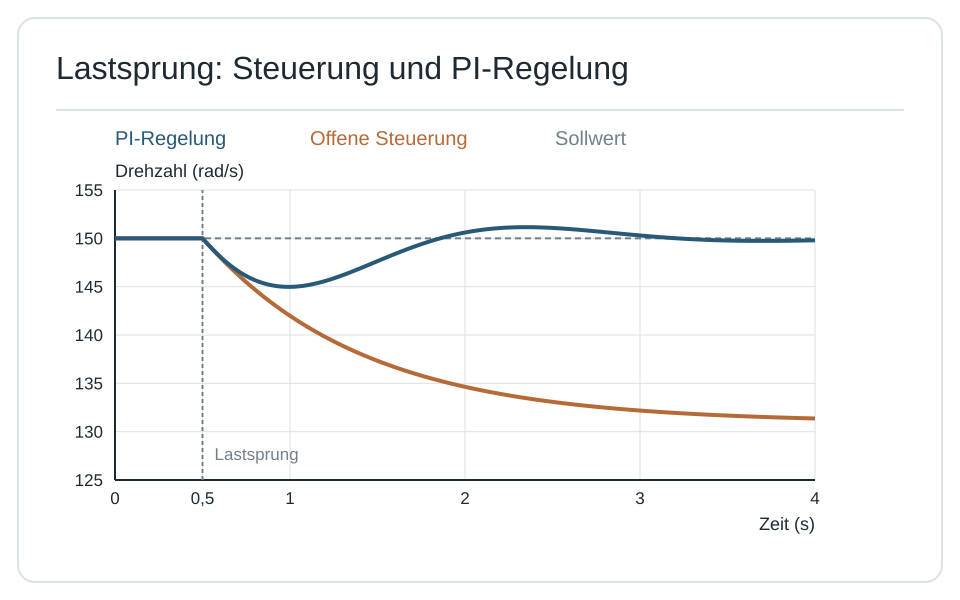

# M9-L5 – Simulation eines Antriebssystems {#L5}

**Kursbereich:** M9 – Bachelor: Elektrische Antriebe und Leistungselektronik

**Niveau:** Bachelor · Wahlbereich

**Vorwissen:** [Motorarbeitspunkt](M9-L1.md), [PWM](M9-L3.md), [M6 – Messung und Einstieg in die Regelung](pages/studienweg.md#S9), [Modellvalidierung](M8-L4.md).

**Lernziel:** Ein gekoppeltes elektrisches und mechanisches Modell mit Lastsprung simulieren, offene Steuerung mit PI-Regelung vergleichen und die Energiebilanz sowie Schrittweitenabhängigkeit prüfen.

## Gemitteltes Modell und Versuchsfrage {#S1}

Die Schaltperiode eines Umrichters kann sehr viel kürzer sein als die mechanische Reaktionszeit. Wir ersetzen einen idealen synchronen Tiefsetzsteller im gegebenen positiven Strombereich durch die mittlere Motorspannung $u=D U_d$ mit $0\le D\le1$. Der Gleichstrommotor aus M9-L1 wird durch die gekoppelten Differentialgleichungen

$$
L\dot i=u-Ri-k\omega,\qquad J\dot\omega=ki-B\omega-M_L
$$

beschrieben. Der Umrichter hat in dieser Näherung keine Eigenverluste oder weiteren Energiespeicher. Strom- und Drehzahldynamik bleiben erhalten, die PWM-Welligkeit nicht. Wir untersuchen einen Sprung des äußeren Lastmoments ausgehend von einem bekannten stationären Zustand. Die Parameter sind fiktiv und beschreiben kein bestimmtes Serienprodukt.

| Parameter | Wert | Parameter | Wert |
| --- | --- | --- | --- |
| $U_d$ | 24 V | $R$ | 0,5 Ω |
| $L$ | 20 mH | $J$ | 0,02 kg m² |
| $k$ | 0,1 Nm/A bzw. Vs/rad | $B$ | 0,001 Nms/rad |
| $M_L$ vor/nach 0,5 s | 0,4 / 0,8 Nm | $\omega_\mathrm{soll}$ | 150 rad/s |

Im Anfangszustand gilt $i=(0{,}4+B\cdot150)/k=5{,}5\,\mathrm A$ und $u=Ri+k\omega=17{,}75\,\mathrm V$. Ohne Regelung bleibt dieser Stellwert konstant. Nach dem Lastsprung sagt die stationäre Rechnung $\omega_\infty=(ku/R-0{,}8)/(B+k^2/R)\approx131{,}36\,\mathrm{rad/s}$ voraus. Mit idealer Drehzahlregelung bei 150 rad/s sind dagegen $i=9{,}5\,\mathrm A$ und $u=19{,}75\,\mathrm V$ erforderlich. Beide Spannungen liegen innerhalb der Modellgrenze.

## PI-Regelung und Begrenzung {#S2}

Wir vergleichen die offene Spannungssteuerung mit einer proportional-integralen Drehzahlregelung. Für den Fehler $e=\omega_\mathrm{soll}-\omega$ und den Integratorzustand $z$ gilt

$$
u^*=K_Pe+z,\qquad \dot z=K_Ie,\qquad u=\operatorname{clip}(u^*,0,U_d).
$$

$K_P=0{,}12\,\mathrm{V\,s/rad}$ und $K_I=0{,}6\,\mathrm{V/rad}$ sind Modellparameter; der Integrator wird mit 17,75 V initialisiert. So beginnt die Simulation ohne künstlichen Anlaufsprung der Spannung. Bei Sättigung wird der Integrator nur dann weiter integriert, wenn der Fehler den unbegrenzten Stellwert zurück in den zulässigen Bereich führt (bedingte Integration gegen Windup). Die Regelung setzt eine ideale Drehzahlmessung voraus. Eine Strombegrenzung und eine innere Stromregelschleife wären für reale Antriebe typische zusätzliche Anforderungen.

## Reproduzierbares Python-Experiment {#S3}

Die Zustände werden mit explizitem Euler-Verfahren gleichzeitig aus den Werten des jeweiligen Zeitschritts fortgeschrieben. Alle Energieterme verwenden die gleichen alten Zustandswerte und dieselbe Schrittweite; die Restbilanz dient als numerische Kontrolle.

```python

def simulate(h, regulated):
    R, L, k, J, B = 0.5, 0.02, 0.1, 0.02, 0.001
    i, w, z = 5.5, 150.0, 17.75
    energy_in = energy_out = 0.0
    storage0 = L*i*i/2 + J*w*w/2
    min_w, max_i = w, i
    for n in range(round(4/h)):
        t = n*h
        load = 0.4 if t < 0.5 else 0.8
        error = 150.0 - w
        raw = z + 0.12*error if regulated else 17.75
        u = max(0.0, min(24.0, raw))
        if regulated and (0 < raw < 24 or
                          raw >= 24 and error < 0 or
                          raw <= 0 and error > 0):
            z += h*0.6*error
        di = (u - R*i - k*w)/L
        dw = (k*i - B*w - load)/J
        energy_in += h*u*i
        energy_out += h*(R*i*i + B*w*w + load*w)
        i += h*di
        w += h*dw
        min_w, max_i = min(min_w, w), max(max_i, i)
    storage1 = L*i*i/2 + J*w*w/2
    residual = energy_in - energy_out - (storage1-storage0)
    return w, i, min_w, max_i, residual


for h in (0.001, 0.0005, 0.00025):
    for regulated in (False, True):
        values = simulate(h, regulated)
        print(h, regulated, *(round(x, 6) for x in values))
```

| Fall, $h=0{,}0005\,\mathrm s$ | $\omega(4\,\mathrm s)$ in rad/s | $i(4\,\mathrm s)$ in A | Minimale Drehzahl in rad/s | Maximaler Strom in A |
| --- | ---: | ---: | ---: | ---: |
| Offen | 131,364 | 9,223 | 131,364 | 9,223 |
| PI | 149,795 | 9,567 | 144,980 | 10,989 |

{alt="Drehzahlverlauf nach dem Lastsprung bei 0,5 s: offene Steuerung und PI-Regelung gegenüber dem Sollwert von 150 rad/s."}

Der PI-Regler begrenzt den Drehzahleinbruch und nähert sich dem Sollwert. Er kann dabei einen höheren Spitzenstrom verlangen als die offene Steuerung. Nach vier Sekunden liegt der Strom im PI-Fall noch geringfügig oberhalb des stationären Zielwerts. Eine Momentaufnahme ist kein Nachweis, dass alle Zustände schon stationär sind.

## Energiebilanz, Konvergenz und Abnahme {#S4}

Multiplizieren wir die elektrische Gleichung mit $i$ und die mechanische mit $\omega$, heben sich die Wandlungsterme $ki\omega$ in der Summe auf:

$$
ui=Ri^2+B\omega^2+M_L\omega+
\frac{d}{dt}\left(\frac12Li^2+\frac12J\omega^2\right).
$$

Integriert bedeutet das: Eingangsenergie minus Verluste minus Lastarbeit minus Speicheränderung sollte null ergeben. Bei explizitem Euler entsteht ein kleiner numerischer Bilanzrest. Die folgende Tabelle gibt seinen Betrag für das Modell wieder.

| Schrittweite in ms | Offen: Restbetrag in J | PI: Restbetrag in J | PI: Drehzahl bei 4 s in rad/s |
| ---: | ---: | ---: | ---: |
| 1 | 0,002057 | 0,001518 | 149,794389 |
| 0,5 | 0,001028 | 0,000757 | 149,794906 |
| 0,25 | 0,000514 | 0,000378 | 149,795165 |

Die ungefähr halbierten Restbeträge sind mit dem verwendeten Verfahren erster Ordnung vereinbar. Die Enddrehzahlen nähern sich einander. Ein kleiner Bilanzrest prüft die diskrete Rechnung, beweist aber nicht die Realitätsnähe des Maschinenmodells.

Als reproduzierbare Abnahmekriterien für diese Modellaufgabe wählen wir: Drehzahlfehler am Ende im PI-Fall höchstens 0,3 rad/s; maximaler Strom im PI-Fall unter 12 A; Betrag des Energierests unter 0,01 J; Enddrehzahländerung zwischen den beiden feineren Schrittweiten unter 0,01 rad/s. Alle vier Kriterien sind für die genannten Testfälle erfüllt. Die 12 A sind eine fiktive Prüfgrenze, keine implementierte Strombegrenzung oder zulässige Bauteilbelastung. Auch ein bestandener Test rechtfertigt keinen unmittelbaren Aufbau. Schaltverluste, Temperatur, Sensorverzögerung, Strombegrenzung und reale mechanische Last müssen separat modelliert und geprüft werden.

## Übungen mit Lösungen {#S5}

1. Bestimme den stationären Stellwert bei 150 rad/s und $M_L=1{,}6\,\mathrm{N\,m}$. Ist er im Modell erreichbar?  
   **Lösung** $i=(1{,}6+0{,}15)/0{,}1=17{,}5\,\mathrm A$, $u=0{,}5\cdot17{,}5+15=23{,}75\,\mathrm V$. Spannung reicht im Modell aus, aber die fiktive 12-A-Grenze wird im stationären Fall überschritten.
2. Wie groß ist die mechanische Speicherenergie bei 150 rad/s?  
   **Lösung** $J\omega^2/2=225\,\mathrm J$.
3. Erweitere das Experiment um einen Lastsprung auf 2 Nm. Kann der Regler 150 rad/s stationär erreichen?  
   **Lösung** $i=21{,}5\,\mathrm A$, $u=25{,}75\,\mathrm V$ wäre nötig. Das überschreitet 24 V. Bei Sättigung liegt die modellierte stationäre Drehzahl bei $(4{,}8-2)/0{,}021\approx133{,}33\,\mathrm{rad/s}$. Der Integrator darf nicht unbeschränkt anwachsen.

**Abschluss:** Halte in einer kurzen Modellbeschreibung den Arbeitspunkt, die Annahmen des Umrichters, den Lastsprung, die numerische Bilanz und mindestens eine Modellgrenze fest. [Studienweg](pages/studienweg.md)

## Quellen {#S6}

- [MIT OpenCourseWare, 6.685 Electric Machines, Kursnotizen](https://ocw.mit.edu/courses/6-685-electric-machines-fall-2013/pages/course-notes/) · (Kapitel 6) · Zuletzt abgerufen: 2026-11-25
- [MIT OpenCourseWare, 6.334 Power Electronics, Vorlesungsnotizen](https://ocw.mit.edu/courses/6-334-power-electronics-spring-2007/pages/lecture-notes/) · (Kapitel 8) · Zuletzt abgerufen: 2026-11-25
- [Åström/Murray – Feedback Systems, Second Edition](https://fbswiki.org/wiki/index.php/Feedback_Systems%3A_An_Introduction_for_Scientists_and_Engineers) · Kapitelübersicht 3, 5, 6, 9 und 11: Modellierung, Dynamik, lineare Systeme, Übertragungsfunktionen und PID; verlinkte Kapitel nicht erneut geprüft. · Zuletzt abgerufen: 2026-11-25
